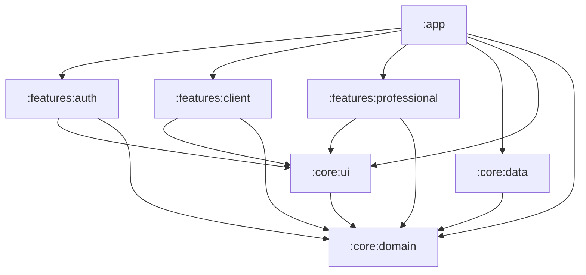
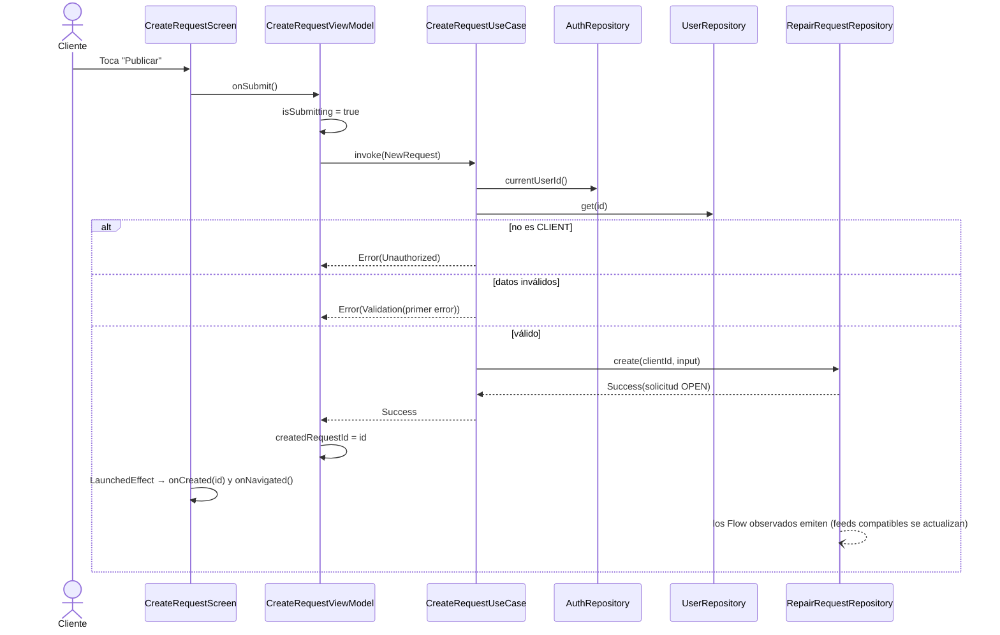
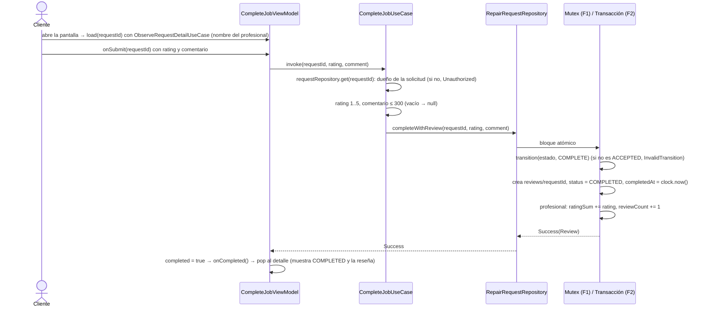

# Diseño: FixIt MVP (Fases 1–3)

> Cambio `fixit-mvp`. El "qué" está en `proposal.md` y `specs/`; este documento define el "cómo".
> Prioridad explícita del usuario: **la solución más simple posible** para un equipo sin experiencia en Kotlin ni Compose, sin dejar de mostrar los temas de la cátedra (Clase 4) y respetando la estructura multi-módulo, que es parte evaluada del TP.

## 1. Cómo leer este diseño

- La app se divide en **módulos de Gradle**: carpetas que compilan por separado y solo "ven" a los módulos que declaran como dependencia.
- `:core:domain` contiene las **reglas del negocio** (qué es una solicitud, quién puede aceptarla). Es Kotlin puro: no sabe que existen Android ni Firebase.
- `:core:data` decide **de dónde salen los datos**: en Fase 1, listas en memoria (Fakes); en Fase 2, Firebase. Cumple los contratos (interfaces) que define el dominio.
- `:core:ui` tiene el tema Material 3 y piezas visuales reutilizables. `:features:auth|client|professional` tienen las pantallas: cada una con un **ViewModel** (decide y guarda el estado) y un **Screen** (solo dibuja ese estado).
- `:app` une todo: arranca Hilt, elige qué mostrar según la sesión y resuelve la navegación.
- Regla de oro: las dependencias apuntan **hacia el dominio**. Si una pantalla intenta usar Firebase o un Fake directamente, el proyecto no compila.
- **Hilt** es el "enchufe": en un solo archivo decide si las pantallas reciben la versión Fake o la de Firebase.
- Orden sugerido: §3 módulos → §5 dominio → §7 casos de uso → §8–9 pantallas y navegación → §10 flujos.

## 2. Enfoque técnico

Clean Architecture multi-módulo, igual que el repositorio de la cátedra (`mauromarod/unaj-am`), con MVVM/UDF: `XxxRoute` (con estado) → `XxxViewModel` (`StateFlow<XxxUiState>`) → caso de uso o interfaz de repositorio → implementación Fake (Fase 1) o Firebase (Fase 2). Todo lo que no es requisito de la cátedra se simplifica (ver §16).

Versiones: usar la última estable al implementar para Compose BOM, Hilt, Navigation 3, Coil 3 y Firebase BoM. Referencia del repositorio de la cátedra: Kotlin 2.4.20, AGP 9.2.1, Compose BOM 2026.09.00, navigation3 1.2.0, lifecycle 2.11.0, Coil 3.6.3, minSdk 26, compile/targetSdk 37. Todas en `gradle/libs.versions.toml`.

## 3. Módulos y dependencias



| Desde \ Hacia | `:core:domain` | `:core:ui` | `:core:data` | `:features:*` |
|---|---|---|---|---|
| `:app` | Sí | Sí | Sí | Sí |
| `:features:*` | Sí | Sí | **No** | **No** (entre sí) |
| `:core:ui` | Sí | — | No | No |
| `:core:data` | Sí | No | — | No |
| `:core:domain` | — | No | No | No |

| Módulo | Tipo / plugins | Dependencias externas principales |
|---|---|---|
| `:core:domain` | `kotlin-jvm`, `java-test-fixtures` | `kotlinx-coroutines-core` expuesto como `api` (los demás módulos lo reciben transitivamente), `javax.inject` (solo la anotación `@Inject`) |
| `:core:data` | Android library, Hilt, KSP | Hilt, `kotlinx-coroutines-android` (dispatchers); Fase 2: Firebase BoM, `kotlinx-coroutines-play-services` (para `Task.await()`), `geofire-android-common`, `androidx.exifinterface`; Fase 3: `play-services-location` |
| `:core:ui` | Android library, Compose | Compose BOM, Material 3, Coil 3; Fase 2: `coil-network-okhttp` (Coil 3 no trae cliente de red; hace falta para cargar las URLs https de Storage) |
| `:features:*` | Android library, Compose, Hilt, KSP | `lifecycle-runtime-compose`, `hiltViewModel()` (mismo artefacto que la cátedra) |
| `:app` | Android application, Compose, Hilt, KSP, Kotlin Serialization | Navigation 3, `lifecycle-viewmodel-navigation3`; Fase 2: plugin `google-services` y permiso `INTERNET` en el manifest |

Gradle simple: `settings.gradle.kts` con los 7 `include`, un `libs.versions.toml` y cada módulo declara sus plugins y su bloque `android {}` directamente (sin `build-logic` ni convention plugins, ver D2).

## 4. Estructura de paquetes

Paquete base `ar.edu.unaj.fixit`. Todos los archivos son nuevos (proyecto greenfield). Por pantalla hay **dos archivos**: `XxxScreen.kt` (contiene `XxxRoute` y `XxxScreen` + `@Preview`) y `XxxViewModel.kt` (contiene `XxxViewModel` y `XxxUiState`).

```
settings.gradle.kts · build.gradle.kts · gradle/libs.versions.toml
firestore.rules · firestore.indexes.json · storage.rules            (Fase 2)
app/            ar.edu.unaj.fixit
  FixItApplication.kt (@HiltAndroidApp) · MainActivity.kt (@AndroidEntryPoint)
  navigation/   Destinations.kt (claves @Serializable : NavKey) · TopLevelDestination.kt (pestañas por rol + pseudo-pestaña AUTH)
                NavigationState.kt (una pila por pestaña; también para AUTH) · AppNavDisplay.kt (NavDisplay + entryProvider)
                Experience.kt (enum Experience + experienceFor, pura) · FixItApp.kt (compuerta + SessionViewModel)
  ui/           AppShell.kt (Scaffold + NavigationBar con las pestañas del rol)
core/domain/    ar.edu.unaj.fixit.core.domain
  model/        User, RepairRequest, Review, enums, GeoPoint, Place, SessionState, forms, RequestDetail, Limits
  result/       AppResult, DomainError, ValidationError
  rules/        RequestStateMachine, Haversine, Matching, ContactRules, PhoneFormatter, Reputation, Validators
  repository/   AuthRepository, UserRepository, RepairRequestRepository, LocationProvider, AddressResolver, Clock
  usecase/      10 casos de uso (§7)
  src/testFixtures/  TestAuthRepository, TestUserRepository, TestRepairRequestRepository, TestLocation, MainDispatcherRule
core/data/      ar.edu.unaj.fixit.core.data
  fake/         FakeDatabase, SeedData, FakeAuthRepository, FakeUserRepository, FakeRepairRequestRepository, FakeLocation
  firebase/     (Fase 2) Firebase*Repository, Dtos.kt (DTO + mappers), FirebaseCalls.kt (firebaseCall, asResult, DomainException, mapeo de excepciones), ImageCompressor.kt (+ targetSize)
  device/       (Fase 3) FusedLocationProvider, GeocoderAddressResolver
  di/           RepositoryModule, CoreModule (+ @IoDispatcher), (Fase 2) FirebaseModule
core/ui/        ar.edu.unaj.fixit.core.ui
  theme/        FixItTheme (Material 3)
  components/   LoadingContent, ErrorContent, StatusBadge, CategoryChips, PhotoThumbnails, PhotoPager,
                PhotoPickerButtons, RatingBar, ContactCard, ReputationText (formatea con el idioma del dispositivo), ProfileFormFields (+ ProfileFormState)
  text/         DomainError.asMessage(), ServiceCategory.label()
  res/drawable/ sample_repair_1..3 (fotos de ejemplo de Fase 1)
features/auth/          ...feature.auth          signin/ · signup/
features/client/        ...feature.client        myrequests/ · create/ · detail/ · complete/ · profile/ (perfil + edición)
features/professional/  ...feature.professional  feed/ · detail/ · myjobs/ · profile/ (perfil + edición)
```

## 5. Dominio (`:core:domain`)

### 5.1 Modelos

```kotlin
enum class UserRole { CLIENT, PROFESSIONAL }
enum class ServiceCategory { ELECTRICITY, PLUMBING, GAS, CARPENTRY, PAINTING, LOCKSMITH, MASONRY, OTHER }
enum class RequestStatus { OPEN, ACCEPTED, COMPLETED, CANCELLED }
enum class RequestAction { ACCEPT, CANCEL, COMPLETE }

data class GeoPoint(val latitude: Double, val longitude: Double)
data class Place(val point: GeoPoint, val address: String) // not "Location": avoids android.location.Location

data class Reputation(val ratingSum: Int = 0, val reviewCount: Int = 0)  // average as a number via rules/Reputation (BigDecimal)
data class ProfessionalInfo(
    val categories: Set<ServiceCategory>, val base: Place, val radiusKm: Int,
    val reputation: Reputation = Reputation(),
)
data class User(
    val id: String, val name: String, val email: String, val phone: String, val role: UserRole,
    val professional: ProfessionalInfo? = null, // non-null only when role == PROFESSIONAL
)
data class RepairRequest(
    val id: String, val clientId: String, val category: ServiceCategory, val description: String,
    val photoUrls: List<String>, val place: Place, val status: RequestStatus,
    val professionalId: String? = null, // kept after ACCEPTED -> CANCELLED (shows in "Mis trabajos")
    val createdAt: Long, val acceptedAt: Long? = null,
    val cancelledAt: Long? = null, val completedAt: Long? = null, // all dates come from the injected Clock (Fake) / serverTimestamp (Firebase, see §13.1)
)
data class Review(
    val requestId: String, val professionalId: String, val clientId: String,
    val rating: Int, val comment: String?, val createdAt: Long,
)
sealed interface SessionState {
    data object Loading : SessionState
    data object SignedOut : SessionState
    data class SignedIn(val user: User) : SessionState
}

// Inputs (pro fields are ignored for CLIENT)
data class ProfileForm(
    val name: String, val phone: String,
    val categories: Set<ServiceCategory> = emptySet(), val base: Place? = null, val radiusKm: Int? = null,
)
data class SignUpForm(val email: String, val password: String, val role: UserRole?, val profile: ProfileForm)
data class NewRequest(val category: ServiceCategory?, val description: String, val photoUris: List<String>, val place: Place?)

// Read models
data class FeedItem(val request: RepairRequest, val distanceKm: Double)
data class Contact(val name: String, val phone: String, val whatsAppUrl: String, val reputation: Reputation?) // whatsAppUrl = PhoneFormatter.whatsAppUrl(phone)
data class RequestDetail(
    val request: RepairRequest,
    val contact: Contact?,           // only ACCEPTED/COMPLETED and viewer is a participant (ContactRules)
    val review: Review?,
    val distanceKm: Double?,         // only for a professional viewer, rounded to 0.1 km
    val viewerIsAssignee: Boolean,   // professional viewer == request.professionalId; drives the professional detail (§9)
)
```

`Limits` agrupa las constantes aprobadas: nombre 2..60, contraseña ≥ 6, teléfono 8..15 dígitos, radio 1..50, descripción 10..500, fotos 1..3, rating 1..5, comentario ≤ 300. El dominio devuelve **números** (promedio, distancia), nunca textos con formato: el formato con el idioma del dispositivo lo hace la UI (§5.3).

### 5.2 Errores como valores

```kotlin
sealed interface AppResult<out T> {
    data class Success<T>(val data: T) : AppResult<T>
    data class Error(val error: DomainError) : AppResult<Nothing>
}

sealed interface DomainError {
    data class Validation(val error: ValidationError) : DomainError
    data class InvalidTransition(val from: RequestStatus, val action: RequestAction) : DomainError
    data object InvalidCredentials : DomainError
    data object EmailAlreadyInUse : DomainError
    data object Unauthorized : DomainError        // wrong role, not the owner, category not offered
    data object NotFound : DomainError
    data object AlreadyTaken : DomainError        // another professional accepted first
    data object LocationUnavailable : DomainError
    data object Network : DomainError
    data object Unknown : DomainError
}

enum class FormField { EMAIL, PASSWORD, NAME, PHONE, ROLE, CATEGORIES, BASE, RADIUS, CATEGORY, DESCRIPTION, PHOTOS, LOCATION, RATING, COMMENT }

// Same names as the specs (Validation.EmptyDescription -> EMPTY_DESCRIPTION); `field` lets forms mark the input.
enum class ValidationError(val field: FormField) {
    INVALID_EMAIL(EMAIL), EMPTY_PASSWORD(PASSWORD), WEAK_PASSWORD(PASSWORD), INVALID_NAME(NAME), INVALID_PHONE(PHONE), ROLE_REQUIRED(ROLE),
    CATEGORIES_REQUIRED(CATEGORIES), BASE_LOCATION_REQUIRED(BASE), INVALID_RADIUS(RADIUS), INVALID_COORDINATES(LOCATION),
    CATEGORY_REQUIRED(CATEGORY), EMPTY_DESCRIPTION(DESCRIPTION), DESCRIPTION_TOO_SHORT(DESCRIPTION),
    DESCRIPTION_TOO_LONG(DESCRIPTION), PHOTOS_REQUIRED(PHOTOS), TOO_MANY_PHOTOS(PHOTOS), LOCATION_REQUIRED(LOCATION),
    INVALID_RATING(RATING), COMMENT_TOO_LONG(COMMENT),
}
```

Sin helpers genéricos (`map`, `flatMap`): se usa `when`. En `:core:ui`, `DomainError.asMessage()` es un único `when` sobre `stringResource`. `INVALID_COORDINATES` marca `LOCATION`; el formulario del profesional lo muestra junto al punto base.

### 5.3 Reglas puras (`rules/`, `object` sin estado)

| Regla | Firma | Comportamiento |
|---|---|---|
| `RequestStateMachine` | `transition(from, action): AppResult<RequestStatus>` | `OPEN+ACCEPT→ACCEPTED`, `OPEN+CANCEL→CANCELLED`, `ACCEPTED+CANCEL→CANCELLED`, `ACCEPTED+COMPLETE→COMPLETED`; `ACCEPTED+ACCEPT→AlreadyTaken`; el resto `InvalidTransition(from, action)`. |
| `Haversine` | `km(a, b): Double` | Radio terrestre 6371.0088 km. El valor intermedio `a` se limita a [0, 1] (`a.coerceIn(0.0, 1.0)`) antes de `asin`/`sqrt`, para evitar `NaN` por errores de redondeo (p. ej., puntos antípodas). |
| `Matching` | `isWithin(distanceKm: Double, radiusKm: Int): Boolean`; `roundKm(km: Double): Double`; `distanceIfMatches(pro: ProfessionalInfo, r: RepairRequest): Double?` | `isWithin` es pura e inclusiva: `distanceKm <= radiusKm`, sobre la distancia **sin redondear** (10.0 con radio 10 → `true`; 10.01 → `false`). `roundKm` redondea a 0.1 km (`Math.round(km * 10) / 10.0`). `distanceIfMatches`: `OPEN` ∧ categoría incluida ∧ `isWithin(Haversine.km(...), radio)`; devuelve la distancia redondeada con `roundKm` o `null`. |
| `ContactRules` | `contactFor(request, viewerId, counterpart: User): AppResult<Contact>` | Solo `ACCEPTED`/`COMPLETED` y participante; si no, `Unauthorized`. |
| `PhoneFormatter` | `whatsAppDigits(raw): String`; `whatsAppUrl(raw): String` | `whatsAppDigits`: primero recorta y quita espacios, guiones y paréntesis (los mismos que ignora `Validators`); **después** mira si el resultado empieza con `+` y conserva solo dígitos. Si empezaba con `+`: se usan tal cual (sin el `+`). Si no, y empiezan con `54`: tal cual. Si no: se antepone `549`. Limitaciones documentadas (sin lógica extra): fijos o extranjeros sin `+`, y los formatos troncales argentinos `0xx 15…` (con `0` inicial y `15`), que generan enlaces inválidos. `whatsAppUrl`: `"https://wa.me/" + whatsAppDigits(raw)`, **sin** `?text`; el mensaje inicial opcional lo agrega la UI al abrir el intent y queda fuera de lo probado. |
| `Reputation` (ext.) | `Reputation.average(): BigDecimal?` | `BigDecimal(ratingSum).divide(BigDecimal(reviewCount), 1, RoundingMode.HALF_UP)`; `null` si `reviewCount == 0` (sin división por cero; "Sin reseñas" en la UI). `ReputationText` (`:core:ui`) formatea el número con el idioma del dispositivo y `minimumFractionDigits = 1` (en español, "4,3"; un promedio de 4.0 se muestra "4,0"). |
| `Validators` | `normalizeEmail(raw)`, `signIn(email, password)`, `signUp(form)`, `profile(role, form)`, `request(input)`, `review(rating, comment)`, `coordinates(point)`: `ValidationError?` | Devuelven el **primer** error en el orden de la tabla siguiente. |

Piezas de `Validators` (Kotlin puro, sin `android.util.Patterns` porque el dominio es JVM):

```kotlin
object Validators {
    // Applied after normalizeEmail(): trim().lowercase()  (Kotlin lowercase() is locale-independent)
    private val EMAIL = Regex("^[a-z0-9._%+-]+@[a-z0-9-]+(\\.[a-z0-9-]+)*\\.[a-z]{2,}$")
    // Applied after trim() and removing ' ', '-', '(' and ')' (the same characters PhoneFormatter ignores)
    private val PHONE = Regex("^\\+?[0-9]{8,15}$")

    fun normalizeEmail(raw: String): String = raw.trim().lowercase()

    fun coordinates(point: GeoPoint): ValidationError? =
        if (point.latitude in -90.0..90.0 && point.longitude in -180.0..180.0) null  // NaN is not "in" the range
        else ValidationError.INVALID_COORDINATES
}
```

`FakeAuthRepository` también aplica `normalizeEmail` al guardar y al comparar (igual que Firebase Auth, que ignora mayúsculas), de modo que `EmailAlreadyInUse` se comporte igual en Fase 1 y 2; los casos de uso ya pasan el email normalizado.

Orden de validación (posición de cada regla):

| Operación | Orden |
|---|---|
| `signIn` | 1 email (`INVALID_EMAIL`) → 2 contraseña no vacía (`EMPTY_PASSWORD`) |
| `signUp` | 1 email → 2 contraseña ≥ 6 (`WEAK_PASSWORD`) → 3 nombre → 4 teléfono → 5 rol → profesional: 6 categorías → 7 punto base (`BASE_LOCATION_REQUIRED`) → 8 coordenadas del punto base (`INVALID_COORDINATES`) → 9 radio |
| `profile(role, form)` | 1 nombre → 2 teléfono → profesional: 3 categorías → 4 punto base → 5 coordenadas del punto base → 6 radio |
| `request` | 1 categoría → 2 descripción vacía → 3 corta → 4 larga → 5 sin fotos → 6 demasiadas fotos → 7 ubicación (`LOCATION_REQUIRED`) → 8 coordenadas (`INVALID_COORDINATES`) |
| `review` | 1 calificación → 2 comentario |

## 6. Interfaces de repositorio

Regla única (D6): los **comandos** (`suspend`) devuelven `AppResult<T>` y las **observaciones** devuelven `Flow<AppResult<T>>`. La capa de datos (Fake y Firebase) convierte las excepciones en `DomainError`; nada lanza hacia el ViewModel, que solo traduce `AppResult` → `UiState`. Excepciones documentadas: `AuthRepository.session` es un `Flow<SessionState>` (nunca falla; un error de datos termina en `SignedOut`) y `signOut()` es una `fun` normal que devuelve `Unit`.

```kotlin
interface AuthRepository {
    val session: Flow<SessionState>        // never fails: a data-layer error ends as SignedOut (see §13.5)
    fun currentUserId(): String?           // only the id: use cases read fresh data with UserRepository.get (D19)
    suspend fun signIn(email: String, password: String): AppResult<User>
    suspend fun signUp(form: SignUpForm): AppResult<User>
    fun signOut()                          // plain fun, returns Unit (documented D6 exception)
}

interface UserRepository {
    suspend fun get(userId: String): AppResult<User>                  // fresh read for pre-checks; NotFound if missing
    fun observe(userId: String): Flow<AppResult<User>>                // NotFound if missing
    suspend fun updateProfile(userId: String, form: ProfileForm): AppResult<User> // never touches email, role, reputation
}

interface RepairRequestRepository {
    suspend fun create(clientId: String, input: NewRequest): AppResult<RepairRequest>
    suspend fun get(requestId: String): AppResult<RepairRequest>                   // fresh read for pre-checks; NotFound if missing
    fun observe(requestId: String): Flow<AppResult<RepairRequest>>                 // NotFound if missing
    fun observeByClient(clientId: String): Flow<AppResult<List<RepairRequest>>>             // createdAt desc
    fun observeByProfessional(professionalId: String): Flow<AppResult<List<RepairRequest>>> // acceptedAt desc
    fun observeOpenNear(center: GeoPoint, radiusKm: Int): Flow<AppResult<List<RepairRequest>>> // candidates; exact filter in domain
    fun observeReview(requestId: String): Flow<AppResult<Review?>>                 // Success(null) while there is no review
    // Atomic (Mutex in Fake, transaction in Firestore); status checked with RequestStateMachine inside the atomic block.
    // accept is idempotent: already ACCEPTED by the same professionalId -> Success(unchanged request), checked before the state machine.
    suspend fun accept(requestId: String, professionalId: String): AppResult<RepairRequest>
    suspend fun cancel(requestId: String): AppResult<RepairRequest>
    suspend fun completeWithReview(requestId: String, rating: Int, comment: String?): AppResult<Review>
}

interface LocationProvider { suspend fun current(): AppResult<GeoPoint> }
interface AddressResolver { suspend fun resolve(point: GeoPoint): AppResult<String> }
fun interface Clock { fun now(): Long }
```

`completeWithReview` vive en `RepairRequestRepository` porque escribe tres documentos en una sola transacción (solicitud, reseña y reputación). Fechas: `accept` guarda `acceptedAt`, `cancel` guarda `cancelledAt` y `completeWithReview` guarda `completedAt` y `Review.createdAt`; en el Fake todas salen de `clock.now()`.

## 7. Casos de uso

Clases con `@Inject constructor` y `operator fun invoke`. **Solo existen donde hay una regla** (D8). División de responsabilidades (D9): el caso de uso verifica **quién** (rol, dueño, categoría) y valida la entrada; el repositorio hace la **transición atómica**. Así `Unauthorized` siempre llega antes que `InvalidTransition`, como piden los specs. Si no hay sesión (`authRepository.currentUserId() == null`), devuelven `Unauthorized`. Los datos para decidir (rol, categorías, dueño) se leen con `get` (lectura fresca, D19), nunca de una copia guardada de la sesión. Los casos de uso **persisten valores recortados**: nombre, teléfono y descripción se guardan con `trim()` (el teléfono conserva su formato, solo se recorta; los separadores se ignoran únicamente al validar y al armar el enlace de WhatsApp), y los límites de largo de la descripción se aplican sobre el texto recortado.

| Caso de uso | Entrada | Salida | Regla |
|---|---|---|---|
| `SignInUseCase` | email, password | `AppResult<User>` | `Validators.signIn`: email normalizado con formato y contraseña no vacía (`EMPTY_PASSWORD`); luego `signIn`. |
| `SignUpUseCase` | `SignUpForm` | `AppResult<User>` | Orden de validación de `auth` (§5.3), incluidas las coordenadas del punto base; campos de profesional si el rol es `PROFESSIONAL`. |
| `UpdateProfileUseCase` | `ProfileForm` | `AppResult<User>` | Mismas validaciones que el registro según el rol (§5.3); email y rol no forman parte de la entrada. |
| `GetCurrentPlaceUseCase` | — | `AppResult<Place>` | Combina `LocationProvider` + `AddressResolver`; si la dirección falla, `address = ""`. |
| `CreateRequestUseCase` | `NewRequest` | `AppResult<RepairRequest>` | Rol `CLIENT` (`userRepository.get(id)`); validación en el orden de `repair-requests` (§5.3), incluida `Validators.coordinates`. |
| `CancelRequestUseCase` | requestId | `AppResult<RepairRequest>` | Solo el cliente dueño (`requestRepository.get(id)`); transición `OPEN/ACCEPTED → CANCELLED` en el repositorio. |
| `ObserveFeedUseCase` | — | `Flow<AppResult<List<FeedItem>>>` | Perfil del profesional (`userRepository.observe`) → se toma `(categories, base, radiusKm)` y se aplica `distinctUntilChanged()` **antes** de `flatMapLatest` (cambios de nombre o de reputación no reinician la observación) → candidatos (`observeOpenNear`) → `Matching` → orden `createdAt` desc. Si una observación emite `Error`, el feed emite ese `Error`. Al editar zona o categorías, se recalcula solo. |
| `AcceptRequestUseCase` | requestId | `AppResult<RepairRequest>` | Lee al profesional con `userRepository.get(id)` (rol `PROFESSIONAL`) y la solicitud con `requestRepository.get(id)` (categoría incluida); luego `accept` atómico (idempotente para el mismo profesional, ver §6). |
| `ObserveRequestDetailUseCase` | requestId | `Flow<AppResult<RequestDetail>>` | Combina solicitud + contraparte + reseña. Verifica la visibilidad: el cliente solo ve las propias (si no, `Error(Unauthorized)`); solicitud inexistente → `Error(NotFound)`; un profesional puede abrir cualquier solicitud y el contacto lo decide `ContactRules`: si devuelve `Unauthorized`, el detalle emite `Success` con `contact = null` (no un `Error` del flujo; excepción documentada de D6). Calcula `viewerIsAssignee` y la distancia (solo profesional, redondeada con `Matching.roundKm`). Se actualiza en vivo (p. ej., cancelación oculta el contacto). Al combinar los flujos de solicitud, reseña y contraparte, puede haber una emisión transitoria (p. ej., solicitud `COMPLETED` con `review = null`) tanto en el Fake como en Firebase: los tests de ViewModel esperan el estado final con `first { ... }`. |
| `CompleteJobUseCase` | requestId, rating, comment | `AppResult<Review>` | Solo el dueño (`requestRepository.get(id)`); rating 1..5; comentario recortado ≤ 300, vacío → `null`; luego `completeWithReview` atómico. |

Sin caso de uso (el ViewModel usa la interfaz del dominio directamente y traduce el `AppResult` de cada `Flow`): sesión (`AuthRepository.session`), cerrar sesión, "Mis solicitudes" (`observeByClient`), "Mis trabajos" (`observeByProfessional`, el ViewModel separa activos y finalizados) y ver perfil (`UserRepository.observe`). `CompleteJobViewModel` carga la solicitud por id con `ObserveRequestDetailUseCase` para mostrar el nombre del profesional.

## 8. Presentación: patrón de pantalla

- **Pantallas de datos**: `sealed interface XxxUiState { Loading; Success(...); Error(error) }`. El ViewModel solo traduce `AppResult.Success` → `Success` y `AppResult.Error(e)` → `Error(e)`; no usa `.catch` porque la capa de datos ya convirtió las excepciones (D6).
- **Formularios**: un `data class` con campos, `isSubmitting`, `validationError: ValidationError?` y `message: DomainError?`.
- **Eventos de una sola vez** (snackbar, navegar): campo nullable en el estado (`message`, `createdRequestId`, `saved`) que la UI consume y limpia con `onMessageShown()` / `onNavigated()`. Sin `Channel` ni `SharedFlow`.
- Pantallas sin ID cargan en `init {}`. Pantallas con ID reciben el ID desde la clave de navegación y llaman `load(id)`:

```kotlin
@Composable
fun ClientRequestDetailRoute(
    requestId: String,
    onBack: () -> Unit,
    onCompleteClick: (String) -> Unit,
    viewModel: ClientRequestDetailViewModel = hiltViewModel(),
) {
    LaunchedEffect(requestId) { viewModel.load(requestId) }
    val uiState by viewModel.uiState.collectAsStateWithLifecycle()
    ClientRequestDetailScreen(uiState, onBack, onCompleteClick, viewModel::onCancelConfirm, viewModel::onMessageShown)
}

// In the ViewModel (UiState = ClientRequestDetailUiState): idempotent load (LaunchedEffect runs again after rotation).
fun load(id: String) {
    if (id == requestId) return
    requestId = id
    job?.cancel()
    job = viewModelScope.launch {
        observeDetail(id).collect { result ->        // Flow<AppResult<RequestDetail>>: Unauthorized / NotFound / Network arrive as values
            _uiState.update { old ->
                when (result) {
                    is AppResult.Error -> UiState.Error(result.error)
                    is AppResult.Success ->
                        if (old is UiState.Success) old.copy(detail = result.data) // keeps isWorking / message
                        else UiState.Success(result.data)
                }
            }
        }
    }
}
fun onRetry() { val id = requestId ?: return; requestId = null; _uiState.value = UiState.Loading; load(id) }
```

Los ViewModels obtienen el id del usuario con `authRepository.currentUserId()` (no de argumentos ni de una copia de la sesión). Como la compuerta usa `key(userId)` (§9), al cambiar de usuario se descartan los ViewModels de todas las entradas y ninguna pantalla conserva datos del usuario anterior.

Cada entrada de navegación tiene su propio `ViewModelStore` (decorador de Navigation 3), así que el ViewModel sobrevive a la rotación y se destruye al volver atrás, como piden los specs. Con historial por pestaña hay que **verificar al armar el proyecto** que los ViewModels de las pestañas no visibles se conserven al cambiar de pestaña, comparando con el código de la cátedra (ver §19).

## 9. Pantallas por rol y navegación

| Módulo | Route / Screen | ViewModel | UiState | Clave | Callbacks → acción en `:app` |
|---|---|---|---|---|---|
| auth | `SignIn` | `SignInViewModel` | form | `SignInKey` | `onSignUpClick` → `navigate(SignUpKey)` |
| auth | `SignUp` | `SignUpViewModel` | form (rol + `ProfileFormState`) | `SignUpKey` | `onBack` → `goBackFrom(SignUpKey)`; éxito: la compuerta cambia sola |
| client | `MyRequests` (raíz "Solicitudes") | `MyRequestsViewModel` | sealed `Success(requests)` | `MyRequestsKey` | `onCreateClick` / `onRequestClick(id)` → `navigate(...)` |
| client | `CreateRequest` | `CreateRequestViewModel` | form + `createdRequestId` | `CreateRequestKey` | `onCreated(id)` → `goBackFrom(CreateRequestKey)` + `navigate(ClientRequestDetailKey(id))` |
| client | `ClientRequestDetail` | `ClientRequestDetailViewModel` | sealed `Success(detail, isWorking, message)` | `ClientRequestDetailKey(requestId)` | `onCompleteClick(id)` → `navigate(CompleteJobKey(id))` |
| client | `CompleteJob` | `CompleteJobViewModel` | form (`professionalName`, `rating`, `comment`, `completed`, `loadError`); carga el detalle por id con `ObserveRequestDetailUseCase` | `CompleteJobKey(requestId)` | `onCompleted` → `goBackFrom(key)` |
| client | `ClientProfile` (raíz "Perfil") | `ClientProfileViewModel` | sealed `Success(user)` | `ClientProfileKey` | `onEditClick` → `navigate(ClientEditProfileKey)` |
| client | `ClientEditProfile` | `ClientEditProfileViewModel` | form + `saved` | `ClientEditProfileKey` | `onSaved` → `goBackFrom(key)` |
| pro | `Feed` (raíz "Feed") | `FeedViewModel` | sealed `Success(items)` | `FeedKey` | `onRequestClick(id)` → `navigate(ProRequestDetailKey(id))` |
| pro | `ProRequestDetail` | `ProRequestDetailViewModel` | sealed `Success(detail, isAccepting, message, acceptedId)` | `ProRequestDetailKey(requestId)` | `onAccepted(id)` → `goBackFrom(key)` (Feed queda en su raíz) + `selectTab(MY_JOBS)` + `resetToRoot(MY_JOBS)` (la pila de "Mis trabajos" vuelve a su raíz) + `navigate(ProRequestDetailKey(id))`, de modo que "Atrás" desde el detalle regresa a "Mis trabajos". `AlreadyTaken`/`InvalidTransition` → diálogo con el mensaje; al confirmar → `goBackFrom(key)` (vuelve al Feed) |
| pro | `MyJobs` (raíz "Mis trabajos") | `MyJobsViewModel` | sealed `Success(active, finished)` | `MyJobsKey` | `onJobClick(id)` → `navigate(ProRequestDetailKey(id))` |
| pro | `ProProfile` (raíz "Perfil") | `ProProfileViewModel` | sealed `Success(user)` | `ProProfileKey` | `onEditClick` → `navigate(ProEditProfileKey)` |
| pro | `ProEditProfile` | `ProEditProfileViewModel` | form + `saved` | `ProEditProfileKey` | `onSaved` → `goBackFrom(key)` |

"Cerrar sesión" está en los ViewModels de perfil (`authRepository.signOut()`); la compuerta reacciona sola. El detalle del cliente en `OPEN` muestra "Esperando que un profesional acepte". La flecha "Atrás" de la barra superior de toda pantalla no raíz llama `goBackFrom(key)`.

**Detalle del profesional** (`ProRequestDetail`, según `detail.request.status` y `detail.viewerIsAssignee`): "Aceptar trabajo" se muestra solo con `OPEN`. Si no está `OPEN` y `!viewerIsAssignee`, se muestra el aviso "Esta solicitud ya no está disponible" (sin botón ni contacto). Si `viewerIsAssignee`: contacto del cliente (`detail.contact`) en `ACCEPTED`/`COMPLETED`, reseña en `COMPLETED` y "Cancelada por el cliente" en `CANCELLED`. El diálogo de carrera perdida (`AlreadyTaken` / `InvalidTransition`) se conserva: con el detalle en vivo solo es alcanzable si el diálogo de confirmación ya estaba abierto o por la latencia de la Fase 2, y se prueba a nivel de caso de uso y de ViewModel con un repositorio de prueba que devuelve el error.

**Navegación (Navigation 3, D3)**: se replica la estructura del repositorio de la cátedra (`mauromarod/unaj-am`), adaptada a dos roles:

| Archivo (`:app`) | Responsabilidad |
|---|---|
| `navigation/Destinations.kt` | Todas las claves: `@Serializable`, implementan `NavKey`, solo IDs. |
| `navigation/TopLevelDestination.kt` | `enum` con las 5 pestañas (`REQUESTS`, `CLIENT_PROFILE`, `FEED`, `MY_JOBS`, `PRO_PROFILE`), cada una con su clave raíz, texto e ícono, más la pseudo-pestaña `AUTH` (raíz `SignInKey`, sin barra de pestañas); más `clientTabs`, `professionalTabs` y `authTabs = listOf(AUTH)` (la primera de cada lista es la pestaña inicial). |
| `navigation/NavigationState.kt` | Una `NavBackStack` por pestaña de la experiencia (autenticación: la única pestaña `AUTH`) + pestaña activa; expone `navigate` (ignora la clave si ya está arriba: guarda contra el doble toque), `goBack`, `goBackFrom(key)`, `selectTab` y `resetToRoot(tab)`. `rememberNavigationState(tabs)` guarda todo con `rememberNavBackStack`/`rememberSaveable`. |
| `navigation/AppNavDisplay.kt` | `NavDisplay` con `entryProvider { entry<...> { } }` y los decoradores `rememberSaveableStateHolderNavEntryDecorator()` + `rememberViewModelStoreNavEntryDecorator()`; un `entryProvider` por experiencia (autenticación, cliente, profesional). La autenticación reutiliza el mismo `NavigationState` con la pseudo-pestaña `AUTH` (`rememberNavigationState(authTabs)`), de modo que `navigate` y `goBackFrom` tienen las mismas guardas contra el doble toque; "Atrás" en `SignInKey` (raíz de `AUTH`) cierra la app. |
| `ui/AppShell.kt` | `Scaffold` con `NavigationBar` construida desde la lista de pestañas del rol; tocar una pestaña llama `selectTab`. |
| `navigation/Experience.kt` | `enum class Experience { AUTH, CLIENT, PROFESSIONAL, LOADING }` y la función pura `experienceFor(state: SessionState): Experience` (`Loading` → `LOADING`; `SignedOut` → `AUTH`; `SignedIn` → `CLIENT` o `PROFESSIONAL` según `user.role`). Se prueba en la JVM junto con `SessionViewModel` (§15). |
| `navigation/FixItApp.kt` | Compuerta: observa `SessionViewModel`, calcula `experienceFor(session)` y muestra carga, autenticación o `AppShell` con `clientTabs`/`professionalTabs`. El shell de cada rol va dentro de `key(userId) { ... }`: al cambiar de usuario (o cerrar sesión) el `NavigationState` y **todos** los `ViewModelStore` de las entradas salen de la composición y se descartan, de modo que otro usuario nunca ve datos del anterior. |

Comportamiento esperado de `NavigationState` (boceto; el código real se copia de la cátedra y los nombres internos pueden variar):

```kotlin
class NavigationState(startTab: TopLevelDestination, private val stacks: Map<TopLevelDestination, MutableList<NavKey>>) { // NavBackStack implements MutableList<NavKey>
    val startTab = startTab
    var currentTab by mutableStateOf(startTab); private set
    val currentStack get() = stacks.getValue(currentTab)

    fun navigate(key: NavKey) { if (currentStack.lastOrNull() != key) currentStack.add(key) } // ignores double taps
    fun goBackFrom(key: NavKey) { if (currentStack.lastOrNull() == key) currentStack.removeLastOrNull() } // ignores stale/double taps
    fun goBack(): Boolean = when {                 // false = let the system close the app
        currentStack.size > 1 -> { currentStack.removeLastOrNull(); true }
        currentTab != startTab -> { currentTab = startTab; true }
        else -> false
    }
    fun resetToRoot(tab: TopLevelDestination) { val st = stacks.getValue(tab); while (st.size > 1) st.removeLastOrNull() } // used after accepting and before signOut
    fun selectTab(tab: TopLevelDestination) {
        if (tab == currentTab) while (currentStack.size > 1) currentStack.removeLastOrNull() // reselect = back to root
        else currentTab = tab                                                                 // other tab keeps its history
    }
}
```

`NavigationState` recibe sus pilas como `MutableList<NavKey>` (`NavBackStack` lo implementa; verificar en §19), por lo que `app/src/test` las prueba con listas comunes, sin composición.

**Intents de contacto**: "Llamar" (`ACTION_DIAL`) y "WhatsApp" (`ACTION_VIEW` con la URL) se abren con `try { startActivity(intent) } catch (e: ActivityNotFoundException) { mostrar el mensaje de "sin aplicación disponible" }`. No se declara `<queries>` en el manifest: no hace falta consultar de antemano si hay una aplicación que resuelva el intent.

Las pantallas siguen sin inyección asistida: `entry<ClientRequestDetailKey> { key -> ClientRequestDetailRoute(key.requestId, ...) }` y el `Route` llama `LaunchedEffect(id) { vm.load(id) }`.

## 10. Flujos

### 10.1 Crear solicitud



### 10.2 Aceptación atómica (el primero gana)

```mermaid
sequenceDiagram
    participant P1 as Profesional 1
    participant P2 as Profesional 2
    participant UC as AcceptRequestUseCase
    participant R as RepairRequestRepository
    participant L as Mutex (F1) / Transacción (F2)
    P1->>UC: invoke(r1)
    P2->>UC: invoke(r1)
    UC->>UC: userRepository.get(p) y requestRepository.get(r1): rol PROFESSIONAL y categoría incluida (si no, Unauthorized)
    UC->>R: accept(r1, p1)
    UC->>R: accept(r1, p2)
    R->>L: bloque atómico para p1
    L->>L: transition(OPEN, ACCEPT) = ACCEPTED, guarda p1 y acceptedAt (clock.now())
    L-->>R: Success
    R->>L: bloque atómico para p2
    L->>L: transition(ACCEPTED, ACCEPT) = AlreadyTaken
    L-->>R: Error(AlreadyTaken)
    R-->>P1: Success → pestaña "Mis trabajos" + detalle
    R-->>P2: Error(AlreadyTaken) → diálogo con el mensaje; al confirmar, vuelve al Feed
```

Aceptar es **idempotente para el mismo profesional**: antes de llamar a `RequestStateMachine`, el bloque atómico (Fake y transacción de Firestore) comprueba `status == ACCEPTED && professionalId == professionalId` y, si se cumple, devuelve `Success` con la solicitud sin cambios (un reintento por doble toque o por red lenta no se muestra como `AlreadyTaken`). Si el que acepta es otro profesional, sigue valiendo `AlreadyTaken`.

### 10.3 Completar y calificar



## 11. Inyección de dependencias (Hilt)

Los módulos Hilt viven en `:core:data/di`; `:app` los incluye al depender de `:core:data`.

```kotlin
@Module @InstallIn(SingletonComponent::class)
abstract class RepositoryModule {          // THE Fake <-> Firebase switch (D11)
    @Binds abstract fun auth(impl: FakeAuthRepository): AuthRepository
    @Binds abstract fun users(impl: FakeUserRepository): UserRepository
    @Binds abstract fun requests(impl: FakeRepairRequestRepository): RepairRequestRepository
    @Binds abstract fun location(impl: FakeLocation): LocationProvider      // Phase 3: FusedLocationProvider
    @Binds abstract fun address(impl: FakeLocation): AddressResolver        // Phase 3: GeocoderAddressResolver
}

@Qualifier annotation class IoDispatcher   // javax.inject.Qualifier, in core/data/di

@Module @InstallIn(SingletonComponent::class)
object CoreModule {
    @Provides fun clock(): Clock = Clock { System.currentTimeMillis() }
    @Provides @IoDispatcher fun ioDispatcher(): CoroutineDispatcher = Dispatchers.IO  // only blocking adapters inject it (D13)
}
```

- `FakeDatabase` es `@Singleton` y guarda el estado de Fase 1 en **un solo** `MutableStateFlow<DbState>` (`data class DbState(val users: List<User>, val requests: List<RepairRequest>, val reviews: List<Review>, val passwords: Map<String, String>, val currentUserId: String?)`: las contraseñas de prueba y la sesión viven **dentro** del estado) y un `Mutex`. **Toda escritura de datos** (`signUp`, `updateProfile`, `create`, `accept`, `cancel`, `completeWithReview`) es una única actualización bajo ese `Mutex`: `mutex.withLock { state.update { old -> /* validar con RequestStateMachine y demás reglas; devolver el estado completo nuevo */ } }`. La lambda de `update` es **pura** (puede reintentarse): antes de ella se leen el hook `failNextWrite`, `clock.now()` y los ids generados, y el hook se consume solo después de decidir que la escritura procede. `signIn` y `signOut` también corren bajo el mismo `Mutex` (`signOut()` es una `fun` no `suspend`: en el Fake usa `runBlocking { mutex.withLock { ... } }`, aceptable porque es memoria pura y el bloqueo es mínimo) y solo cambian `currentUserId`; no son "escrituras" para el hook de prueba. Los `observe*` de los Fakes aplican `distinctUntilChanged()` tras el `map`, de modo que un cambio de `DbState` ajeno a su vista no produce emisiones repetidas. Así solicitud, reseña y reputación cambian juntas o no cambian (§10.3). Los `observe*` derivan de ese flujo con `map` y devuelven `AppResult.Success`. Las fechas salen de `clock.now()`.
- Hook de prueba `failNextWrite(error: DomainError)` en `FakeDatabase` (solo para tests): la **siguiente escritura que supere la validación** devuelve `AppResult.Error(error)` sin modificar el estado y el hook se consume. No lo consumen `signIn`, `signOut` ni las escrituras rechazadas antes por validación o por `Unauthorized`. Permite probar la "Falla parcial" (§15).
- Los repositorios Fake reciben `FakeDatabase` y `Clock` por constructor.
- `ImageCompressor` (Fase 2) y `GeocoderAddressResolver` (Fase 3) reciben `@IoDispatcher CoroutineDispatcher`; ningún repositorio ni ViewModel lo recibe.
- Fase 2: `FirebaseModule` provee `FirebaseAuth`, `FirebaseFirestore` y `FirebaseStorage` (este último con `maxUploadRetryTimeMillis = 15_000`, §13.4), y se cambian los tres `@Binds` de repositorios. Fase 3: se cambian los dos de ubicación.
- Casos de uso: `@Inject constructor`, sin módulo. ViewModels: `@HiltViewModel` en cada feature.

## 12. Datos de ejemplo (Fase 1, `SeedData`)

Contraseña de todas las cuentas: `test1234` (solo datos locales).

| id | Rol | Nombre / email | Datos |
|---|---|---|---|
| `c1` | CLIENT | Ana López / `ana@fixit.test` | 11 5555-0001 |
| `c2` | CLIENT | Bruno Díaz / `bruno@fixit.test` | 11 5555-0002 |
| `p1` | PROFESSIONAL | Carlos Gómez / `carlos@fixit.test` | 11 5555-0101 · ELECTRICITY, GAS · Florencio Varela (-34.8065, -58.2788) · 10 km · suma 9 / 2 reseñas (r5: 5, r7: 4) |
| `p2` | PROFESSIONAL | Diana Ruiz / `diana@fixit.test` | 11 5555-0102 · PLUMBING, GAS · Quilmes (-34.7206, -58.2546) · 8 km · sin reseñas (0 / 0) |
| `p3` | PROFESSIONAL | Esteban Paz / `esteban@fixit.test` | 11 5555-0103 · CARPENTRY, PAINTING, OTHER · Berazategui (-34.7600, -58.2120) · 15 km · suma 4 / 1 reseña (r8: 4) |

| id | Cliente | Categoría | Punto | Estado | Para qué sirve |
|---|---|---|---|---|---|
| `r1` | c1 | ELECTRICITY | (-34.7950, -58.2700) | OPEN | Feed de p1 (~1.5 km) |
| `r2` | c1 | PLUMBING | (-34.7300, -58.2600) | OPEN | Feed de p2 (~1.2 km) |
| `r3` | c2 | GAS | (-34.7700, -58.2650) | OPEN | Feed de p1 y p2: probar la carrera |
| `r4` | c2 | PAINTING | (-34.7650, -58.2200) | ACCEPTED por p3 | Contacto visible |
| `r5` | c1 | ELECTRICITY | (-34.8100, -58.2800) | COMPLETED por p1 (reseña 5) | Reseña y reputación |
| `r6` | c2 | MASONRY | (-34.8000, -58.2750) | OPEN | Nadie la ve: "Esperando que un profesional acepte" |
| `r7` | c2 | ELECTRICITY | (-34.8040, -58.2790) | COMPLETED por p1 (reseña 4) | Segunda reseña de p1 (promedio 4.5) |
| `r8` | c1 | PAINTING | (-34.7580, -58.2150) | COMPLETED por p3 (reseña 4) | Reseña de p3 (promedio 4.0) |

Las reseñas sembradas (`r5`, `r7`, `r8`) son coherentes con la reputación de cada profesional: para cada uno, `ratingSum` es la suma de sus reseñas y `reviewCount` es su cantidad. Las fechas (`createdAt` < `acceptedAt` < `completedAt`) se calculan relativas a `clock.now()`.

Fotos de ejemplo: `android.resource://ar.edu.unaj.fixit/drawable/sample_repair_{1..3}` (recursos en `:core:ui`). `FakeLocation` devuelve Florencio Varela con "Av. San Martín 2000, Florencio Varela" y tiene un `var failWith: DomainError?` para simular fallas.

## 13. Firebase (Fase 2)

### 13.1 Colecciones

| Documento | Campos |
|---|---|
| `users/{uid}` | `name`, `email`, `phone`, `role` (inmutable), `categories` (array), `baseLat`, `baseLng`, `baseAddress`, `radiusKm`, `ratingSum`, `reviewCount`, `createdAt` |
| `requests/{id}` | `clientId`, `category`, `description`, `photoUrls` (1..3), `lat`, `lng`, `address`, `geohash` (solo en el DTO, nunca en el dominio), `status`, `professionalId`, `createdAt`, `acceptedAt`, `cancelledAt`, `completedAt` |
| `reviews/{requestId}` | `professionalId`, `clientId`, `rating`, `comment`, `createdAt` |

- **Alta de usuario**: el DTO escribe siempre `ratingSum = 0` y `reviewCount = 0`, para cualquier rol (también `CLIENT`), porque la regla de creación de `users/{uid}` lo exige (§13.3). El orden y los errores del registro están en §13.5.
- **Crear**: `id = collection("requests").document().id` → comprimir cada foto (`ImageCompressor`, §13.6) → subir a `requestPhotos/{uid}/{id}/{i}.jpg` con `putBytes(bytes, storageMetadata { contentType = "image/jpeg" })` (sin ese metadato, la regla de Storage que exige `contentType` `image/.*` rechazaría la subida) → escribir el documento con las URLs de descarga y `GeoFireUtils.getGeoHashForLocation(...)`. Al crear, el DTO escribe como fecha **solo** `createdAt` (`serverTimestamp()`); `professionalId`, `acceptedAt`, `cancelledAt` y `completedAt` quedan ausentes hasta que la transacción correspondiente los escribe. Si falla una subida **o la escritura del documento**: borrar las fotos ya subidas (mejor esfuerzo; la regla de Storage permite borrar al dueño, §13.3) y devolver el error mapeado (§13.4). Cada subida y cada escritura va dentro de `firebaseCall` (15 s por operación).
- **Aceptar / cancelar / completar**: `runTransaction` (dentro de `firebaseCall`) que lee la solicitud, aplica `RequestStateMachine` (más la idempotencia de aceptar del mismo profesional, §10.2) y escribe; cuando la regla de dominio da un `Error`, la transacción lo lanza como `DomainException(error)` (§13.4); cada una guarda su fecha (`acceptedAt`, `cancelledAt`, `completedAt`); completar además crea la reseña (con `completedAt` y `Review.createdAt`) y suma al agregado del profesional. Un error de reglas (`PERMISSION_DENIED`) se mapea a `Unauthorized`.
- **Fechas**: en Fase 1 todas salen de `Clock.now()`; en Fase 2 se escriben con `serverTimestamp()` y se leen con `getTimestamp(campo, ServerTimestampBehavior.ESTIMATE)`, que devuelve una estimación local mientras el valor del servidor está pendiente (no hay regla propia de "escritura pendiente"; nunca `System.currentTimeMillis()` fuera de `CoreModule`).
- **Lecturas frescas**: `get(id)` lee el documento directamente (no el estado de la sesión); lo usan los casos de uso para sus chequeos previos (D19).
- **Feed**: `GeoFireUtils.getGeoHashQueryBounds(center, radiusKm * 1000.0)` → un listener por límite (`whereEqualTo("status","OPEN").orderBy("geohash").startAt(..).endAt(..)`), cada uno envuelto con `asResult()` (§13.4) → `combine` (si algún listener emite `Error`, el feed emite ese `Error`) → sin duplicados → `Matching` en el dominio elimina los falsos positivos.
- **Mappers** (`Dtos.kt`): `getTimestamp(campo, ServerTimestampBehavior.ESTIMATE)` → epoch millis; campo ausente → `null`.

### 13.2 Índices compuestos (`firestore.indexes.json`)

| Colección | Campos | Uso |
|---|---|---|
| `requests` | `status ASC, geohash ASC` | Feed |
| `requests` | `clientId ASC, createdAt DESC` | Mis solicitudes |
| `requests` | `professionalId ASC, acceptedAt DESC` | Mis trabajos |

### 13.3 Reglas (borrador)

```
rules_version = '2';
service cloud.firestore {
  match /databases/{db}/documents {
    function signedIn() { return request.auth != null; }
    function me() { return get(/databases/$(db)/documents/users/$(request.auth.uid)).data; }
    function changed() { return request.resource.data.diff(resource.data).affectedKeys(); }

    match /users/{uid} {
      allow read: if signedIn();   // KNOWN WEAKNESS: phone readable by any signed-in user
      allow create: if request.auth.uid == uid   // the DTO always writes ratingSum = 0 and reviewCount = 0 (any role)
        && request.resource.data.ratingSum == 0 && request.resource.data.reviewCount == 0;
      allow update: if (request.auth.uid == uid   // profile edit: editable fields only
          && changed().hasOnly(['name','phone','categories','baseLat','baseLng','baseAddress','radiusKm']))
        || (signedIn()                            // KNOWN WEAKNESS: permissive aggregate (no Cloud Functions)
          && changed().hasOnly(['ratingSum','reviewCount'])
          && request.resource.data.reviewCount == resource.data.reviewCount + 1);
    }

    match /requests/{id} {
      allow read: if signedIn();
      allow create: if signedIn() && me().role == 'CLIENT'
        && request.resource.data.clientId == request.auth.uid
        && request.resource.data.status == 'OPEN'
        && request.resource.data.photoUrls.size() >= 1 && request.resource.data.photoUrls.size() <= 3
        && request.resource.data.description.size() >= 10 && request.resource.data.description.size() <= 500;
      allow update: if
        (signedIn() && me().role == 'PROFESSIONAL'                                   // accept
          && resource.data.status == 'OPEN' && request.resource.data.status == 'ACCEPTED'
          && request.resource.data.professionalId == request.auth.uid
          && resource.data.category in me().categories
          && changed().hasOnly(['status','professionalId','acceptedAt']))
        || (resource.data.clientId == request.auth.uid                                // cancel
          && resource.data.status in ['OPEN','ACCEPTED']
          && request.resource.data.status == 'CANCELLED' && changed().hasOnly(['status','cancelledAt']))
        || (resource.data.clientId == request.auth.uid                                // complete (+ review, same tx)
          && resource.data.status == 'ACCEPTED' && request.resource.data.status == 'COMPLETED'
          && existsAfter(/databases/$(db)/documents/reviews/$(id))
          && changed().hasOnly(['status','completedAt']));
      allow delete: if false;
    }

    match /reviews/{requestId} {
      allow read: if signedIn();
      allow create: if signedIn()
        && get(/databases/$(db)/documents/requests/$(requestId)).data.clientId == request.auth.uid
        && getAfter(/databases/$(db)/documents/requests/$(requestId)).data.status == 'COMPLETED'
        && request.resource.data.rating is int
        && request.resource.data.rating >= 1 && request.resource.data.rating <= 5;
      allow update, delete: if false;
    }
  }
}
```

Storage (`storage.rules`). El `uid` en la ruta evita depender de metadatos. El borrado es una regla **separada** porque en un `delete` no existe `request.resource` (la regla de escritura con `size` y `contentType` siempre fallaría) y la limpieza de fotos huérfanas (§13.1) lo necesita:

```
rules_version = '2';
service firebase.storage {
  match /b/{bucket}/o {
    match /requestPhotos/{uid}/{requestId}/{file} {
      allow read: if request.auth != null;
      allow create, update: if request.auth != null && request.auth.uid == uid
        && request.resource.size < 5 * 1024 * 1024
        && request.resource.contentType.matches('image/.*');
      allow delete: if request.auth != null && request.auth.uid == uid;
    }
  }
}
```

### 13.4 Errores y tiempos de espera

Los repositorios Firebase nunca lanzan hacia el dominio: los comandos pasan por `firebaseCall` y las observaciones por `asResult()` (ambos en `firebase/FirebaseCalls.kt`). Las transacciones expresan los errores de dominio lanzando `DomainException`, definida en la misma capa de datos:

```kotlin
class DomainException(val error: DomainError) : Exception()   // :core:data/firebase; never leaves the data layer
```

Motivo: sin conexión, Firestore **encola** las escrituras y el `Task` no termina ni falla, y Storage reintenta una subida durante minutos; sin un límite, la pantalla quedaría esperando indefinidamente. Por eso toda escritura y subida tiene un `withTimeout` de 15 s que se traduce a `Network`, y `FirebaseModule` fija `FirebaseStorage.maxUploadRetryTimeMillis = 15_000`.

```kotlin
const val WRITE_TIMEOUT_MS = 15_000L

suspend fun <T> firebaseCall(block: suspend () -> T): AppResult<T> = try {
    AppResult.Success(withTimeout(WRITE_TIMEOUT_MS) { block() })
} catch (e: TimeoutCancellationException) {   // subclass of CancellationException: must be caught BEFORE it
    AppResult.Error(DomainError.Network)
} catch (e: CancellationException) {
    throw e                                     // the caller was cancelled: propagate
} catch (e: Exception) {
    AppResult.Error(e.toDomainError())
}

fun <T> Flow<T>.asResult(): Flow<AppResult<T>> =
    map<T, AppResult<T>> { AppResult.Success(it) }.catch { emit(AppResult.Error(it.toDomainError())) }
```

Mapeo de excepciones (`Throwable.toDomainError()`):

| Excepción | `DomainError` |
|---|---|
| `DomainException` (o una con `DomainException` como causa: `toDomainError()` la busca en la cadena de causas, porque el SDK puede envolver la excepción de una transacción) | su propio `error` (se evalúa **primero**) |
| `FirebaseFirestoreException` `UNAVAILABLE` / `DEADLINE_EXCEEDED`, `FirebaseNetworkException`, `TimeoutCancellationException` (de `withTimeout`), `StorageException` `ERROR_RETRY_LIMIT_EXCEEDED` | `Network` |
| `FirebaseFirestoreException` `PERMISSION_DENIED`, `StorageException` `ERROR_NOT_AUTHENTICATED` / `ERROR_NOT_AUTHORIZED` | `Unauthorized` |
| `FirebaseFirestoreException` `NOT_FOUND`, `StorageException` `ERROR_OBJECT_NOT_FOUND` | `NotFound` |
| `FirebaseAuthInvalidCredentialsException`, `FirebaseAuthInvalidUserException` | `InvalidCredentials` |
| `FirebaseAuthUserCollisionException` | `EmailAlreadyInUse` |
| Cualquier otra | `Unknown` |

Limitación aceptada: el timeout deja de esperar, pero no cancela una escritura ya encolada en el SDK; puede sincronizarse más tarde (ver §19).

### 13.5 Registro y sesión

- **Bandera de operación en curso**: `FirebaseAuthRepository` tiene una bandera en memoria (`MutableStateFlow<Boolean>`) que está activa mientras dura un `signUp` o un `signIn`. Mientras está activa, `session` emite `SignedOut` aunque ya exista un usuario de Auth; así la pantalla de autenticación y su ViewModel no se quitan de la composición a mitad de la operación (la compuerta cambiaría de experiencia y el ViewModel se destruiría antes de recibir el resultado). La bandera se apaga siempre al terminar (`finally`) y, al apagarse, `session` se recalcula.
- **Registro (`signUp`)**: bandera activa → (1) `createUserWithEmailAndPassword` → `uid`; (2) escribir `users/{uid}`. Si falla (2): `withContext(NonCancellable) { user.delete() }` (mejor esfuerzo; sigue ejecutándose aunque el ViewModel se cancele) y se devuelve el error mapeado; la sesión no queda iniciada. Si todo sale bien, al apagar la bandera `session` pasa a `SignedIn(user)`.
- **Sesión (`session`)**: combina el `AuthStateListener`, un listener de `users/{uid}` y la bandera. Emite `SignedOut` si la bandera está activa o no hay usuario de Auth; `Loading` mientras haya usuario de Auth, no haya operación en curso y el documento de perfil todavía no exista (p. ej., al arrancar la app); `SignedIn(user)` cuando el documento existe. Si el listener del perfil falla (p. ej., `PERMISSION_DENIED`), emite `SignedOut` y llama `signOut()`.
- **Inicio de sesión (`signIn`)**: bandera activa → `signInWithEmailAndPassword` + `get` del perfil. Si el perfil no existe: `signOut()` y `Unknown`, con un mensaje claro en `DomainError.asMessage()` ("Ocurrió un error inesperado. Si el problema continúa, cree la cuenta nuevamente.").
- **Cuenta huérfana** (la app se cierra entre (1) y (2) y el `delete` no llega a ejecutarse): para no dejar la sesión en `Loading` para siempre, si el servidor confirma que el documento no existe y la bandera está apagada, la sesión se cierra con `signOut()`. El email queda ocupado en Auth (limitación aceptada; se limpia desde la consola de Firebase).

### 13.6 Compresión de imágenes

`ImageCompressor` vive en `:core:data/firebase` y recibe `@ApplicationContext context: Context` y un `CoroutineDispatcher` por constructor (D13). `suspend fun compress(uri: String): ByteArray` corre en `withContext(dispatcher)`: decodifica la imagen, lee la orientación EXIF con `ExifInterface` (`androidx.exifinterface`) y la rota antes de comprimir (sin esto, las fotos de la cámara en vertical se verían acostadas, porque el JPEG recomprimido pierde el EXIF), la reescala con `targetSize` (sobre las dimensiones ya rotadas) y la comprime a JPEG calidad 80. La subida usa `putBytes(bytes, storageMetadata { contentType = "image/jpeg" })` (§13.1). El cálculo del tamaño es una función pura de nivel superior (sin Android), por eso se prueba en la JVM:

```kotlin
fun targetSize(width: Int, height: Int, maxSide: Int = 1600): Pair<Int, Int> {
    val longest = maxOf(width, height)
    if (longest <= maxSide) return width to height          // never upscale
    val scale = maxSide.toDouble() / longest
    return (width * scale).roundToInt().coerceAtLeast(1) to (height * scale).roundToInt().coerceAtLeast(1)  // never 0 px on extreme aspect ratios
}
```

`targetSize(4000, 3000)` = `1600 x 1200`; `targetSize(3000, 4000)` = `1200 x 1600`; `targetSize(800, 600)` = `800 x 600`. La calidad visual y la orientación del JPEG resultante se verifican a mano (§15).

## 14. Hardware (Fase 3)

- **Ubicación**: `FusedLocationProvider` (`getCurrentLocation`, prioridad balanceada, timeout 10 s → `LocationUnavailable`) y `GeocoderAddressResolver` en `:core:data/device`; se cambian dos `@Binds`. Este último es bloqueante (Geocoder antes de API 33) y, igual que `ImageCompressor` en Fase 2, recibe su `CoroutineDispatcher` por constructor (D13).
- **Permisos**: en la UI de las features, con `rememberLauncherForActivityResult(RequestMultiplePermissions())` solo al tocar "Usar mi ubicación"; manifest en `:app`.
- **Fotos**: solo cambia `PhotoPickerButtons` en `:core:ui`. Fase 1: botón "Agregar foto de ejemplo". Fase 3: si falta exactamente 1 foto, `PickVisualMedia` (selección única); si faltan 2 o más, `PickMultipleVisualMedia(faltantes)` (el selector múltiple exige un máximo de al menos 2); y `TakePicture` con `FileProvider` (declarado en `:app`). La UI aplica `take(faltantes)` a los URIs devueltos (algunos selectores pueden entregar más de los pedidos) y entrega `uri.toString()` al ViewModel; el dominio solo ve `String`.

## 15. Estrategia de testing

JUnit4 + `kotlinx-coroutines-test` + dobles escritos a mano (sin librería de mocks). TDD estricto: primero dominio, después Fakes, después ViewModels. Nombres: `` `given X when Y then Z` ``.

Criterio de cobertura: cada escenario de los specs está cubierto **por un test JVM o por un ítem del checklist manual**. Los escenarios puramente visuales, de intents de Android, de rotación, de la consola de Firebase o de hardware llevan `[manual]` en el título y se verifican con el checklist (ver "Checklist manual").

| Dónde | Qué se prueba | Cómo |
|---|---|---|
| `core/domain/src/test` | Reglas puras: 12 combinaciones de `RequestStateMachine`; Haversine (distancias conocidas con las tolerancias definidas en los specs, simetría, antimeridiano, puntos antípodas sin `NaN`); `Matching.isWithin` (frontera: 10.0 con radio 10 → `true`; 10.01 → `false`) y `roundKm`; `ContactRules`; `PhoneFormatter` (`whatsAppDigits` y `whatsAppUrl`, incluidos espacios o paréntesis antes del `+`); `Reputation.average` (13/3 → 4.3, 17/4 → 4.3, sin reseñas → `null`); `Validators` (orden de errores de §5.3, regex de email y normalización, teléfono con separadores, `coordinates`). Los 10 casos de uso: cada escenario de spec, incluidos el error de una observación (`Error(Network)`), la visibilidad de `ObserveRequestDetailUseCase` (`Unauthorized` / `NotFound`) y el chequeo con `get` en `AcceptRequestUseCase`. | JUnit4 + `runTest`; dobles de `testFixtures`: `TestAuthRepository`, `TestUserRepository` y `TestRepairRequestRepository` con listas configurables y **ganchos de error por operación** de un solo uso (`acceptError`, `completeError`, `updateProfileError`, `createError`, `cancelError`, `signInError`, `signUpError`, `observeError`): cada uno lo consume únicamente la **siguiente** llamada de su operación, así un test puede fallar solo `accept` y no `get`. `observeError` aplica a cualquier `observe*` de ese doble (lo consume la siguiente observación, sea cual sea). |
| `core/data/src/test` | Fakes: 10 profesionales distintos aceptan a la vez → exactamente 1 `Success` y 9 `AlreadyTaken`; cancelar y completar con agregado; fechas iguales a `clock.now()` (`acceptedAt`, `cancelledAt`, `completedAt`); aceptar es idempotente: el mismo profesional que reintenta obtiene `Success` sin cambios y otro obtiene `AlreadyTaken`; email duplicado también con mayúsculas y espacios; seed coherente (todos los usuarios con teléfono; `ratingSum` y `reviewCount` de cada profesional = suma y cantidad de sus reseñas); "Falla parcial" con `failNextWrite` (ver abajo); Fase 2: `targetSize(...)` de `ImageCompressor` (4000x3000 → 1600x1200, 3000x4000 → 1200x1600, 800x600 sin cambios; relación extrema sin lado en 0). | `runTest` + `withContext(Dispatchers.Default) { List(10) { async { accept(...) } }.awaitAll() }`. |
| `features/*/src/test` | ViewModels clave: Loading → Success/Error (incluido `Error(Network)` desde una observación, sin `.catch`), `isSubmitting`, `validationError`, eventos que se limpian, resultado de aceptar. `CompleteJobViewModel` carga el nombre del profesional por id. `ProRequestDetailViewModel`: "Aceptar trabajo" solo con `OPEN`; aviso de no disponible si no está `OPEN` y no es el asignado; contacto si es el asignado; diálogo de carrera perdida con un repositorio de prueba que devuelve `AlreadyTaken`. Los tests del detalle esperan el estado final con `first { ... }` porque puede haber una emisión transitoria (p. ej., `COMPLETED` con `review = null`) en Fake y en Firebase. | `MainDispatcherRule` + casos de uso reales con dobles de `testFixtures`. |
| `core/data/src/test` (Fase 2) | `firebaseCall`: éxito → `Success`; excepción → `Error` mapeado; `DomainException` (también como causa) → su `error`; una operación que no termina → `Error(Network)` a los 15 s **de tiempo virtual**; cancelación del llamador → se propaga. `asResult()`: emite `Success` por elemento y `Error` mapeado si el flujo falla. | `runTest` con `advanceTimeBy` / `currentTime` (sin esperar 15 s reales); excepciones construidas a mano. |
| `app/src/test` | `experienceFor` (`Loading` → `LOADING`, `SignedOut` → `AUTH`, `SignedIn` de cada rol → `CLIENT` / `PROFESSIONAL`) y `SessionViewModel` (expone la sesión de `TestAuthRepository`). `NavigationState`: cambiar de pestaña conserva historiales, reseleccionar vuelve a la raíz, "Atrás" en raíz no inicial selecciona la inicial, `goBackFrom` ignora claves que no están arriba, `navigate` ignora la clave si ya está arriba (doble toque), flujos de publicar, completar, aceptar y editar perfil, y la pila `AUTH` ("Atrás" en `SignInKey` devuelve `false`). Listas de pestañas: `clientTabs == [REQUESTS, CLIENT_PROFILE]` y `professionalTabs == [FEED, MY_JOBS, PRO_PROFILE]`. | `MainDispatcherRule` + JUnit con `MutableList<NavKey>` comunes, sin composición (ver §9 y §19). |
| No automatizado | Compose UI (se usa `@Preview` + checklist manual) y Firebase de Fase 2 (checklist manual; opcional Emulator Suite). | — |

**Prueba de "Falla parcial"** (`core/data/src/test`, escenario Fase 1 de `job-completion`): DADO un trabajo `ACCEPTED` de c1 asignado a p1 (suma 9, 2 reseñas), CUANDO se llama `db.failNextWrite(DomainError.Network)` y luego `completeWithReview(...)`, ENTONCES devuelve `Error(Network)`, la solicitud sigue `ACCEPTED` sin `completedAt`, no existe la reseña y p1 sigue con suma 9 y 2 reseñas. Un segundo `completeWithReview` (el hook ya se consumió) tiene éxito. El hook lo consume **solo** una escritura que supera la validación: otro test verifica que un `signIn`, un `signOut` o una escritura rechazada por validación (p. ej., `Unauthorized`) no lo consumen. Como la escritura es una única actualización de `DbState`, no hay estado intermedio observable. El mismo hook se usa para `updateProfile` ("Fallo al guardar").

**Escenarios de `navigation` cubiertos por tests JVM** (todos los demás de ese spec llevan `[manual]` y están en el checklist):

| Escenario (por título) | Test JVM |
|---|---|
| Sesión previa de profesional; Sin sesión; Iniciar sesión como cliente; Cerrar sesión; Sesión en determinación | `experienceFor` + `SessionViewModel`; pestaña inicial de `professionalTabs` / `clientTabs` (`FEED` / `REQUESTS`) con una sola entrada raíz; en `AUTH`, "Atrás" en `SignInKey` devuelve `false` |
| Pestañas del cliente; Pestañas del profesional | Contenido de `clientTabs` y `professionalTabs` |
| Historial independiente por pestaña; Volver a tocar la pestaña activa; Atrás en una pestaña no inicial | `NavigationState` (`selectTab`, `goBack`) |
| Publicar una solicitud; Completar y calificar; Salir de Completar y calificar sin confirmar; Aceptar un trabajo; Perder la carrera al aceptar; Abrir un trabajo; Detalle con acción Atrás; Guardar cambios; Salir sin guardar | Secuencias de `navigate` / `goBackFrom` / `selectTab` sobre `NavigationState` (p. ej., aceptar: `goBackFrom(detalle)` + `selectTab(MY_JOBS)` + `resetToRoot(MY_JOBS)` + `navigate(detalle)`); el contenido mostrado lo prueban los tests de ViewModel y de casos de uso |

La regla "el dominio no depende de Android" la hace cumplir Gradle (`:core:domain` es `kotlin-jvm`); no hace falta un test para eso.

### Checklist manual

Los escenarios con `[manual]` en el título se verifican a mano antes de cada entrega de su fase. El checklist tiene un ítem por escenario (el título del escenario es el título del ítem); cada ítem se tilda con fecha y dispositivo o emulador. Un escenario `[manual]` no cuenta como "sin cubrir": su cobertura es ese ítem.

| Grupo | Escenarios (por título) | Fase |
|---|---|---|
| Intents de Android | Llamar; Abrir WhatsApp; Sin aplicación disponible | 1 |
| Render visual | Visualizar perfil de cliente; Formato visual del perfil de profesional; Formato del promedio según el idioma; Contador de descripción; Lista vacía; Detalle sin edición; Feed vacío; Imagen que no carga; Descripción accesible | 1 |
| Rotación y retención de estado | Sesión estable durante el uso; Rotación del formulario; Estado descartado al volver | 1 |
| Diálogos de confirmación | Descartar la confirmación de cancelación; Descartar la confirmación de aceptación | 1 |
| Compuerta y cambio de usuario | Otro usuario tras cerrar sesión no ve datos del anterior; (Fase 2) Pantalla de registro estable durante la operación | 1, 2 |
| Botón Atrás del sistema | Atrás en la raíz de la pestaña inicial | 1 |
| Revisión de pantallas | Sin acción para cambiar el rol; Email y rol no editables; Sin acceso a pantallas del otro rol; Sin pantalla de chat; Pantalla raíz sin acción Atrás | 1 |
| Firebase (consola o Emulator Suite) | Todos los escenarios `[Fase 2]` marcados `[manual]` (auth, perfiles, solicitudes, feed, finalización, ubicación por proximidad, subida de fotos); incluyen el comportamiento sin conexión y el timeout de 15 s | 2 |
| Compresión | Calidad visual de la compresión, incluida la orientación EXIF: una foto vertical tomada con la cámara se ve derecha en el detalle (el cálculo del tamaño es un test JVM) | 2 |
| Hardware | Permisos de ubicación, GPS, galería (selector único y múltiple) y cámara | 3 |

## 16. Decisiones (ADR)

| # | Decisión | Alternativa descartada | Motivo / costo |
|---|---|---|---|
| D1 | **Multi-módulo** (7 módulos), como la cátedra. | Un solo módulo `:app` con paquetes. | Requisito evaluado del TP; Gradle hace cumplir la regla de dependencia. Costo: más archivos `build.gradle.kts` y Hilt/KSP en varios módulos. |
| D2 | Gradle sin `build-logic`: version catalog y bloque `android {}` repetido. | Convention plugins. | Un concepto menos. Costo: ~15 líneas repetidas en 5 módulos Android. |
| D3 | **Historial por pestaña replicando `NavigationState` de la cátedra** (una `NavBackStack` por `TopLevelDestination`; `navigate`, `goBack`, `goBackFrom`, `selectTab`), con un juego de pestañas por rol. | Una sola pila por rol que se reinicia al tocar una pestaña; `TopLevelBackStack` propio del borrador. | Cumple "Historial independiente por pestaña" y está alineado con el TP; código de referencia probado por la cátedra. Costo: más código en `:app` y hay que verificar la retención de ViewModels por entrada (§19). La autenticación reutiliza el mismo `NavigationState` con la pseudo-pestaña `AUTH` (sin una segunda implementación de pila). |
| D4 | ID desde la clave → `Route(id)` → `LaunchedEffect(id) { vm.load(id) }` idempotente. | `@AssistedInject` + `creationCallback`. | Sin factories; un solo patrón. Costo: `load` debe ignorar llamadas repetidas. |
| D5 | `AppResult` + `DomainError` chico; validaciones como `enum ValidationError`. | Un `data object` por validación. | Mismos nombres que los specs con una línea por regla. |
| D6 | **Una sola regla**: comandos → `AppResult<T>`; observaciones → `Flow<AppResult<T>>`. La capa de datos (Fake y Firebase) convierte las excepciones en `DomainError`; el ViewModel solo traduce `AppResult` → `UiState`. | `Flow<T>` con `.catch` en el ViewModel (errores de stream genéricos). | Los errores conservan su tipo (`Unauthorized`, `NotFound`, `Network`) y no hay `.catch` repartido por los ViewModels. Costo: `combine`/`flatMapLatest` más verbosos; se concentran en `ObserveFeedUseCase` y `ObserveRequestDetailUseCase`. Excepciones documentadas: `session` es `Flow<SessionState>` (nunca falla), `signOut()` es una `fun` que devuelve `Unit`, y `ContactRules` → `Unauthorized` se traduce a `contact = null` en el detalle (no es un error del flujo). |
| D7 | Eventos únicos como campo nullable + `onXxxShown()`. | `Channel` / `SharedFlow`. | Patrón de la cátedra; sobrevive a la rotación. Costo: hay que limpiar el campo. |
| D8 | Casos de uso **solo con reglas** (10); lecturas simples vía interfaz de repositorio. | Un caso de uso por operación (16 en el borrador). | Menos clases triviales; la guía de Android declara opcional la capa de dominio. Regla práctica: "si hay un `if` de negocio, es caso de uso". |
| D9 | Caso de uso valida quién y la entrada; el repositorio, la transición atómica. | Todo en el repositorio. | `Unauthorized` antes que `InvalidTransition`, como piden los specs. |
| D10 | `FakeDatabase` singleton con **un solo** `MutableStateFlow<DbState(users, requests, reviews, passwords, currentUserId)>` y un `Mutex`; toda escritura es una única actualización. Hook de prueba `failNextWrite` (lo consume solo una escritura que supera la validación). Contraseñas y `currentUserId` dentro de `DbState`; las escrituras calculan con una lambda pura bajo el `Mutex` y `signIn`/`signOut` usan el mismo `Mutex`. | Estado separado por repositorio (varios flujos). | Un solo lugar para atomicidad, sesión y datos de ejemplo; solicitud, reseña y reputación cambian juntas sin estados intermedios observables. Costo: un `data class` más y un hook solo para tests. |
| D11 | Fake ↔ Firebase editando los `@Binds` de `RepositoryModule`. | Flavors o `BuildConfig.USE_FAKES`. | Cero configuración extra. Costo: rollback = revertir un archivo y recompilar. |
| D12 | Dobles de prueba en `testFixtures` de `:core:domain`. | Copiarlos por módulo; módulo `:core:testing`. | Un solo juego de dobles sin módulo extra. |
| D13 | Se inyecta `Clock`; los adaptadores bloqueantes reciben su `CoroutineDispatcher` por constructor (`ImageCompressor` en Fase 2, `GeocoderAddressResolver` en Fase 3). | `@IoDispatcher` global usado en todos los repositorios. | Fakes en memoria y Firebase con `await()` no bloquean; solo decodificar y comprimir imágenes y el Geocoder bloquean. Costo: un `@Provides @IoDispatcher` de `CoroutineDispatcher` en `CoreModule`; el calificador `@IoDispatcher` lo usan **solo** esos adaptadores (ningún repositorio ni ViewModel). |
| D14 | Perfil y edición dentro de cada feature de rol; formulario compartido en `:core:ui`. | `:features:profile`. | Respeta "features no dependen entre sí" sin módulo extra. |
| D15 | Dos detalles de solicitud (cliente y profesional). | Un detalle compartido. | Las features no pueden compartir pantallas; lo común (fotos, estado, contacto) está en `:core:ui`. |
| D16 | Fotos de Fase 3 en la UI con contratos `ActivityResult`. | Adaptadores de media inyectados con Hilt. | Los contratos necesitan una Activity; un adaptador no simplifica nada. |
| D17 | Feed en Firestore por `status` + geohash; categoría y distancia exacta en el dominio. | `whereIn(category)` + geohash. | Índice simple y filtro ya testeado. Costo: algunas lecturas extra. |
| D18 | Debilidades aceptadas: teléfono legible por usuarios autenticados y agregado de reputación permisivo (`ratingSum` y `reviewCount` escribibles a través de la cláusula del agregado). | Subcolección privada; Cloud Function (plan Blaze). | Decidido en la propuesta (alcance académico). |
| D19 | Los casos de uso toman de la sesión solo el id (`currentUserId()`) y verifican rol, categoría y dueño con `get` (lectura fresca). | Usar el `User` guardado en la sesión (`currentUser()`). | Evita decidir con un rol o unas categorías desactualizados. Costo: una lectura extra por operación. |
| D20 | La compuerta envuelve el shell de cada rol en `key(userId) { ... }`; los ViewModels leen el id con `AuthRepository.currentUserId()`. | Conservar los ViewModels de un usuario al iniciar sesión otro. | Al cambiar de usuario se descartan todas las pilas y los `ViewModelStore` de las entradas; ningún dato del usuario anterior sobrevive. Costo: recomponer todo el shell al cambiar de usuario (poco frecuente). Respaldo si `key(userId)` no vacía los `ViewModelStore` de las entradas de Navigation 3: reiniciar todas las pilas a su raíz (`resetToRoot` en cada pestaña) **antes** de `signOut()` y, como último recurso, recrear la `Activity`. Se verifica en §19. |

## 17. Migración / rollout

No hay datos previos. Fase 1 → 2: crear proyecto Firebase, `google-services.json`, desplegar reglas e índices y cambiar `RepositoryModule`. Los Fakes no se borran. Fase 2 → 3: cambiar los `@Binds` de ubicación y `PhotoPickerButtons`. Antes de la primera tarea de apply: `git init`.

## 18. Alineación con propuesta, configuración y specs

Las diferencias detectadas al escribir este diseño se resolvieron con decisiones del usuario y ya están aplicadas:

| Artefacto | Cambio aplicado |
|---|---|
| `proposal.md` | Fase 3: la ubicación se cambia en `RepositoryModule` y fotos/permisos son cambios de UI (sin `LocationModule`, D16). Rollback: el selector son los `@Binds` de `RepositoryModule.kt` (D11). Riesgo del Fake: checklist manual de Fase 2 (Emulator Suite opcional) en lugar de tests de contrato. Supuesto de WhatsApp actualizado. |
| `openspec/config.yaml` (`rules.design`) | Se inyecta `Clock` y los adaptadores bloqueantes (`ImageCompressor`, Geocoder) reciben su dispatcher por constructor mediante el calificador `@IoDispatcher`, que solo ellos usan (D13); excepciones documentadas de D6: `session` es `Flow<SessionState>`, `signOut()` devuelve `Unit` y `ContactRules` → `Unauthorized` se traduce a `contact = null`; comandos y observaciones devuelven `AppResult` (las observaciones como `Flow<AppResult<T>>`, con la conversión de excepciones en la capa de datos, D6); UiState sealed para pantallas de datos y data class para formularios. |
| `openspec/config.yaml` (`rules.specs`, `rules.verify`) y criterios de éxito de `proposal.md` | Cada escenario está cubierto por un test JVM o por un ítem del checklist manual (títulos `[manual]`, §15). |
| `specs/navigation` | Se mantiene "Historial independiente por pestaña" (cubierto por D3). "Perder la carrera al aceptar": se muestra el mensaje y, al confirmarlo, se vuelve al Feed. |
| `specs/professional-feed` | "Resultado de la aceptación": mismo texto (mensaje y, al confirmarlo, Feed). |
| `specs/contact` | Normalización de WhatsApp: con `+` se usan los dígitos tal cual; sin `+` y empezando con `54`, tal cual; si no, se antepone `549`. Nuevo escenario para números que ya empiezan con `54`. |

Los nombres de error se traducen sin cambiar los specs: `Validation.EmptyDescription` ↔ `Validation(ValidationError.EMPTY_DESCRIPTION)`.

## 19. Preguntas abiertas (verificar al armar el proyecto)

- [ ] **Retención de ViewModels por entrada con historial por pestaña**: comparar con el código de la cátedra que, al cambiar de pestaña y volver, los ViewModels y el estado guardable de la pestaña no visible se conservan (p. ej., si `NavDisplay` recibe solo la pila activa o las entradas decoradas de todas las pestañas). Si se pierden, la pantalla vuelve a cargar sus datos (aceptable) pero un formulario a medio completar se perdería.
- [ ] Verificar contra el repositorio de la cátedra los artefactos de `hiltViewModel()` y de `rememberViewModelStoreNavEntryDecorator` (`lifecycle-viewmodel-navigation3`), y la semántica exacta de `goBackFrom`.
- [ ] Verificar que los módulos Android consuman `testFixtures(project(":core:domain"))`. Alternativa: copiar los dobles en cada `src/test`.
- [ ] **Fábricas de Dagger para casos de uso de `:core:domain`**: verificar que Hilt genera las fábricas de los casos de uso con `@Inject constructor` definidos en `:core:domain` (módulo `kotlin-jvm` sin KSP) al inyectarlos en los ViewModels de las features. Alternativa: declararlos con `@Provides` en un módulo Hilt de `:app` o `:core:data`.
- [ ] **ViewModels descartados al cambiar de usuario**: verificar que, con `key(userId)` en la compuerta (D20), tras cerrar sesión e iniciar con otro usuario ninguna entrada conserva el ViewModel ni el estado del anterior (cubre el escenario `[manual]` "Otro usuario tras cerrar sesión no ve datos del anterior").
- [ ] **`NavBackStack` como `MutableList<NavKey>`**: verificar que `NavBackStack` de Navigation 3 se puede construir y usar en tests JVM como una lista mutable; si no, `NavigationState` recibe `MutableList<NavKey>` y `rememberNavigationState` adapta las pilas.
- [ ] Verificar el comportamiento de las escrituras de Firestore sin conexión (Fase 2): `withTimeout` deja de esperar pero no cancela una escritura ya encolada, que podría sincronizarse más tarde. Si ocurre, usar `runTransaction` también para `create` y `updateProfile` (las transacciones no se encolan sin conexión).
