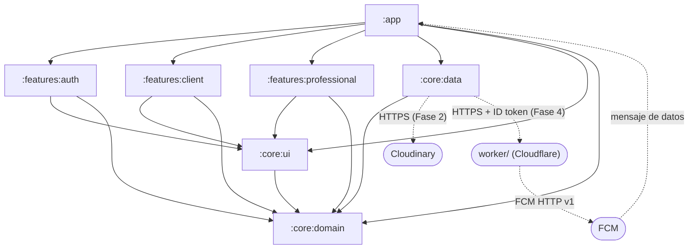
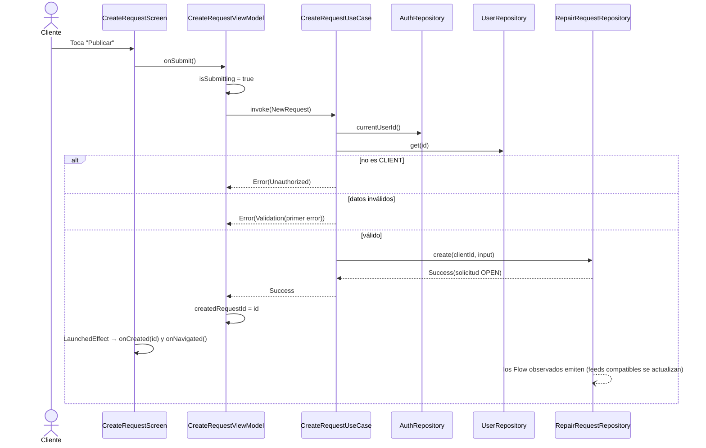
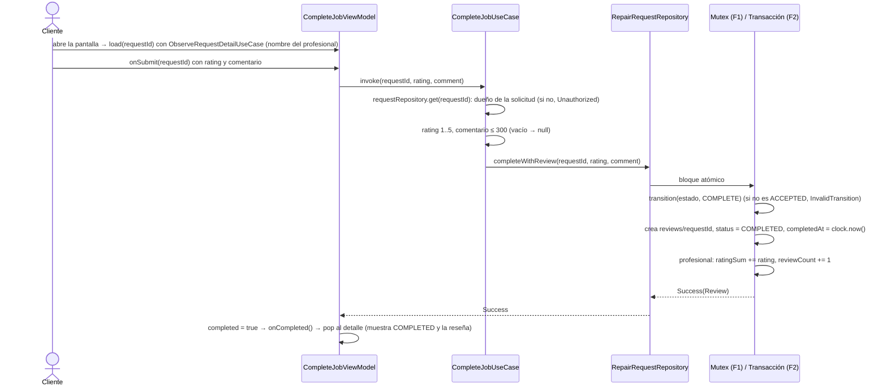

# Diseño: FixIt MVP (Fases 1–4)

> Cambio `fixit-mvp`. El "qué" está en `proposal.md` y `specs/`; este documento define el "cómo".
> Prioridad explícita del usuario: **la solución más simple posible** para un equipo sin experiencia en Kotlin ni Compose, sin dejar de mostrar los temas de la cátedra (Clase 4) y respetando la estructura multi-módulo, que es parte evaluada del TP.
> **Restricción dura (2026-10-08)**: nada puede requerir tarjeta de crédito. Firebase queda en Spark (Auth + Firestore + FCM); las fotos van a Cloudinary (§13.7) y los avisos push los envía un Cloudflare Worker (§14b). Actualizado el 2026-10-08.

## 1. Cómo leer este diseño

- La app se divide en **módulos de Gradle**: carpetas que compilan por separado y solo "ven" a los módulos que declaran como dependencia.
- `:core:domain` contiene las **reglas del negocio** (qué es una solicitud, quién puede aceptarla). Es Kotlin puro: no sabe que existen Android ni Firebase.
- `:core:data` decide **de dónde salen los datos**: en Fase 1, listas en memoria (Fakes); en Fase 2, Firebase. Cumple los contratos (interfaces) que define el dominio.
- `:core:ui` tiene el tema Material 3 y piezas visuales reutilizables. `:features:auth|client|professional` tienen las pantallas: cada una con un **ViewModel** (decide y guarda el estado) y un **Screen** (solo dibuja ese estado).
- `:app` une todo: arranca Hilt, elige qué mostrar según la sesión y resuelve la navegación.
- Regla de oro: las dependencias apuntan **hacia el dominio**. Si una pantalla intenta usar Firebase o un Fake directamente, el proyecto no compila.
- **Hilt** es el "enchufe": en un solo archivo decide si las pantallas reciben la versión Fake o la de Firebase.
- `worker/` (raíz del repositorio, fuera de Gradle) es un servidor mínimo en TypeScript que solo existe para la Fase 4: guarda la clave de FCM y envía los avisos.
- Orden sugerido: §3 módulos → §5 dominio → §7 casos de uso → §8–9 pantallas y navegación → §10 flujos. Fase 2: §13. Fase 4: §14b.

## 2. Enfoque técnico

Clean Architecture multi-módulo, igual que el repositorio de la cátedra (`mauromarod/unaj-am`), con MVVM/UDF: `XxxRoute` (con estado) → `XxxViewModel` (`StateFlow<XxxUiState>`) → caso de uso o interfaz de repositorio → implementación Fake (Fase 1) o Firebase (Fase 2). Todo lo que no es requisito de la cátedra se simplifica (ver §16).

| Fase | Qué se agrega en `:core:data` / `:app` | Qué NO cambia |
|---|---|---|
| 2 | `Firebase*Repository` (Auth + Firestore, plan Spark); fotos con un `POST` HTTP a Cloudinary (preset sin firma, OkHttp, D21) | `:core:domain`, `:features:*` |
| 3 | Ubicación real (`@Binds`), cámara y Photo Picker (UI) | `:core:domain` |
| 4 | Decorador `NotifyingRepairRequestRepository` (D24), sincronización de temas FCM (D26), servicio FCM y enlace profundo en `:app` (D28); Worker en `worker/` (D23, D27) | `:core:domain`, `:features:*` |

Versiones: usar la última estable al implementar para Compose BOM, Hilt, Navigation 3, Coil 3 y Firebase BoM. Referencia del repositorio de la cátedra: Kotlin 2.4.20, AGP 9.2.1, Compose BOM 2026.09.00, navigation3 1.2.0, lifecycle 2.11.0, Coil 3.6.3, minSdk 26, compile/targetSdk 37. Todas en `gradle/libs.versions.toml`.

## 3. Módulos y dependencias



Las flechas punteadas son servicios externos por red, no dependencias de Gradle: `worker/` no es un módulo y no forma parte del APK.

| Desde \ Hacia | `:core:domain` | `:core:ui` | `:core:data` | `:features:*` |
|---|---|---|---|---|
| `:app` | Sí | Sí | Sí | Sí |
| `:features:*` | Sí | Sí | **No** | **No** (entre sí) |
| `:core:ui` | Sí | — | No | No |
| `:core:data` | Sí | No | — | No |
| `:core:domain` | — | No | No | No |

| Módulo | Tipo / plugins | Dependencias externas principales |
|---|---|---|
| `:core:domain` | `kotlin-jvm`, `java-test-fixtures` | `kotlinx-coroutines-core` expuesto como `api` (los demás módulos lo reciben transitivamente), `javax.inject` (solo la anotación `@Inject`) |
| `:core:data` | Android library, Hilt, KSP; Fase 2: `buildFeatures { buildConfig = true }` (D22) | Hilt, `kotlinx-coroutines-android` (dispatchers); Fase 2: Firebase BoM (`firebase-auth`, `firebase-firestore`; **sin** `firebase-storage`), `kotlinx-coroutines-play-services` (para `Task.await()`), `geofire-android-common`, `androidx.exifinterface`, `okhttp` + `okhttp-coroutines` (subida a Cloudinary, D21), `kotlinx-serialization-json` (solo la API `JsonElement` para leer la respuesta; no requiere el plugin); Fase 3: `play-services-location`; Fase 4: `firebase-messaging` (suscripción a temas), `androidx.core:core-ktx` (`NotificationManagerCompat.cancelAll()` al cerrar sesión) |
| `:core:ui` | Android library, Compose | Compose BOM, Material 3, Coil 3; Fase 2: `coil-network-okhttp` (Coil 3 no trae cliente de red; hace falta para cargar las URLs https de Cloudinary) |
| `:features:*` | Android library, Compose, Hilt, KSP | `lifecycle-runtime-compose`, `hiltViewModel()` (mismo artefacto que la cátedra). Sin cambios en Fases 2 y 4. |
| `:app` | Android application, Compose, Hilt, KSP, Kotlin Serialization | Navigation 3, `lifecycle-viewmodel-navigation3`; Fase 2: plugin `google-services` y permiso `INTERNET` en el manifest; Fase 4: `firebase-messaging`, permiso `POST_NOTIFICATIONS`, `<service>` de `FixItMessagingService` y `MainActivity` con `launchMode="singleTop"` |
| `worker/` (fuera de Gradle) | Cloudflare Worker, TypeScript, `wrangler` | Solo APIs estándar del runtime (`fetch`, WebCrypto); desarrollo: `wrangler`, `typescript`, `@cloudflare/workers-types`, `vitest` (D23) |

Gradle simple: `settings.gradle.kts` con los 7 `include`, un `libs.versions.toml` y cada módulo declara sus plugins y su bloque `android {}` directamente (sin `build-logic` ni convention plugins, ver D2).

## 4. Estructura de paquetes

Paquete base `com.vespelabs.fixit`. Todos los archivos son nuevos (proyecto greenfield). Por pantalla hay **dos archivos**: `XxxScreen.kt` (contiene `XxxRoute` y `XxxScreen` + `@Preview`) y `XxxViewModel.kt` (contiene `XxxViewModel` y `XxxUiState`).

```
settings.gradle.kts · build.gradle.kts · gradle/libs.versions.toml
firestore.rules · firestore.indexes.json                            (Fase 2; ya no hay storage.rules)
local.properties (NO versionado)  CLOUDINARY_CLOUD_NAME, CLOUDINARY_UPLOAD_PRESET (Fase 2), PUSH_WORKER_URL (Fase 4)
app/            com.vespelabs.fixit
  FixItApplication.kt (@HiltAndroidApp; Fase 4: crea el canal y arranca TopicSync) · MainActivity.kt (@AndroidEntryPoint; Fase 4: lee el enlace profundo del Intent)
  navigation/   Destinations.kt (claves @Serializable : NavKey) · TopLevelDestination.kt (pestañas por rol + pseudo-pestaña AUTH)
                NavigationState.kt (una pila por pestaña; también para AUTH) · AppNavDisplay.kt (NavDisplay + entryProvider)
                Experience.kt (enum Experience + experienceFor, pura) · FixItApp.kt (compuerta + SessionViewModel)
                (Fase 4) DeepLink.kt (DeepLinkDestination, deepLinkDestination(type, role, requestId), NavigationState.open; puras)
  ui/           AppShell.kt (Scaffold + NavigationBar con las pestañas del rol; Fase 4: pide POST_NOTIFICATIONS)
  push/         (Fase 4) FixItMessagingService.kt (@AndroidEntryPoint), Notifications.kt (canal + construcción del aviso + PendingIntent)
core/domain/    com.vespelabs.fixit.core.domain
  model/        User, RepairRequest, Review, enums, GeoPoint, Place, SessionState, forms, RequestDetail, Limits
  result/       AppResult, DomainError, ValidationError
  rules/        RequestStateMachine, Haversine, Matching, ContactRules, PhoneFormatter, Reputation, Validators
  repository/   AuthRepository, UserRepository, RepairRequestRepository, LocationProvider, AddressResolver, Clock
  usecase/      10 casos de uso (§7)
  src/testFixtures/  TestAuthRepository, TestUserRepository, TestRepairRequestRepository, TestLocation, MainDispatcherRule
core/data/      com.vespelabs.fixit.core.data
  fake/         FakeDatabase, SeedData, FakeAuthRepository, FakeUserRepository, FakeRepairRequestRepository, FakeLocation
  firebase/     (Fase 2) Firebase*Repository, Dtos.kt (DTO + mappers), FirebaseCalls.kt (firebaseCall, asResult, DomainException, mapeo de excepciones)
  cloudinary/   (Fase 2) CloudinaryConfig, PhotoUploader + CloudinaryUploader (+ buildUploadRequest, parseUploadResponse, CloudinaryUploadException), ImageCompressor.kt (+ targetSize, sampleSizeFor)
  device/       (Fase 3) FusedLocationProvider, GeocoderAddressResolver
  push/         (Fase 4) PushEvent, WorkerClient + HttpWorkerClient (+ buildNotifyRequest), IdTokenProvider + FirebaseIdTokenProvider,
                NotifyingRepairRequestRepository (+ withPush), TopicMessaging + FirebaseTopicMessaging, TopicStore + TopicState + SharedPrefsTopicStore,
                NoticeCanceller + AndroidNoticeCanceller, TopicSync (+ topicsFor, topicChanges),
                PushDecision.kt (PushEventType, shouldNotify, mayMatchCategory; puras), PushMessageHandler
  di/           RepositoryModule, CoreModule (+ @IoDispatcher; Fase 4: @ApplicationScope), (Fase 2) FirebaseModule (Fase 4: FirebaseMessaging), NetworkModule (OkHttpClient, CloudinaryConfig; Fase 4: WorkerConfig)
core/ui/        com.vespelabs.fixit.core.ui
  theme/        FixItTheme (Material 3)
  components/   LoadingContent, ErrorContent, StatusBadge, CategoryChips, PhotoThumbnails, PhotoPager,
                PhotoPickerButtons, RatingBar, ContactCard, ReputationText (formatea con el idioma del dispositivo), ProfileFormFields (+ ProfileFormState)
  text/         DomainError.asMessage(), ServiceCategory.label()
  res/drawable/ sample_repair_1..3 (fotos de ejemplo de Fase 1)
features/auth/          ...feature.auth          signin/ · signup/
features/client/        ...feature.client        myrequests/ · create/ · detail/ · complete/ · profile/ (perfil + edición)
features/professional/  ...feature.professional  feed/ · detail/ · myjobs/ · profile/ (perfil + edición)
worker/         (Fase 4, fuera de Gradle) package.json · tsconfig.json · wrangler.toml · .dev.vars (NO versionado)
  src/          index.ts (POST /notify, orquesta) · body.ts (parseNotifyBody, pura) · claims.ts (checkClaims, pura)
                idToken.ts (verifica el ID token de Firebase, JWKS en caché) · googleAuth.ts (JWT RS256 con WebCrypto → token OAuth de FCM, en caché)
                firestore.ts (lee requests/{id} por REST) · fcm.ts (arma y envía el mensaje HTTP v1) · rules.ts (decideTarget: destino y vigencia, pura)
  test/         body · rules · claims · idToken · firestore · googleAuth · fcm · index (.test.ts); funciones puras o con dependencias inyectadas (fetch, reloj, claves)
```

## 5. Dominio (`:core:domain`)

### 5.1 Modelos

```kotlin
enum class UserRole { CLIENT, PROFESSIONAL }
enum class ServiceCategory { ELECTRICITY, PLUMBING, GAS, CARPENTRY, PAINTING, LOCKSMITH, MASONRY, OTHER }
enum class RequestStatus { OPEN, ACCEPTED, COMPLETED, CANCELLED }
enum class RequestAction { ACCEPT, CANCEL, COMPLETE }

data class GeoPoint(val latitude: Double, val longitude: Double)
data class Place(val point: GeoPoint, val address: String) // not "Location": avoids android.location.Location

data class Reputation(val ratingSum: Int = 0, val reviewCount: Int = 0)  // average as a number via rules/Reputation (BigDecimal)
data class ProfessionalInfo(
    val categories: Set<ServiceCategory>, val base: Place, val radiusKm: Int,
    val reputation: Reputation = Reputation(),
)
data class User(
    val id: String, val name: String, val email: String, val phone: String, val role: UserRole,
    val professional: ProfessionalInfo? = null, // non-null only when role == PROFESSIONAL
)
data class RepairRequest(
    val id: String, val clientId: String, val category: ServiceCategory, val description: String,
    val photoUrls: List<String>, val place: Place, val status: RequestStatus,
    val professionalId: String? = null, // kept after ACCEPTED -> CANCELLED (shows in "Mis trabajos")
    val createdAt: Long, val acceptedAt: Long? = null,
    val cancelledAt: Long? = null, val completedAt: Long? = null, // all dates come from the injected Clock (Fake) / serverTimestamp (Firebase, see §13.1)
)
data class Review(
    val requestId: String, val professionalId: String, val clientId: String,
    val rating: Int, val comment: String?, val createdAt: Long,
)
sealed interface SessionState {
    data object Loading : SessionState
    data object SignedOut : SessionState
    data class SignedIn(val user: User) : SessionState
}

// Inputs (pro fields are ignored for CLIENT)
data class ProfileForm(
    val name: String, val phone: String,
    val categories: Set<ServiceCategory> = emptySet(), val base: Place? = null, val radiusKm: Int? = null,
)
data class SignUpForm(val email: String, val password: String, val role: UserRole?, val profile: ProfileForm)
data class NewRequest(val category: ServiceCategory?, val description: String, val photoUris: List<String>, val place: Place?)

// Read models
data class FeedItem(val request: RepairRequest, val distanceKm: Double)
data class Contact(val name: String, val phone: String, val whatsAppUrl: String, val reputation: Reputation?) // whatsAppUrl = PhoneFormatter.whatsAppUrl(phone)
data class RequestDetail(
    val request: RepairRequest,
    val contact: Contact?,           // only ACCEPTED/COMPLETED and viewer is a participant (ContactRules)
    val review: Review?,
    val distanceKm: Double?,         // only for a professional viewer, rounded to 0.1 km
    val viewerIsAssignee: Boolean,   // professional viewer == request.professionalId; drives the professional detail (§9)
)
```

`Limits` agrupa las constantes aprobadas: nombre 2..60, contraseña ≥ 6, teléfono 8..15 dígitos, radio 1..50, descripción 10..500, fotos 1..3, rating 1..5, comentario ≤ 300. El dominio devuelve **números** (promedio, distancia), nunca textos con formato: el formato con el idioma del dispositivo lo hace la UI (§5.3).

### 5.2 Errores como valores

```kotlin
sealed interface AppResult<out T> {
    data class Success<T>(val data: T) : AppResult<T>
    data class Error(val error: DomainError) : AppResult<Nothing>
}

sealed interface DomainError {
    data class Validation(val error: ValidationError) : DomainError
    data class InvalidTransition(val from: RequestStatus, val action: RequestAction) : DomainError
    data object InvalidCredentials : DomainError
    data object EmailAlreadyInUse : DomainError
    data object Unauthorized : DomainError        // wrong role, not the owner, category not offered
    data object NotFound : DomainError
    data object AlreadyTaken : DomainError        // another professional accepted first
    data object LocationUnavailable : DomainError
    data object Network : DomainError
    data object ProfileMissing : DomainError   // signed in, but users/{uid} does not exist
    data object Unknown : DomainError
}

enum class FormField { EMAIL, PASSWORD, NAME, PHONE, ROLE, CATEGORIES, BASE, RADIUS, CATEGORY, DESCRIPTION, PHOTOS, LOCATION, RATING, COMMENT }

// Same names as the specs (Validation.EmptyDescription -> EMPTY_DESCRIPTION); `field` lets forms mark the input.
enum class ValidationError(val field: FormField) {
    INVALID_EMAIL(EMAIL), EMPTY_PASSWORD(PASSWORD), WEAK_PASSWORD(PASSWORD), INVALID_NAME(NAME), INVALID_PHONE(PHONE), ROLE_REQUIRED(ROLE),
    CATEGORIES_REQUIRED(CATEGORIES), BASE_LOCATION_REQUIRED(BASE), INVALID_RADIUS(RADIUS), INVALID_COORDINATES(LOCATION),
    CATEGORY_REQUIRED(CATEGORY), EMPTY_DESCRIPTION(DESCRIPTION), DESCRIPTION_TOO_SHORT(DESCRIPTION),
    DESCRIPTION_TOO_LONG(DESCRIPTION), PHOTOS_REQUIRED(PHOTOS), TOO_MANY_PHOTOS(PHOTOS), LOCATION_REQUIRED(LOCATION),
    INVALID_RATING(RATING), COMMENT_TOO_LONG(COMMENT),
}
```

Sin helpers genéricos (`map`, `flatMap`): se usa `when`. En `:core:ui`, `DomainError.asMessage()` es un único `when` sobre `stringResource`. `INVALID_COORDINATES` marca `LOCATION`; el formulario del profesional lo muestra junto al punto base.

### 5.3 Reglas puras (`rules/`, `object` sin estado)

| Regla | Firma | Comportamiento |
|---|---|---|
| `RequestStateMachine` | `transition(from, action): AppResult<RequestStatus>` | `OPEN+ACCEPT→ACCEPTED`, `OPEN+CANCEL→CANCELLED`, `ACCEPTED+CANCEL→CANCELLED`, `ACCEPTED+COMPLETE→COMPLETED`; `ACCEPTED+ACCEPT→AlreadyTaken`; el resto `InvalidTransition(from, action)`. |
| `Haversine` | `km(a, b): Double` | Radio terrestre 6371.0088 km. El valor intermedio `a` se limita a [0, 1] (`a.coerceIn(0.0, 1.0)`) antes de `asin`/`sqrt`, para evitar `NaN` por errores de redondeo (p. ej., puntos antípodas). |
| `Matching` | `isWithin(distanceKm: Double, radiusKm: Int): Boolean`; `roundKm(km: Double): Double`; `distanceIfMatches(pro: ProfessionalInfo, r: RepairRequest): Double?` | `isWithin` es pura e inclusiva: `distanceKm <= radiusKm`, sobre la distancia **sin redondear** (10.0 con radio 10 → `true`; 10.01 → `false`). `roundKm` redondea a 0.1 km (`Math.round(km * 10) / 10.0`). `distanceIfMatches`: `OPEN` ∧ categoría incluida ∧ `isWithin(Haversine.km(...), radio)`; devuelve la distancia redondeada con `roundKm` o `null`. |
| `ContactRules` | `contactFor(request, viewerId, counterpart: User): AppResult<Contact>` | Solo `ACCEPTED`/`COMPLETED` y participante; si no, `Unauthorized`. |
| `PhoneFormatter` | `whatsAppDigits(raw): String`; `whatsAppUrl(raw): String` | `whatsAppDigits`: primero recorta y quita espacios, guiones y paréntesis (los mismos que ignora `Validators`); **después** mira si el resultado empieza con `+` y conserva solo dígitos. Si empezaba con `+`: se usan tal cual (sin el `+`). Si no, y empiezan con `54`: tal cual. Si no: se antepone `549`. Limitaciones documentadas (sin lógica extra): fijos o extranjeros sin `+`, y los formatos troncales argentinos `0xx 15…` (con `0` inicial y `15`), que generan enlaces inválidos. `whatsAppUrl`: `"https://wa.me/" + whatsAppDigits(raw)`, **sin** `?text`; el mensaje inicial opcional lo agrega la UI al abrir el intent y queda fuera de lo probado. |
| `Reputation` (ext.) | `Reputation.average(): BigDecimal?` | `BigDecimal(ratingSum).divide(BigDecimal(reviewCount), 1, RoundingMode.HALF_UP)`; `null` si `reviewCount == 0` (sin división por cero; "Sin reseñas" en la UI). `ReputationText` (`:core:ui`) formatea el número con el idioma del dispositivo y `minimumFractionDigits = 1` (en español, "4,3"; un promedio de 4.0 se muestra "4,0"). |
| `Validators` | `normalizeEmail(raw)`, `signIn(email, password)`, `signUp(form)`, `profile(role, form)`, `request(input)`, `review(rating, comment)`, `coordinates(point)`: `ValidationError?` | Devuelven el **primer** error en el orden de la tabla siguiente. |

Piezas de `Validators` (Kotlin puro, sin `android.util.Patterns` porque el dominio es JVM):

```kotlin
object Validators {
    // Applied after normalizeEmail(): trim().lowercase()  (Kotlin lowercase() is locale-independent)
    private val EMAIL = Regex("^[a-z0-9._%+-]+@[a-z0-9-]+(\\.[a-z0-9-]+)*\\.[a-z]{2,}$")
    // Applied after trim() and removing ' ', '-', '(' and ')' (the same characters PhoneFormatter ignores)
    private val PHONE = Regex("^\\+?[0-9]{8,15}$")

    fun normalizeEmail(raw: String): String = raw.trim().lowercase()

    fun coordinates(point: GeoPoint): ValidationError? =
        if (point.latitude in -90.0..90.0 && point.longitude in -180.0..180.0) null  // NaN is not "in" the range
        else ValidationError.INVALID_COORDINATES
}
```

`FakeAuthRepository` también aplica `normalizeEmail` al guardar y al comparar (igual que Firebase Auth, que ignora mayúsculas), de modo que `EmailAlreadyInUse` se comporte igual en Fase 1 y 2; los casos de uso ya pasan el email normalizado.

Orden de validación (posición de cada regla):

| Operación | Orden |
|---|---|
| `signIn` | 1 email (`INVALID_EMAIL`) → 2 contraseña no vacía (`EMPTY_PASSWORD`) |
| `signUp` | 1 email → 2 contraseña ≥ 6 (`WEAK_PASSWORD`) → 3 nombre → 4 teléfono → 5 rol → profesional: 6 categorías → 7 punto base (`BASE_LOCATION_REQUIRED`) → 8 coordenadas del punto base (`INVALID_COORDINATES`) → 9 radio |
| `profile(role, form)` | 1 nombre → 2 teléfono → profesional: 3 categorías → 4 punto base → 5 coordenadas del punto base → 6 radio |
| `request` | 1 categoría → 2 descripción vacía → 3 corta → 4 larga → 5 sin fotos → 6 demasiadas fotos → 7 ubicación (`LOCATION_REQUIRED`) → 8 coordenadas (`INVALID_COORDINATES`) |
| `review` | 1 calificación → 2 comentario |

## 6. Interfaces de repositorio

Regla única (D6): los **comandos** (`suspend`) devuelven `AppResult<T>` y las **observaciones** devuelven `Flow<AppResult<T>>`. La capa de datos (Fake y Firebase) convierte las excepciones en `DomainError`; nada lanza hacia el ViewModel, que solo traduce `AppResult` → `UiState`. Excepciones documentadas: `AuthRepository.session` es un `Flow<SessionState>` (nunca falla; un error de datos termina en `SignedOut`) y `signOut()` es una `fun` normal que devuelve `Unit`.

```kotlin
interface AuthRepository {
    val session: Flow<SessionState>        // never fails: a data-layer error ends as SignedOut (see §13.5)
    fun currentUserId(): String?           // only the id: use cases read fresh data with UserRepository.get (D19)
    suspend fun signIn(email: String, password: String): AppResult<User>
    suspend fun signUp(form: SignUpForm): AppResult<User>
    fun signOut()                          // plain fun, returns Unit (documented D6 exception)
}

interface UserRepository {
    suspend fun get(userId: String): AppResult<User>                  // fresh read for pre-checks; NotFound if missing
    fun observe(userId: String): Flow<AppResult<User>>                // NotFound if missing
    suspend fun updateProfile(userId: String, form: ProfileForm): AppResult<User> // never touches email, role, reputation
}

interface RepairRequestRepository {
    suspend fun create(clientId: String, input: NewRequest): AppResult<RepairRequest>
    suspend fun get(requestId: String): AppResult<RepairRequest>                   // fresh read for pre-checks; NotFound if missing
    fun observe(requestId: String): Flow<AppResult<RepairRequest>>                 // NotFound if missing
    fun observeByClient(clientId: String): Flow<AppResult<List<RepairRequest>>>             // createdAt desc
    fun observeByProfessional(professionalId: String): Flow<AppResult<List<RepairRequest>>> // acceptedAt desc
    fun observeOpenNear(center: GeoPoint, radiusKm: Int): Flow<AppResult<List<RepairRequest>>> // candidates; exact filter in domain
    fun observeReview(requestId: String): Flow<AppResult<Review?>>                 // Success(null) while there is no review
    // Atomic (Mutex in Fake, transaction in Firestore); status checked with RequestStateMachine inside the atomic block.
    // accept is idempotent: already ACCEPTED by the same professionalId -> Success(unchanged request), checked before the state machine.
    suspend fun accept(requestId: String, professionalId: String): AppResult<RepairRequest>
    suspend fun cancel(requestId: String): AppResult<RepairRequest>
    suspend fun completeWithReview(requestId: String, rating: Int, comment: String?): AppResult<Review>
}

interface LocationProvider { suspend fun current(): AppResult<GeoPoint> }
interface AddressResolver { suspend fun resolve(point: GeoPoint): AppResult<String> }
fun interface Clock { fun now(): Long }
```

`completeWithReview` vive en `RepairRequestRepository` porque escribe tres documentos en una sola transacción (solicitud, reseña y reputación). Fechas: `accept` guarda `acceptedAt`, `cancel` guarda `cancelledAt` y `completeWithReview` guarda `completedAt` y `Review.createdAt`; en el Fake todas salen de `clock.now()`.

## 7. Casos de uso

Clases con `@Inject constructor` y `operator fun invoke`. **Solo existen donde hay una regla** (D8). División de responsabilidades (D9): el caso de uso verifica **quién** (rol, dueño, categoría) y valida la entrada; el repositorio hace la **transición atómica**. Así `Unauthorized` siempre llega antes que `InvalidTransition`, como piden los specs. Si no hay sesión (`authRepository.currentUserId() == null`), devuelven `Unauthorized`. Los datos para decidir (rol, categorías, dueño) se leen con `get` (lectura fresca, D19), nunca de una copia guardada de la sesión. Los casos de uso **persisten valores recortados**: nombre, teléfono y descripción se guardan con `trim()` (el teléfono conserva su formato, solo se recorta; los separadores se ignoran únicamente al validar y al armar el enlace de WhatsApp), y los límites de largo de la descripción se aplican sobre el texto recortado.

| Caso de uso | Entrada | Salida | Regla |
|---|---|---|---|
| `SignInUseCase` | email, password | `AppResult<User>` | `Validators.signIn`: email normalizado con formato y contraseña no vacía (`EMPTY_PASSWORD`); luego `signIn`. |
| `SignUpUseCase` | `SignUpForm` | `AppResult<User>` | Orden de validación de `auth` (§5.3), incluidas las coordenadas del punto base; campos de profesional si el rol es `PROFESSIONAL`. |
| `UpdateProfileUseCase` | `ProfileForm` | `AppResult<User>` | Mismas validaciones que el registro según el rol (§5.3); email y rol no forman parte de la entrada. |
| `GetCurrentPlaceUseCase` | — | `AppResult<Place>` | Combina `LocationProvider` + `AddressResolver`; si la dirección falla, `address = ""`. |
| `CreateRequestUseCase` | `NewRequest` | `AppResult<RepairRequest>` | Rol `CLIENT` (`userRepository.get(id)`); validación en el orden de `repair-requests` (§5.3), incluida `Validators.coordinates`. |
| `CancelRequestUseCase` | requestId | `AppResult<RepairRequest>` | Solo el cliente dueño (`requestRepository.get(id)`); transición `OPEN/ACCEPTED → CANCELLED` en el repositorio. |
| `ObserveFeedUseCase` | — | `Flow<AppResult<List<FeedItem>>>` | Perfil del profesional (`userRepository.observe`) → se toma `(categories, base, radiusKm)` y se aplica `distinctUntilChanged()` **antes** de `flatMapLatest` (cambios de nombre o de reputación no reinician la observación) → candidatos (`observeOpenNear`) → `Matching` → orden `createdAt` desc. Si una observación emite `Error`, el feed emite ese `Error`. Al editar zona o categorías, se recalcula solo. |
| `AcceptRequestUseCase` | requestId | `AppResult<RepairRequest>` | Lee al profesional con `userRepository.get(id)` (rol `PROFESSIONAL`) y la solicitud con `requestRepository.get(id)` (categoría incluida); luego `accept` atómico (idempotente para el mismo profesional, ver §6). |
| `ObserveRequestDetailUseCase` | requestId | `Flow<AppResult<RequestDetail>>` | Combina solicitud + contraparte + reseña. Verifica la visibilidad: el cliente solo ve las propias (si no, `Error(Unauthorized)`); solicitud inexistente → `Error(NotFound)`; un profesional puede abrir cualquier solicitud y el contacto lo decide `ContactRules`: si devuelve `Unauthorized`, el detalle emite `Success` con `contact = null` (no un `Error` del flujo; excepción documentada de D6). Calcula `viewerIsAssignee` y la distancia (solo profesional, redondeada con `Matching.roundKm`). Se actualiza en vivo (p. ej., cancelación oculta el contacto). Al combinar los flujos de solicitud, reseña y contraparte, puede haber una emisión transitoria (p. ej., solicitud `COMPLETED` con `review = null`) tanto en el Fake como en Firebase: los tests de ViewModel esperan el estado final con `first { ... }`. |
| `CompleteJobUseCase` | requestId, rating, comment | `AppResult<Review>` | Solo el dueño (`requestRepository.get(id)`); rating 1..5; comentario recortado ≤ 300, vacío → `null`; luego `completeWithReview` atómico. |

Sin caso de uso (el ViewModel usa la interfaz del dominio directamente y traduce el `AppResult` de cada `Flow`): sesión (`AuthRepository.session`), cerrar sesión, "Mis solicitudes" (`observeByClient`), "Mis trabajos" (`observeByProfessional`, el ViewModel separa activos y finalizados) y ver perfil (`UserRepository.observe`). `CompleteJobViewModel` carga la solicitud por id con `ObserveRequestDetailUseCase` para mostrar el nombre del profesional.

## 8. Presentación: patrón de pantalla

- **Pantallas de datos**: `sealed interface XxxUiState { Loading; Success(...); Error(error) }`. El ViewModel solo traduce `AppResult.Success` → `Success` y `AppResult.Error(e)` → `Error(e)`; no usa `.catch` porque la capa de datos ya convirtió las excepciones (D6).
- **Formularios**: un `data class` con campos, `isSubmitting`, `validationError: ValidationError?` y `message: DomainError?`.
- **Eventos de una sola vez** (snackbar, navegar): campo nullable en el estado (`message`, `createdRequestId`, `saved`) que la UI consume y limpia con `onMessageShown()` / `onNavigated()`. Sin `Channel` ni `SharedFlow`.
- Pantallas sin ID cargan en `init {}`. Pantallas con ID reciben el ID desde la clave de navegación y llaman `load(id)`:

```kotlin
@Composable
fun ClientRequestDetailRoute(
    requestId: String,
    onBack: () -> Unit,
    onCompleteClick: (String) -> Unit,
    viewModel: ClientRequestDetailViewModel = hiltViewModel(),
) {
    LaunchedEffect(requestId) { viewModel.load(requestId) }
    val uiState by viewModel.uiState.collectAsStateWithLifecycle()
    ClientRequestDetailScreen(uiState, onBack, onCompleteClick, viewModel::onCancelConfirm, viewModel::onMessageShown)
}

// In the ViewModel (UiState = ClientRequestDetailUiState): idempotent load (LaunchedEffect runs again after rotation).
fun load(id: String) {
    if (id == requestId) return
    requestId = id
    job?.cancel()
    job = viewModelScope.launch {
        observeDetail(id).collect { result ->        // Flow<AppResult<RequestDetail>>: Unauthorized / NotFound / Network arrive as values
            _uiState.update { old ->
                when (result) {
                    is AppResult.Error -> UiState.Error(result.error)
                    is AppResult.Success ->
                        if (old is UiState.Success) old.copy(detail = result.data) // keeps isWorking / message
                        else UiState.Success(result.data)
                }
            }
        }
    }
}
fun onRetry() { val id = requestId ?: return; requestId = null; _uiState.value = UiState.Loading; load(id) }
```

Los ViewModels obtienen el id del usuario con `authRepository.currentUserId()` (no de argumentos ni de una copia de la sesión). Como la compuerta usa `key(userId)` (§9), al cambiar de usuario se descartan los ViewModels de todas las entradas y ninguna pantalla conserva datos del usuario anterior.

Cada entrada de navegación tiene su propio `ViewModelStore` (decorador de Navigation 3), así que el ViewModel sobrevive a la rotación y se destruye al volver atrás, como piden los specs. Con historial por pestaña hay que **verificar al armar el proyecto** que los ViewModels de las pestañas no visibles se conserven al cambiar de pestaña, comparando con el código de la cátedra (ver §19).

## 9. Pantallas por rol y navegación

| Módulo | Route / Screen | ViewModel | UiState | Clave | Callbacks → acción en `:app` |
|---|---|---|---|---|---|
| auth | `SignIn` | `SignInViewModel` | form | `SignInKey` | `onSignUpClick` → `navigate(SignUpKey)` |
| auth | `SignUp` | `SignUpViewModel` | form (rol + `ProfileFormState`) | `SignUpKey` | `onBack` → `goBackFrom(SignUpKey)`; éxito: la compuerta cambia sola |
| client | `MyRequests` (raíz "Solicitudes") | `MyRequestsViewModel` | sealed `Success(requests)` | `MyRequestsKey` | `onCreateClick` / `onRequestClick(id)` → `navigate(...)` |
| client | `CreateRequest` | `CreateRequestViewModel` | form + `createdRequestId` | `CreateRequestKey` | `onCreated(id)` → `goBackFrom(CreateRequestKey)` + `navigate(ClientRequestDetailKey(id))` |
| client | `ClientRequestDetail` | `ClientRequestDetailViewModel` | sealed `Success(detail, isWorking, message)` | `ClientRequestDetailKey(requestId)` | `onCompleteClick(id)` → `navigate(CompleteJobKey(id))` |
| client | `CompleteJob` | `CompleteJobViewModel` | form (`professionalName`, `rating`, `comment`, `completed`, `loadError`); carga el detalle por id con `ObserveRequestDetailUseCase` | `CompleteJobKey(requestId)` | `onCompleted` → `goBackFrom(key)` |
| client | `ClientProfile` (raíz "Perfil") | `ClientProfileViewModel` | sealed `Success(user)` | `ClientProfileKey` | `onEditClick` → `navigate(ClientEditProfileKey)` |
| client | `ClientEditProfile` | `ClientEditProfileViewModel` | form + `saved` | `ClientEditProfileKey` | `onSaved` → `goBackFrom(key)` |
| pro | `Feed` (raíz "Feed") | `FeedViewModel` | sealed `Success(items)` | `FeedKey` | `onRequestClick(id)` → `navigate(ProRequestDetailKey(id))` |
| pro | `ProRequestDetail` | `ProRequestDetailViewModel` | sealed `Success(detail, isAccepting, message, acceptedId)` | `ProRequestDetailKey(requestId)` | `onAccepted(id)` → `goBackFrom(key)` (Feed queda en su raíz) + `selectTab(MY_JOBS)` + `resetToRoot(MY_JOBS)` (la pila de "Mis trabajos" vuelve a su raíz) + `navigate(ProRequestDetailKey(id))`, de modo que "Atrás" desde el detalle regresa a "Mis trabajos". `AlreadyTaken`/`InvalidTransition` → diálogo con el mensaje; al confirmar → `goBackFrom(key)` (vuelve al Feed) |
| pro | `MyJobs` (raíz "Mis trabajos") | `MyJobsViewModel` | sealed `Success(active, finished)` | `MyJobsKey` | `onJobClick(id)` → `navigate(ProRequestDetailKey(id))` |
| pro | `ProProfile` (raíz "Perfil") | `ProProfileViewModel` | sealed `Success(user)` | `ProProfileKey` | `onEditClick` → `navigate(ProEditProfileKey)` |
| pro | `ProEditProfile` | `ProEditProfileViewModel` | form + `saved` | `ProEditProfileKey` | `onSaved` → `goBackFrom(key)` |

"Cerrar sesión" está en los ViewModels de perfil (`authRepository.signOut()`); la compuerta reacciona sola. El detalle del cliente en `OPEN` muestra "Esperando que un profesional acepte". La flecha "Atrás" de la barra superior de toda pantalla no raíz llama `goBackFrom(key)`.

**Detalle del profesional** (`ProRequestDetail`, según `detail.request.status` y `detail.viewerIsAssignee`): "Aceptar trabajo" se muestra solo con `OPEN`. Si no está `OPEN` y `!viewerIsAssignee`, se muestra el aviso "Esta solicitud ya no está disponible" (sin botón ni contacto). Si `viewerIsAssignee`: contacto del cliente (`detail.contact`) en `ACCEPTED`/`COMPLETED`, reseña en `COMPLETED` y "Cancelada por el cliente" en `CANCELLED`. El diálogo de carrera perdida (`AlreadyTaken` / `InvalidTransition`) se conserva: con el detalle en vivo solo es alcanzable si el diálogo de confirmación ya estaba abierto o por la latencia de la Fase 2, y se prueba a nivel de caso de uso y de ViewModel con un repositorio de prueba que devuelve el error.

**Navegación (Navigation 3, D3)**: se replica la estructura del repositorio de la cátedra (`mauromarod/unaj-am`), adaptada a dos roles:

| Archivo (`:app`) | Responsabilidad |
|---|---|
| `navigation/Destinations.kt` | Todas las claves: `@Serializable`, implementan `NavKey`, solo IDs. |
| `navigation/TopLevelDestination.kt` | `enum` con las 5 pestañas (`REQUESTS`, `CLIENT_PROFILE`, `FEED`, `MY_JOBS`, `PRO_PROFILE`), cada una con su clave raíz, texto e ícono, más la pseudo-pestaña `AUTH` (raíz `SignInKey`, sin barra de pestañas); más `clientTabs`, `professionalTabs` y `authTabs = listOf(AUTH)` (la primera de cada lista es la pestaña inicial). |
| `navigation/NavigationState.kt` | Una `NavBackStack` por pestaña de la experiencia (autenticación: la única pestaña `AUTH`) + pestaña activa; expone `navigate` (ignora la clave si ya está arriba: guarda contra el doble toque), `goBack`, `goBackFrom(key)`, `selectTab` y `resetToRoot(tab)`. `rememberNavigationState(tabs)` guarda todo con `rememberNavBackStack`/`rememberSaveable`. |
| `navigation/NavigationFlows.kt` | Funciones de extensión sobre `NavigationState` para los flujos de varios pasos (`onRequestCreated`, `onJobAccepted`). `AppNavDisplay` las usa en los callbacks y `NavigationFlowsTest` prueba las mismas funciones. |
| `navigation/AppNavDisplay.kt` | `NavDisplay` con `entryProvider { entry<...> { } }` y los decoradores `rememberSaveableStateHolderNavEntryDecorator()` + `rememberViewModelStoreNavEntryDecorator()`; un `entryProvider` por experiencia (autenticación, cliente, profesional). La autenticación reutiliza el mismo `NavigationState` con la pseudo-pestaña `AUTH` (`rememberNavigationState(authTabs)`), de modo que `navigate` y `goBackFrom` tienen las mismas guardas contra el doble toque; "Atrás" en `SignInKey` (raíz de `AUTH`) cierra la app. |
| `ui/AppShell.kt` | `Scaffold` con `NavigationBar` construida desde la lista de pestañas del rol; tocar una pestaña llama `selectTab`. |
| `navigation/Experience.kt` | `enum class Experience { AUTH, CLIENT, PROFESSIONAL, LOADING }` y la función pura `experienceFor(state: SessionState): Experience` (`Loading` → `LOADING`; `SignedOut` → `AUTH`; `SignedIn` → `CLIENT` o `PROFESSIONAL` según `user.role`). Se prueba en la JVM junto con `SessionViewModel` (§15). |
| `navigation/FixItApp.kt` | Compuerta: observa `SessionViewModel`, calcula `experienceFor(session)` y muestra carga, autenticación o `AppShell` con `clientTabs`/`professionalTabs`. El shell de cada rol va dentro de `key(userId) { ... }`: al cambiar de usuario (o cerrar sesión) el `NavigationState` y **todos** los `ViewModelStore` de las entradas salen de la composición y se descartan, de modo que otro usuario nunca ve datos del anterior. |

Comportamiento esperado de `NavigationState` (boceto; el código real se copia de la cátedra y los nombres internos pueden variar):

```kotlin
class NavigationState(startTab: TopLevelDestination, private val stacks: Map<TopLevelDestination, MutableList<NavKey>>) { // NavBackStack implements MutableList<NavKey>
    val startTab = startTab
    var currentTab by mutableStateOf(startTab); private set
    val currentStack get() = stacks.getValue(currentTab)

    fun navigate(key: NavKey) { if (currentStack.lastOrNull() != key) currentStack.add(key) } // ignores double taps
    fun goBackFrom(key: NavKey) { if (currentStack.lastOrNull() == key) currentStack.removeLastOrNull() } // ignores stale/double taps
    fun goBack(): Boolean = when {                 // false = let the system close the app
        currentStack.size > 1 -> { currentStack.removeLastOrNull(); true }
        currentTab != startTab -> { currentTab = startTab; true }
        else -> false
    }
    fun resetToRoot(tab: TopLevelDestination) { val st = stacks.getValue(tab); while (st.size > 1) st.removeLastOrNull() } // used after accepting and before signOut
    fun selectTab(tab: TopLevelDestination) {
        if (tab == currentTab) while (currentStack.size > 1) currentStack.removeLastOrNull() // reselect = back to root
        else currentTab = tab                                                                 // other tab keeps its history
    }
}
```

`NavigationState` recibe sus pilas como `MutableList<NavKey>` (`NavBackStack` lo implementa; verificar en §19), por lo que `app/src/test` las prueba con listas comunes, sin composición.

**Intents de contacto**: "Llamar" (`ACTION_DIAL`) y "WhatsApp" (`ACTION_VIEW` con la URL) se abren con `try { startActivity(intent) } catch (e: ActivityNotFoundException) { mostrar el mensaje de "sin aplicación disponible" }`. No se declara `<queries>` en el manifest: no hace falta consultar de antemano si hay una aplicación que resuelva el intent.

Las pantallas siguen sin inyección asistida: `entry<ClientRequestDetailKey> { key -> ClientRequestDetailRoute(key.requestId, ...) }` y el `Route` llama `LaunchedEffect(id) { vm.load(id) }`.

## 10. Flujos

### 10.1 Crear solicitud



### 10.2 Aceptación atómica (el primero gana)

```mermaid
sequenceDiagram
    participant P1 as Profesional 1
    participant P2 as Profesional 2
    participant UC as AcceptRequestUseCase
    participant R as RepairRequestRepository
    participant L as Mutex (F1) / Transacción (F2)
    P1->>UC: invoke(r1)
    P2->>UC: invoke(r1)
    UC->>UC: userRepository.get(p) y requestRepository.get(r1): rol PROFESSIONAL y categoría incluida (si no, Unauthorized)
    UC->>R: accept(r1, p1)
    UC->>R: accept(r1, p2)
    R->>L: bloque atómico para p1
    L->>L: transition(OPEN, ACCEPT) = ACCEPTED, guarda p1 y acceptedAt (clock.now())
    L-->>R: Success
    R->>L: bloque atómico para p2
    L->>L: transition(ACCEPTED, ACCEPT) = AlreadyTaken
    L-->>R: Error(AlreadyTaken)
    R-->>P1: Success → pestaña "Mis trabajos" + detalle
    R-->>P2: Error(AlreadyTaken) → diálogo con el mensaje; al confirmar, vuelve al Feed
```

Aceptar es **idempotente para el mismo profesional**: antes de llamar a `RequestStateMachine`, el bloque atómico (Fake y transacción de Firestore) comprueba `status == ACCEPTED && professionalId == professionalId` y, si se cumple, devuelve `Success` con la solicitud sin cambios (un reintento por doble toque o por red lenta no se muestra como `AlreadyTaken`). Si el que acepta es otro profesional, sigue valiendo `AlreadyTaken`.

### 10.3 Completar y calificar



## 11. Inyección de dependencias (Hilt)

Los módulos Hilt viven en `:core:data/di`; `:app` los incluye al depender de `:core:data`.

```kotlin
@Module @InstallIn(SingletonComponent::class)
abstract class RepositoryModule {          // THE Fake <-> Firebase switch (D11)
    @Binds abstract fun auth(impl: FakeAuthRepository): AuthRepository
    @Binds abstract fun users(impl: FakeUserRepository): UserRepository
    @Binds abstract fun requests(impl: FakeRepairRequestRepository): RepairRequestRepository
    @Binds abstract fun location(impl: FakeLocation): LocationProvider      // Phase 3: FusedLocationProvider
    @Binds abstract fun address(impl: FakeLocation): AddressResolver        // Phase 3: GeocoderAddressResolver
}

@Qualifier annotation class IoDispatcher   // javax.inject.Qualifier, in core/data/di

@Module @InstallIn(SingletonComponent::class)
object CoreModule {
    @Provides fun clock(): Clock = Clock { System.currentTimeMillis() }
    @Provides @IoDispatcher fun ioDispatcher(): CoroutineDispatcher = Dispatchers.IO  // only blocking adapters inject it (D13)
}
```

- `FakeDatabase` es `@Singleton` y guarda el estado de Fase 1 en **un solo** `MutableStateFlow<DbState>` (`data class DbState(val users: List<User>, val requests: List<RepairRequest>, val reviews: List<Review>, val passwords: Map<String, String>, val currentUserId: String?)`: las contraseñas de prueba y la sesión viven **dentro** del estado) y un `Mutex`. **Toda escritura de datos** (`signUp`, `updateProfile`, `create`, `accept`, `cancel`, `completeWithReview`) es una única actualización bajo ese `Mutex`: `mutex.withLock { state.update { old -> /* validar con RequestStateMachine y demás reglas; devolver el estado completo nuevo */ } }`. La lambda de `update` es **pura** (puede reintentarse): antes de ella se leen el hook `failNextWrite`, `clock.now()` y los ids generados, y el hook se consume solo después de decidir que la escritura procede. `signIn` y `signOut` **no** toman el `Mutex`: son un `state.update { ... }` atómico que solo cambia `currentUserId` (`signOut()` es una `fun` no `suspend` y no necesita `runBlocking`); no son "escrituras" para el hook de prueba. Solo las escrituras de datos usan el `Mutex`. Los `observe*` de los Fakes aplican `distinctUntilChanged()` tras el `map`, de modo que un cambio de `DbState` ajeno a su vista no produce emisiones repetidas. Así solicitud, reseña y reputación cambian juntas o no cambian (§10.3). Los `observe*` derivan de ese flujo con `map` y devuelven `AppResult.Success`. Las fechas salen de `clock.now()`.
- Hook de prueba `failNextWrite(error: DomainError)` en `FakeDatabase` (solo para tests): la **siguiente escritura que supere la validación** devuelve `AppResult.Error(error)` sin modificar el estado y el hook se consume. No lo consumen `signIn`, `signOut` ni las escrituras rechazadas antes por validación o por `Unauthorized`. Permite probar la "Falla parcial" (§15).
- Los repositorios Fake reciben `FakeDatabase` y `Clock` por constructor.
- `ImageCompressor` (Fase 2) y `GeocoderAddressResolver` (Fase 3) reciben `@IoDispatcher CoroutineDispatcher`; ningún repositorio ni ViewModel lo recibe.
- Fase 2: `FirebaseModule` provee `FirebaseAuth` y `FirebaseFirestore`; `NetworkModule` provee un `OkHttpClient` `@Singleton`, `CloudinaryConfig` (leído de `BuildConfig`, D22) y `@Binds PhotoUploader` → `CloudinaryUploader` (que `FirebaseRepairRequestRepository` recibe por constructor); se cambian los tres `@Binds` de repositorios. Fase 3: se cambian los dos de ubicación.
- Fase 4: el `@Binds` de `RepairRequestRepository` se reemplaza por un `@Provides` que envuelve el repositorio Firebase con el decorador (§14b.3), y `RepositoryModule` agrega los `@Binds` de `WorkerClient` → `HttpWorkerClient`, `IdTokenProvider` → `FirebaseIdTokenProvider`, `TopicMessaging` → `FirebaseTopicMessaging`, `TopicStore` → `SharedPrefsTopicStore` y `NoticeCanceller` → `AndroidNoticeCanceller`; `CoreModule` agrega `@ApplicationScope CoroutineScope`; `FirebaseModule` provee `FirebaseMessaging`; `NetworkModule` reutiliza el `OkHttpClient` de Fase 2 y provee `WorkerConfig` (leído de `BuildConfig.PUSH_WORKER_URL`).
- Casos de uso: `@Inject constructor`, sin módulo. ViewModels: `@HiltViewModel` en cada feature.

## 12. Datos de ejemplo (Fase 1, `SeedData`)

Contraseña de todas las cuentas: `test1234` (solo datos locales).

| id | Rol | Nombre / email | Datos |
|---|---|---|---|
| `c1` | CLIENT | Ana López / `ana@fixit.test` | 11 5555-0001 |
| `c2` | CLIENT | Bruno Díaz / `bruno@fixit.test` | 11 5555-0002 |
| `p1` | PROFESSIONAL | Carlos Gómez / `carlos@fixit.test` | 11 5555-0101 · ELECTRICITY, GAS · Florencio Varela (-34.8065, -58.2788) · 10 km · suma 9 / 2 reseñas (r5: 5, r7: 4) |
| `p2` | PROFESSIONAL | Diana Ruiz / `diana@fixit.test` | 11 5555-0102 · PLUMBING, GAS · Quilmes (-34.7206, -58.2546) · 8 km · sin reseñas (0 / 0) |
| `p3` | PROFESSIONAL | Esteban Paz / `esteban@fixit.test` | 11 5555-0103 · CARPENTRY, PAINTING, OTHER · Berazategui (-34.7600, -58.2120) · 15 km · suma 4 / 1 reseña (r8: 4) |

| id | Cliente | Categoría | Punto | Estado | Para qué sirve |
|---|---|---|---|---|---|
| `r1` | c1 | ELECTRICITY | (-34.7950, -58.2700) | OPEN | Feed de p1 (~1.5 km) |
| `r2` | c1 | PLUMBING | (-34.7300, -58.2600) | OPEN | Feed de p2 (~1.2 km) |
| `r3` | c2 | GAS | (-34.7700, -58.2650) | OPEN | Feed de p1 y p2: probar la carrera |
| `r4` | c2 | PAINTING | (-34.7650, -58.2200) | ACCEPTED por p3 | Contacto visible |
| `r5` | c1 | ELECTRICITY | (-34.8100, -58.2800) | COMPLETED por p1 (reseña 5) | Reseña y reputación |
| `r6` | c2 | MASONRY | (-34.8000, -58.2750) | OPEN | Nadie la ve: "Esperando que un profesional acepte" |
| `r7` | c2 | ELECTRICITY | (-34.8040, -58.2790) | COMPLETED por p1 (reseña 4) | Segunda reseña de p1 (promedio 4.5) |
| `r8` | c1 | PAINTING | (-34.7580, -58.2150) | COMPLETED por p3 (reseña 4) | Reseña de p3 (promedio 4.0) |

Las reseñas sembradas (`r5`, `r7`, `r8`) son coherentes con la reputación de cada profesional: para cada uno, `ratingSum` es la suma de sus reseñas y `reviewCount` es su cantidad. Las fechas (`createdAt` < `acceptedAt` < `completedAt`) se calculan relativas a `clock.now()`.

Fotos de ejemplo: `android.resource://com.vespelabs.fixit/drawable/sample_repair_{1..3}` (recursos en `:core:ui`). `FakeLocation` devuelve Florencio Varela con "Av. San Martín 2000, Florencio Varela" y tiene un `var failWith: DomainError?` para simular fallas.

## 13. Firebase (Fase 2)

### 13.1 Colecciones

| Documento | Campos |
|---|---|
| `users/{uid}` | `name`, `email`, `phone`, `role` (inmutable), `categories` (array), `baseLat`, `baseLng`, `baseAddress`, `radiusKm`, `ratingSum`, `reviewCount`, `createdAt` |
| `requests/{id}` | `clientId`, `category`, `description`, `photoUrls` (1..3), `lat`, `lng`, `address`, `geohash` (solo en el DTO, nunca en el dominio), `status`, `professionalId`, `createdAt`, `acceptedAt`, `cancelledAt`, `completedAt` |
| `reviews/{requestId}` | `professionalId`, `clientId`, `rating`, `comment`, `createdAt` |

- **Alta de usuario**: el DTO escribe siempre `ratingSum = 0` y `reviewCount = 0`, para cualquier rol (también `CLIENT`), porque la regla de creación de `users/{uid}` lo exige (§13.3). El orden y los errores del registro están en §13.5.
- **Crear**: `id = collection("requests").document().id` → por cada foto, en orden: comprimir (`ImageCompressor`, §13.6) y subir con `PhotoUploader.upload(bytes)` (implementado por `CloudinaryUploader`, §13.7), que devuelve la `secure_url` → escribir el documento con esas URLs en `photoUrls` y `GeoFireUtils.getGeoHashForLocation(...)`. Al crear, el DTO escribe como fecha **solo** `createdAt` (`serverTimestamp()`, que las reglas exigen igual a `request.time`, §13.3); `professionalId`, `acceptedAt`, `cancelledAt` y `completedAt` quedan ausentes hasta que la transacción correspondiente los escribe. Si falla una subida **o la escritura del documento**, se devuelve el error mapeado (§13.4) y **no** se intenta borrar nada: las fotos ya subidas quedan huérfanas en Cloudinary (borrar exige la API firmada; debilidad aceptada, D18). Un `firebaseCall` con el tiempo de subida (`UPLOAD_TIMEOUT_MS`, 30 s) por cada subida de foto y otro con el de escritura (`WRITE_TIMEOUT_MS`, 15 s) por la escritura del documento; la compresión (`ImageCompressor`) corre **fuera** del timeout (es CPU local, no espera a la red). Peor caso con 3 fotos: 3 × 30 s de subida + 15 s de escritura (105 s); la primera falla corta la creación.
- **Aceptar / cancelar / completar**: `runTransaction` (dentro de `firebaseCall`) que lee la solicitud, aplica `RequestStateMachine` (más la idempotencia de aceptar del mismo profesional, §10.2) y escribe; cuando la regla de dominio da un `Error`, la transacción lo lanza como `DomainException(error)` (§13.4); cada una guarda su fecha con `serverTimestamp()` (`acceptedAt`, `cancelledAt`, `completedAt`); completar además crea la reseña (con `completedAt` y `Review.createdAt`) y suma al agregado del profesional. Un error de reglas (`PERMISSION_DENIED`) se mapea a `Unauthorized`.
- **Fechas**: en Fase 1 todas salen de `Clock.now()`; en Fase 2 se escriben con `serverTimestamp()` y se leen con `getTimestamp(campo, ServerTimestampBehavior.ESTIMATE)`, que devuelve una estimación local mientras el valor del servidor está pendiente (no hay regla propia de "escritura pendiente"; nunca `System.currentTimeMillis()` fuera de `CoreModule`). Las reglas de Firestore fijan cada marca del flujo a la hora del servidor (`createdAt`, `acceptedAt`, `cancelledAt` y `completedAt` deben ser iguales a `request.time`, §13.3): un cliente no puede escribir una fecha propia, y el Worker se apoya en eso para la vigencia del evento (§14b.7).
- **Lecturas frescas**: `get(id)` lee el documento directamente (no el estado de la sesión); lo usan los casos de uso para sus chequeos previos (D19).
- **Feed**: `GeoFireUtils.getGeoHashQueryBounds(center, radiusKm * 1000.0)` → un listener por límite (`whereEqualTo("status","OPEN").orderBy("geohash").startAt(..).endAt(..)`), cada uno envuelto con `asResult()` (§13.4) → `combine` (si algún listener emite `Error`, el feed emite ese `Error`) → sin duplicados → `Matching` en el dominio elimina los falsos positivos.
- **Mappers** (`Dtos.kt`): `getTimestamp(campo, ServerTimestampBehavior.ESTIMATE)` → epoch millis; campo ausente → `null`.

### 13.2 Índices compuestos (`firestore.indexes.json`)

| Colección | Campos | Uso |
|---|---|---|
| `requests` | `status ASC, geohash ASC` | Feed |
| `requests` | `clientId ASC, createdAt DESC` | Mis solicitudes |
| `requests` | `professionalId ASC, acceptedAt DESC` | Mis trabajos |

### 13.3 Reglas (borrador)

```
rules_version = '2';
service cloud.firestore {
  match /databases/{db}/documents {
    function signedIn() { return request.auth != null; }
    function me() { return get(/databases/$(db)/documents/users/$(request.auth.uid)).data; }
    function changed() { return request.resource.data.diff(resource.data).affectedKeys(); }
    // Only URLs of OUR Cloudinary account (replace <CLOUD_NAME> before deploying). Does NOT depend on the folder: with dynamic folder mode the asset folder is not part of the URL. `||` short-circuits, so p[1]/p[2] are never read out of range.
    function isPhotoUrl(u) { return u is string && u.matches('https://res[.]cloudinary[.]com/<CLOUD_NAME>/image/upload/.+'); }
    function validPhotos(p) { return p is list && p.size() >= 1 && p.size() <= 3 && isPhotoUrl(p[0])
      && (p.size() < 2 || isPhotoUrl(p[1])) && (p.size() < 3 || isPhotoUrl(p[2])); }

    match /users/{uid} {
      allow read: if signedIn();   // KNOWN WEAKNESS: phone readable by any signed-in user
      allow create: if request.auth.uid == uid   // the DTO always writes ratingSum = 0 and reviewCount = 0 (any role)
        && request.resource.data.ratingSum == 0 && request.resource.data.reviewCount == 0;
      allow update: if (request.auth.uid == uid   // profile edit: editable fields only
          && changed().hasOnly(['name','phone','categories','baseLat','baseLng','baseAddress','radiusKm']))
        || (signedIn()                            // KNOWN WEAKNESS: permissive aggregate (no Cloud Functions)
          && changed().hasOnly(['ratingSum','reviewCount'])
          && request.resource.data.reviewCount == resource.data.reviewCount + 1);
    }

    match /requests/{id} {
      allow read: if signedIn();
      allow create: if signedIn() && me().role == 'CLIENT'
        && request.resource.data.clientId == request.auth.uid
        && request.resource.data.status == 'OPEN'
        && request.resource.data.createdAt == request.time   // server time: serverTimestamp() satisfies it, a client-chosen date does not
        && validPhotos(request.resource.data.photoUrls)
        && request.resource.data.description.size() >= 10 && request.resource.data.description.size() <= 500;
      allow update: if
        (signedIn() && me().role == 'PROFESSIONAL'                                   // accept
          && resource.data.status == 'OPEN' && request.resource.data.status == 'ACCEPTED'
          && request.resource.data.professionalId == request.auth.uid
          && resource.data.category in me().categories
          && request.resource.data.acceptedAt == request.time
          && changed().hasOnly(['status','professionalId','acceptedAt']))
        || (resource.data.clientId == request.auth.uid                                // cancel
          && resource.data.status in ['OPEN','ACCEPTED']
          && request.resource.data.status == 'CANCELLED' && request.resource.data.cancelledAt == request.time
          && changed().hasOnly(['status','cancelledAt']))
        || (resource.data.clientId == request.auth.uid                                // complete (+ review, same tx)
          && resource.data.status == 'ACCEPTED' && request.resource.data.status == 'COMPLETED'
          && existsAfter(/databases/$(db)/documents/reviews/$(id))
          && request.resource.data.completedAt == request.time
          && changed().hasOnly(['status','completedAt']));
      allow delete: if false;
    }

    match /reviews/{requestId} {
      allow read: if signedIn();
      allow create: if signedIn()
        && get(/databases/$(db)/documents/requests/$(requestId)).data.clientId == request.auth.uid
        && getAfter(/databases/$(db)/documents/requests/$(requestId)).data.status == 'COMPLETED'
        && request.resource.data.rating is int
        && request.resource.data.rating >= 1 && request.resource.data.rating <= 5;
      allow update, delete: if false;
    }
  }
}
```

**Marcas de tiempo fijadas por el servidor**: `request.time` es la hora del servidor al evaluar la escritura y `FieldValue.serverTimestamp()` se resuelve a ese mismo valor, por lo que las escrituras legítimas de la app cumplen la igualdad. Un cliente que intente escribir una fecha propia (pasada o futura) es rechazado con `PERMISSION_DENIED`. Esto sostiene la vigencia de 2 min del evento push (§14b.7): sin esta regla, una `createdAt` futura mantendría vigente indefinidamente el evento de una solicitud.

No hay `storage.rules`: Cloud Storage for Firebase no se usa (exige Blaze). El control de las fotos se reparte así: el **preset** de Cloudinary limita qué se puede subir (carpeta, formatos y transformación de entrada; el tamaño máximo lo acota el límite de la cuenta y, si la consola lo ofrece, el preset, §13.7) y la regla `validPhotos` de Firestore exige que `photoUrls` tenga de 1 a 3 URLs de **nuestra** cuenta de Cloudinary (evita que una solicitud apunte a imágenes de cualquier sitio). No se puede probar en reglas que la foto la subió el mismo cliente (debilidad aceptada, D18).

### 13.4 Errores y tiempos de espera

Los repositorios Firebase nunca lanzan hacia el dominio: los comandos pasan por `firebaseCall` y las observaciones por `asResult()` (ambos en `firebase/FirebaseCalls.kt`). Las transacciones expresan los errores de dominio lanzando `DomainException`, definida en la misma capa de datos:

```kotlin
class DomainException(val error: DomainError) : Exception()   // :core:data/firebase; never leaves the data layer
```

Motivo: sin conexión, Firestore **encola** las escrituras y el `Task` no termina ni falla; una subida HTTP con red lenta puede tardar mucho. Sin un límite, la pantalla quedaría esperando indefinidamente. Por eso toda escritura y cada subida a Cloudinary van dentro de su propio `firebaseCall`, con un `withTimeout` que se traduce a `Network`: 15 s para las escrituras y 30 s para cada subida de foto (una foto de ~1 MB por red móvil lenta puede tardar más que una escritura; el peor caso de 3 fotos es de 105 s); la compresión de imágenes queda fuera del timeout. `firebaseCall` es genérico (no depende de Firebase): se conserva el nombre para no duplicar el envoltorio. La subida usa `executeAsync()` de `okhttp-coroutines`, que **cancela** el `Call` de OkHttp cuando `withTimeout` cancela la corrutina (no queda una subida colgada).

```kotlin
const val WRITE_TIMEOUT_MS = 15_000L
const val UPLOAD_TIMEOUT_MS = 30_000L          // one photo upload; writes keep 15 s (call site: firebaseCall(UPLOAD_TIMEOUT_MS) { uploader.upload(bytes) })

suspend fun <T> firebaseCall(timeoutMs: Long = WRITE_TIMEOUT_MS, block: suspend () -> T): AppResult<T> = try {
    AppResult.Success(withTimeout(timeoutMs) { block() })
} catch (e: TimeoutCancellationException) {   // subclass of CancellationException: must be caught BEFORE it
    AppResult.Error(DomainError.Network)
} catch (e: CancellationException) {
    throw e                                     // the caller was cancelled: propagate
} catch (e: Exception) {
    AppResult.Error(e.toDomainError())
}

fun <T> Flow<T>.asResult(): Flow<AppResult<T>> =
    map<T, AppResult<T>> { AppResult.Success(it) }.catch { emit(AppResult.Error(it.toDomainError())) }
```

Mapeo de excepciones (`Throwable.toDomainError()`):

| Excepción | `DomainError` |
|---|---|
| `DomainException` (o una con `DomainException` como causa: `toDomainError()` la busca en la cadena de causas, porque el SDK puede envolver la excepción de una transacción) | su propio `error` (se evalúa **primero**) |
| `FirebaseFirestoreException` `UNAVAILABLE` / `DEADLINE_EXCEEDED`, `FirebaseNetworkException`, `TimeoutCancellationException` (de `withTimeout`) | `Network` |
| `java.io.IOException` de OkHttp (`UnknownHostException`, `ConnectException`, `SocketTimeoutException`, etc.): sin red o conexión cortada durante la subida a Cloudinary | `Network` |
| `CloudinaryUploadException(httpCode)` con cualquier código (400 formato o tamaño rechazado por el preset, 401/403 preset inexistente o no `unsigned`, 404 *cloud name* mal escrito, 429 límite de uso, 5xx) o respuesta 2xx sin `secure_url` (`httpCode` = el recibido) | `Unknown` (como pide `specs/media`: solo la red y el tiempo agotado son `Network`; el código queda en el log para diagnosticar) |
| `FirebaseFirestoreException` `PERMISSION_DENIED` (incluye `validPhotos` rechazando una URL ajena) | `Unauthorized` |
| `FirebaseFirestoreException` `NOT_FOUND` | `NotFound` |
| `FirebaseAuthInvalidCredentialsException`, `FirebaseAuthInvalidUserException` | `InvalidCredentials` |
| `FirebaseAuthUserCollisionException` | `EmailAlreadyInUse` |
| Cualquier otra (incluida `IllegalStateException` por `CloudinaryConfig` vacío, §13.7) | `Unknown` |

Limitación aceptada: el timeout deja de esperar, pero no cancela una escritura ya encolada en el SDK; puede sincronizarse más tarde (ver §19).

### 13.5 Registro y sesión

- **Bandera de operación en curso**: `FirebaseAuthRepository` tiene una bandera en memoria (`MutableStateFlow<Boolean>`) que está activa mientras dura un `signUp` o un `signIn`. Mientras está activa, `session` emite `SignedOut` aunque ya exista un usuario de Auth; así la pantalla de autenticación y su ViewModel no se quitan de la composición a mitad de la operación (la compuerta cambiaría de experiencia y el ViewModel se destruiría antes de recibir el resultado). La bandera se apaga siempre al terminar (`finally`) y, al apagarse, `session` se recalcula.
- **Registro (`signUp`)**: bandera activa → (1) `createUserWithEmailAndPassword` → `uid`; (2) escribir `users/{uid}`. Si falla (2): `withContext(NonCancellable) { user.delete() }` (mejor esfuerzo; sigue ejecutándose aunque el ViewModel se cancele) y se devuelve el error mapeado; la sesión no queda iniciada. Si todo sale bien, al apagar la bandera `session` pasa a `SignedIn(user)`.
- **Sesión (`session`)**: combina el `AuthStateListener`, un listener de `users/{uid}` y la bandera. Emite `SignedOut` si la bandera está activa o no hay usuario de Auth; `Loading` mientras haya usuario de Auth, no haya operación en curso y el documento de perfil todavía no exista (p. ej., al arrancar la app); `SignedIn(user)` cuando el documento existe. Si el listener del perfil falla (p. ej., `PERMISSION_DENIED`), emite `SignedOut` y llama `signOut()`.
- **Inicio de sesión (`signIn`)**: bandera activa → `signInWithEmailAndPassword` + `get` del perfil. Si el perfil no existe: `signOut()` y `ProfileMissing`, con su propio mensaje en `DomainError.asMessage()` ("Su cuenta no tiene un perfil asociado. Cree la cuenta nuevamente."). `Unknown` se muestra como "Ocurrió un error inesperado. Intente nuevamente." y nunca sugiere crear la cuenta.
- **Cuenta huérfana** (la app se cierra entre (1) y (2) y el `delete` no llega a ejecutarse): para no dejar la sesión en `Loading` para siempre, si el servidor confirma que el documento no existe y la bandera está apagada, la sesión se cierra con `signOut()`. El email queda ocupado en Auth (limitación aceptada; se limpia desde la consola de Firebase).

### 13.6 Compresión de imágenes

`ImageCompressor` vive en `:core:data/cloudinary` y recibe `@ApplicationContext context: Context` y un `CoroutineDispatcher` por constructor (D13). `suspend fun compress(uri: String): ByteArray` corre en `withContext(dispatcher)` y **nunca decodifica la foto a tamaño completo** (una foto de 12 MP son unos 48 MB de `Bitmap` ARGB y puede agotar la memoria): (1) lee solo las dimensiones (`BitmapFactory.Options.inJustDecodeBounds`); (2) calcula `inSampleSize = sampleSizeFor(width, height)` y decodifica ya submuestreada (si la foto supera 1600 px, el lado mayor queda entre 1600 y 3199 px); (3) lee la orientación EXIF con `ExifInterface` (`androidx.exifinterface`) y calcula `targetSize` sobre las dimensiones ya rotadas (sin rotar, las fotos de la cámara en vertical se verían acostadas, porque el JPEG recomprimido pierde el EXIF); (4) aplica la rotación y la escala en **una sola** `Matrix` con una única llamada a `Bitmap.createBitmap(src, 0, 0, w, h, matrix, true)`, de modo que el orden es *decodificar submuestreada → una única transformación* y solo existe una copia transformada en memoria (no un bitmap rotado y otro reescalado); si no hay rotación ni reducción, no se crea copia; y (5) la comprime a JPEG calidad 80, reciclando el bitmap decodificado y el transformado. Los bytes resultantes se suben con `CloudinaryUploader` como `image/jpeg` (§13.7). Comprimir antes de subir sigue siendo necesario: ahorra datos móviles y créditos del plan gratuito de Cloudinary, y mantiene la foto dentro del límite de tamaño efectivo de la subida (§13.7). El cálculo del tamaño y del submuestreo son funciones puras de nivel superior (sin Android), por eso se prueban en la JVM:

```kotlin
fun targetSize(width: Int, height: Int, maxSide: Int = 1600): Pair<Int, Int> {
    val longest = maxOf(width, height)
    if (longest <= maxSide) return width to height          // never upscale
    val scale = maxSide.toDouble() / longest
    return (width * scale).roundToInt().coerceAtLeast(1) to (height * scale).roundToInt().coerceAtLeast(1)  // never 0 px on extreme aspect ratios
}

// Largest power of two that keeps the decoded longest side >= maxSide (so targetSize can still downscale, never upscale). Invalid bounds (<= 0) -> 1.
fun sampleSizeFor(width: Int, height: Int, maxSide: Int = 1600): Int {
    val longest = maxOf(width, height)
    if (longest <= 0) return 1
    var sample = 1
    while (longest / (sample * 2) >= maxSide) sample *= 2
    return sample
}
```

`targetSize(4000, 3000)` = `1600 x 1200`; `targetSize(3000, 4000)` = `1200 x 1600`; `targetSize(800, 600)` = `800 x 600`. `sampleSizeFor(4000, 3000)` = `2`; `sampleSizeFor(12000, 9000)` = `4`; `sampleSizeFor(800, 600)` = `1`; `sampleSizeFor(3200, 2400)` = `2`. La calidad visual y la orientación del JPEG resultante se verifican a mano (§15).

### 13.7 Fotos en Cloudinary (preset sin firma)

**Decisión (D21)**: un `POST` multipart con OkHttp al endpoint público de subida, **sin** el SDK de Cloudinary para Android.

| Opción | A favor | En contra | Decisión |
|---|---|---|---|
| SDK `cloudinary-android` (`MediaManager`) | Documentación oficial; reintentos propios | Estado global (`MediaManager.init` en `Application`); API de callbacks que hay que envolver con `suspendCancellableCoroutine`; despacha la subida en su propio servicio, así que `withTimeout` no la cancela de verdad; no se prueba en la JVM | Descartada |
| OkHttp + `okhttp-coroutines` | Un solo concepto (un `POST` HTTP); `suspend` nativo y cancelable; el armado del pedido y la lectura de la respuesta son funciones puras probadas en la JVM; OkHttp ya llega al proyecto por `coil-network-okhttp` | ~40 líneas propias; sin reintentos automáticos (no hacen falta: el usuario reintenta) | **Elegida** |

**Configuración (D22)**: `local.properties` (no versionado) → `core/data/build.gradle.kts` lo lee con `java.util.Properties` → `buildConfigField("String", "CLOUDINARY_CLOUD_NAME", ...)` y `CLOUDINARY_UPLOAD_PRESET` → `NetworkModule` provee `CloudinaryConfig(cloudName, uploadPreset)`. Si faltan, quedan vacíos: la Fase 1 compila igual y la primera subida falla con `IllegalStateException` → `Unknown` (el checklist lo detecta). No son secretos (se pueden extraer del APK), pero no publicarlos en el repositorio evita el abuso trivial por quien encuentre el repositorio.

**Contrato** (`:core:data/cloudinary`):

```kotlin
data class CloudinaryConfig(val cloudName: String, val uploadPreset: String)
class CloudinaryUploadException(val httpCode: Int) : Exception("Cloudinary upload failed: HTTP $httpCode")

// Pure (JVM-tested): builds POST https://api.cloudinary.com/v1_1/{cloudName}/image/upload
// multipart fields: file (bytes, image/jpeg, filename "photo.jpg") + upload_preset. Nothing else (the preset decides the rest).
fun buildUploadRequest(config: CloudinaryConfig, bytes: ByteArray): Request

// Pure (JVM-tested): 2xx with "secure_url" -> the URL; anything else -> throws CloudinaryUploadException(code).
fun parseUploadResponse(code: Int, body: String): String

interface PhotoUploader { suspend fun upload(bytes: ByteArray): String }   // seam for JVM tests of the error mapping

class CloudinaryUploader @Inject constructor(private val client: OkHttpClient, private val config: CloudinaryConfig) : PhotoUploader {
    override suspend fun upload(bytes: ByteArray): String {  // called inside firebaseCall(UPLOAD_TIMEOUT_MS) (30 s, error mapping §13.4)
        check(config.cloudName.isNotBlank() && config.uploadPreset.isNotBlank()) { "Cloudinary config missing" }
        client.newCall(buildUploadRequest(config, bytes)).executeAsync().use { response ->  // cancellable (okhttp-coroutines)
            return parseUploadResponse(response.code, response.body.string())
        }
    }
}
```

`parseUploadResponse` usa `Json.parseToJsonElement(body).jsonObject["secure_url"]` de `kotlinx-serialization-json` (sin plugin ni clases `@Serializable`); se evita `org.json` porque en los tests JVM de Android es un stub que lanza excepción. `CloudinaryUploader` no recibe dispatcher: `executeAsync()` no bloquea (D13 se mantiene).

**Preset sin firma** (consola de Cloudinary → *Settings → Upload → Upload presets*; se documenta paso a paso en el checklist de Fase 2):

| Opción del preset | Valor | Para qué |
|---|---|---|
| *Signing mode* | `Unsigned` | La app sube sin secreto. |
| *Asset folder* | `fixit/requests` (fija) | Todo lo de la app queda en una carpeta de la *Media Library*; lo ajeno se distingue y se borra a mano. Con carpetas dinámicas la carpeta **no** aparece en la URL ni en el `public_id`. |
| *Use filename* / *Unique filename* / *Overwrite* | No / Sí / No | El cliente no elige el nombre ni pisa fotos existentes. |
| *Allowed formats* | `jpg` | La app siempre sube JPEG comprimido; cualquier otro formato se rechaza (HTTP 400). |
| Tamaño máximo | **DEBERÍA** limitarse en el preset (objetivo: 2 MB) **solo si** la consola lo ofrece (no se asume que los presets tengan un campo de tamaño máximo propio); si no, rigen el límite de la cuenta gratuita (10 MB por imagen) y la transformación de entrada | La app sube ≤ 1600 px a calidad 80 (normalmente < 1 MB). El preset garantiza carpeta, formatos y transformación; el tamaño máximo es un refuerzo opcional. Ver §19. |
| *Incoming transformation* | `c_limit,w_1600,h_1600/q_auto:good` | Aunque alguien suba una imagen grande con el preset, se guarda reducida (ahorra créditos). |
| Endpoint | `image/upload` (no `auto/upload`) | Cloudinary rechaza lo que no sea imagen. |

La URL guardada es la `secure_url` (`https://res.cloudinary.com/<cloud>/image/upload/v.../<public_id>.jpg`), que cumple `validPhotos` (§13.3). No se promete la carpeta dentro de la URL: en modo de carpetas dinámicas (el de las cuentas nuevas) el *asset folder* no forma parte de la `secure_url`, y en modo de carpetas fijas sí formaría parte del `public_id`; por eso `validPhotos` no depende de ella y la carpeta se comprueba en la *Media Library*. Coil la carga con `coil-network-okhttp` sin cambios en `:core:ui`. No se usan transformaciones en la URL de entrega (miniaturas) para no agregar lógica; queda como mejora futura.

## 14. Hardware (Fase 3)

- **Ubicación**: `FusedLocationProvider` (`getCurrentLocation`, prioridad balanceada, timeout 10 s → `LocationUnavailable`) y `GeocoderAddressResolver` en `:core:data/device`; se cambian dos `@Binds`. Este último es bloqueante (Geocoder antes de API 33) y, igual que `ImageCompressor` en Fase 2, recibe su `CoroutineDispatcher` por constructor (D13).
- **Permisos**: en la UI de las features, con `rememberLauncherForActivityResult(RequestMultiplePermissions())` solo al tocar "Usar mi ubicación"; manifest en `:app`.
- **Fotos**: solo cambia `PhotoPickerButtons` en `:core:ui`. Fase 1: botón "Agregar foto de ejemplo". Fase 3: si falta exactamente 1 foto, `PickVisualMedia` (selección única); si faltan 2 o más, `PickMultipleVisualMedia(faltantes)` (el selector múltiple exige un máximo de al menos 2); y `TakePicture` con `FileProvider` (declarado en `:app`). La UI aplica `take(faltantes)` a los URIs devueltos (algunos selectores pueden entregar más de los pedidos) y entrega `uri.toString()` al ViewModel; el dominio solo ve `String`.

## 14b. Notificaciones push (Fase 4, opcional)

> Requiere la Fase 2 (el Worker valida el ID token de Firebase y lee Firestore). Sin `:core:domain` ni `:features:*` modificados: todo vive en `:core:data/push`, `:app` y `worker/`.

### 14b.1 Piezas

| Pieza | Dónde | Responsabilidad |
|---|---|---|
| `NotifyingRepairRequestRepository` + `withPush(...)` | `:core:data/push` | Decorador: tras un `create`, `accept` (no idempotente) o `cancel` de un `ACCEPTED` exitoso, pide el aviso sin esperarlo, con 5 s como máximo (D24); la lectura previa de `accept` está acotada a 2 s. `withPush` devuelve el repositorio sin decorar si no hay Worker configurado. |
| `WorkerClient` / `HttpWorkerClient` | `:core:data/push` | `send(idToken, event)`: `POST {PUSH_WORKER_URL}/notify`. |
| `IdTokenProvider` / `FirebaseIdTokenProvider` | `:core:data/push` | `idToken(): String?` con `FirebaseAuth.currentUser?.getIdToken(false)?.await()`. |
| `TopicSync` + `TopicMessaging` + `TopicStore` + `NoticeCanceller` | `:core:data/push` | Reconcilia los temas FCM con `AuthRepository.session`: aplica la diferencia contra el estado **persistido** (`TopicStore`: temas `applied`, confirmados, y `maybe`, posiblemente suscritos), muta el estado solo desde su único consumidor (`collectLatest`, sin `Mutex`), reintenta lo fallido y, al pasar a `SignedOut`, retira primero y de inmediato los avisos de la bandeja (`NoticeCanceller`) (D26). |
| `PushMessageHandler` + `shouldNotify` | `:core:data/push` | Al llegar un mensaje: descarta por categoría con el perfil de la sesión (sin lecturas) y, si procede, lee la solicitud y al usuario y decide si se muestra (D25). |
| `FixItMessagingService`, `Notifications` | `:app/push` | Recibe el mensaje, publica la notificación del sistema y arma el `PendingIntent`. |
| `deepLinkDestination`, `NavigationState.open` | `:app/navigation` | Al tocar el aviso, resuelve el destino con (tipo, rol, `requestId`) y abre el detalle (D28). |
| Worker | `worker/` | Valida el token, relee la solicitud, verifica el evento y envía por FCM HTTP v1 (D23, D27). |

### 14b.2 Eventos

| Evento (`PushEventType`) | Lo dispara en la app | El Worker exige (releyendo `requests/{id}`) | Tema destino | El dispositivo lo muestra si… | Al tocar |
|---|---|---|---|---|---|
| `NEW_REQUEST` | `create` → `Success` | `status == OPEN`, `clientId == uid` del token, `createdAt` de hace ≤ 2 min | `category_{CATEGORY}` (categoría leída de Firestore) | hay sesión `PROFESSIONAL`, la `category` del mensaje figura entre sus categorías vigentes (prefiltro sin lecturas, §14b.5) y `Matching.distanceIfMatches(pro, request) != null` (`OPEN`, categoría vigente, `isWithin` inclusivo) | (`PROFESSIONAL`) Feed → `ProRequestDetailKey` |
| `REQUEST_ACCEPTED` | `accept` → `Success` **y** la solicitud no estaba ya `ACCEPTED` por ese profesional (lectura previa, §14b.3) | `status == ACCEPTED`, `professionalId == uid`, `acceptedAt` de hace ≤ 2 min | `user_{clientId}` | `request.clientId == usuario actual` y `status == ACCEPTED` | (`CLIENT`) Solicitudes → `ClientRequestDetailKey` |
| `REQUEST_CANCELLED` | `cancel` → `Success` **con** `professionalId != null` (solo un `ACCEPTED` tiene profesional asignado) | `status == CANCELLED`, `clientId == uid`, `professionalId` presente, `cancelledAt` de hace ≤ 2 min | `user_{professionalId}` | `request.professionalId == usuario actual` y `status == CANCELLED` | (`PROFESSIONAL`) Mis trabajos → `ProRequestDetailKey` |

Carga útil: mensaje **solo de datos**, sin bloque `notification`. Entrega por tipo: `NEW_REQUEST` con `android.priority = NORMAL` y `ttl = 3600s` (1 h; la mayoría de los dispositivos lo descarta por distancia, y la prioridad alta sin aviso visible puede degradarse; un aviso de nueva solicitud con más de 1 h ya no tiene sentido, el feed la sigue mostrando); `REQUEST_ACCEPTED` y `REQUEST_CANCELLED` con `android.priority = HIGH` y `ttl = 86400s`. `NEW_REQUEST` lleva exactamente `{ "type", "requestId", "category" }`; `REQUEST_ACCEPTED` y `REQUEST_CANCELLED` llevan exactamente `{ "type", "requestId" }`. Sin datos personales ni coordenadas: los temas no son privados (D18). El destino y la categoría salen siempre de lo leído en Firestore; el Worker ignora cualquier otro campo del cuerpo. La vigencia (de −60 s a +2 min respecto del reloj del Worker: `EVENT_MAX_AGE_MS = 120_000` y `EVENT_MAX_SKEW_MS = 60_000`, que tolera el desfase entre los relojes de Firestore y del Worker) usa las marcas de tiempo del **servidor** de Firestore, no el reloj del dispositivo: las reglas exigen que `createdAt`, `acceptedAt` y `cancelledAt` sean iguales a `request.time` (§13.3), así que un cliente no puede escribir una fecha propia, ni una futura que mantendría el evento vigente. Un ID token válido (dura 1 h) no sirve para reenviar avisos viejos de una solicitud.

### 14b.3 Decorador y binding

```kotlin
const val PUSH_TIMEOUT_MS = 5_000L
const val PRE_READ_TIMEOUT_MS = 2_000L          // bounds the idempotence pre-read of accept(): the user's operation never waits longer for it

class NotifyingRepairRequestRepository(
    private val delegate: RepairRequestRepository,
    private val worker: WorkerClient,
    private val tokens: IdTokenProvider,
    private val scope: CoroutineScope,           // @ApplicationScope: the request survives the ViewModel
) : RepairRequestRepository by delegate {        // get/observe*/completeWithReview pass through unchanged
    override suspend fun create(clientId: String, input: NewRequest) =
        delegate.create(clientId, input).also { if (it is AppResult.Success) fire(NEW_REQUEST, it.data.id) }

    override suspend fun accept(requestId: String, professionalId: String): AppResult<RepairRequest> {
        // Idempotent retry by the same professional -> no second request. Bounded: a slow get() must not delay the user's
        // operation; on timeout (or Error) it counts as "not mine" and may yield a duplicate request, replaced on the device by tag.
        val before = withTimeoutOrNull(PRE_READ_TIMEOUT_MS) { delegate.get(requestId) }
        val alreadyMine = before is AppResult.Success &&
            before.data.status == RequestStatus.ACCEPTED && before.data.professionalId == professionalId
        return delegate.accept(requestId, professionalId).also {
            if (it is AppResult.Success && !alreadyMine) fire(REQUEST_ACCEPTED, it.data.id)
        }
    }

    override suspend fun cancel(requestId: String) =
        delegate.cancel(requestId).also {
            if (it is AppResult.Success && it.data.professionalId != null) fire(REQUEST_CANCELLED, it.data.id) // only an ACCEPTED one had a professional
        }

    private fun fire(type: PushEventType, id: String) {
        scope.launch {                                       // fire-and-forget: the caller never waits
            try {
                withTimeoutOrNull(PUSH_TIMEOUT_MS) {         // dropped after 5 s, no retries
                    val token = tokens.idToken() ?: return@withTimeoutOrNull
                    worker.send(token, PushEvent(type, id))
                }
            } catch (e: CancellationException) { throw e }
            catch (e: Exception) { /* best effort: logged, never reaches presentation */ }
        }
    }
}

// Pure factory, JVM-tested: no Worker configured (Phases 1-3 or rollback) -> the same undecorated instance.
fun withPush(real: RepairRequestRepository, workerUrl: String, worker: WorkerClient, tokens: IdTokenProvider, scope: CoroutineScope) =
    if (workerUrl.isBlank()) real else NotifyingRepairRequestRepository(real, worker, tokens, scope)

// RepositoryModule, Phase 4: the @Binds for RepairRequestRepository is REPLACED by
companion object {
    @Provides @Singleton
    fun requests(real: FirebaseRepairRequestRepository, config: WorkerConfig, worker: WorkerClient,
                 tokens: IdTokenProvider, @ApplicationScope scope: CoroutineScope): RepairRequestRepository =
        withPush(real, config.baseUrl, worker, tokens, scope)
}
```

- El resultado devuelto es **siempre** el del repositorio real: el aviso es de mejor esfuerzo y nunca cambia el éxito ni el error de crear, aceptar o cancelar. El llamador no espera el pedido al Worker (0 s ≤ 5 s exigidos); el pedido en segundo plano se descarta a los 5 s. La única espera que el decorador agrega es la lectura previa de `accept`, acotada a `PRE_READ_TIMEOUT_MS` (2 s): `create` y `cancel` no agregan ninguna.
- Los tres caminos (crear, aceptar y cancelar) pasan por el decorador porque los casos de uso solo conocen la interfaz `RepairRequestRepository`; `CancelRequestUseCase` llama a `cancel`, así que la cancelación queda cubierta.
- **Aceptación idempotente**: la lectura previa con `get` (acotada a 2 s) evita el segundo pedido cuando la solicitud ya era del mismo profesional. Si la lectura se agota o falla, se asume una aceptación nueva. Si dos toques del mismo profesional corren a la vez, ambos pueden leer `OPEN` y pedir dos avisos; el dispositivo muestra **como máximo un aviso visible** por aceptación efectiva, porque el segundo **reemplaza** al primero (mismo `tag` e id, `setOnlyAlertOnce(true)`, §14b.5). Costo: una lectura extra por aceptación, de hasta 2 s en el peor caso.
- `CoreModule` agrega `@Provides @Singleton @ApplicationScope fun appScope(): CoroutineScope = CoroutineScope(SupervisorJob())`. Es un *scope*, no un dispatcher inyectado (D13 se mantiene: usa `Dispatchers.Default` implícito). Solo lo reciben el decorador y `TopicSync`.
- `HttpWorkerClient.send(idToken, event)`: arma el pedido con la función pura `buildNotifyRequest(baseUrl, idToken, event)` (`POST {baseUrl}/notify`, `Authorization: Bearer`, cuerpo `{ "type", "requestId" }`) y lo envía con `executeAsync()`; la respuesta HTTP no se interpreta (se registra con `Log.w` si no es 2xx).

### 14b.4 Suscripción a temas (`TopicSync`)

`FixItApplication.onCreate` llama `topicSync.start()`, que carga el estado persistido desde `TopicStore` y recolecta `AuthRepository.session` en el `@ApplicationScope`. El estado tiene dos conjuntos disjuntos (invariante `applied ∩ maybe = ∅`): `applied`, los temas **aplicados con éxito** (nunca el deseado), y `maybe`, los temas cuya suscripción se inició y no se confirmó (falló, venció el tiempo, se canceló o el proceso murió): el dispositivo **podría** estar suscrito. Cada mutación se persiste de inmediato y de forma **síncrona** (`SharedPrefsTopicStore`: `SharedPreferences` de `:core:data/push`, dos `Set<String>`; sin la dependencia de DataStore, que sería un artefacto más para dos conjuntos de textos).

```kotlin
data class TopicState(val applied: Set<String> = emptySet(), val maybe: Set<String> = emptySet())
interface TopicStore {                                    // SharedPreferences in production, in-memory double in tests
    fun load(): TopicState
    fun save(state: TopicState)                           // synchronous (commit), both sets in ONE edit
    fun markTokenDirty(); fun isTokenDirty(): Boolean; fun clearTokenDirty()   // separate key, survives process death
}
fun interface NoticeCanceller { fun cancelAll() }         // NotificationManagerCompat.cancelAll() in production

// Pure. subscribe = desired - applied (a `maybe` topic that is desired is subscribed again: idempotent);
// unsubscribe = (applied + maybe) - desired. Overlap (topic in both sets): treated as applied if desired (no subscribe), else unsubscribed.
fun topicChanges(applied: Set<String>, maybe: Set<String>, desired: Set<String>): TopicChanges

// TopicSync core (sketch). `mutate { f }` = state = f(state); store.save(state). Called ONLY inside the collectLatest block.
data class SessionKey(val kind: Kind, val uid: String?, val categories: Set<Category>)   // projection of SessionState; Kind = LOADING | SIGNED_OUT | SIGNED_IN
fun start() {
    state = store.load()
    scope.launch {
        val keys = session.map(::sessionKey).distinctUntilChanged()     // name/reputation or cache -> server re-emissions do not cancel work in progress
        combine(keys, tokenEpoch, ::Pair).collectLatest { (k, _) ->      // a new key (or token) cancels the block in progress, Loading included
            if (store.isTokenDirty()) { mutate { TopicState() }; store.clearTokenDirty() }   // new FCM token: nothing is subscribed yet
            when (k.kind) {
                Kind.LOADING -> return@collectLatest                    // never subscribes without knowing the user
                Kind.SIGNED_OUT -> noticeCanceller.cancelAll()          // FIRST action: immediate, independent of topic operations
                Kind.SIGNED_IN -> Unit
            }
            reconcile(topicsFor(k))
        }
    }
}
fun resubscribe() { store.markTokenDirty(); tokenEpoch.update { it + 1 } }   // called by onNewToken (background thread): persists FIRST, then wakes the collector
// subscribe(t):   mutate { maybe += t } -> messaging.subscribe(t): Boolean -> if true: withContext(NonCancellable) { mutate { applied += t; maybe -= t } }
//                 (failure, timeout or cancellation: t stays in `maybe`)
// unsubscribe(t): messaging.unsubscribe(t): Boolean -> if true: withContext(NonCancellable) { mutate { applied -= t; maybe -= t } } (failure: nothing changes)
// FirebaseTopicMessaging: withTimeoutOrNull(15_000) { task.await() } -> true; null (timeout) or any Exception except CancellationException -> logged, false
```

1. **Sesión y temas deseados**. `SignedIn(user)` → temas deseados `topicsFor(user)` = `{ user_{uid} }` ∪ (si es profesional) `{ category_{C} | C ∈ categorías }`. `SignedOut` → conjunto vacío **y**, como **primera acción** del bloque (antes de cualquier operación de temas), `noticeCanceller.cancelAll()`: los avisos que siguen en la bandeja no deben quedar visibles para la persona que inicie sesión después en el mismo dispositivo (tocar uno igual solo abriría un detalle que la pantalla vuelve a verificar, §14b.6, pero no deben verse). `Loading` no suscribe nada, pero **sí interrumpe** el bloque en curso (es una clave distinta de la proyección): es intencional, el estado persistido queda conservador (`maybe`) y se reconcilia al salir de `Loading`.
2. **Diferencia**. `session` se proyecta a `SessionKey(kind, uid, categorías)` y se aplica `distinctUntilChanged()` **antes** del `combine`: los cambios de nombre, de reputación o de radio, y el paso del caché al servidor del mismo perfil, no cancelan operaciones en curso ni generan trabajo. En cada clave nueva que no sea `Loading`, `topicChanges(applied, maybe, desired)` devuelve las suscripciones y desuscripciones pendientes. Así: **iniciar sesión** o restaurar la sesión al abrir la app suscribe lo que falte; **editar categorías** suscribe solo las agregadas y desuscribe solo las quitadas (en Fase 2 `session` vuelve a emitir con el perfil nuevo, §13.5; no hace falta tocar `UserRepository` ni la pantalla de edición); editar solo el radio no genera operaciones; **cerrar sesión** desuscribe todo lo de `applied ∪ maybe` (`user_{uid}`, todos los `category_*` de esa cuenta y cualquier tema cuya suscripción quedó dudosa); **cerrar la app** no hace nada. Si un tema figura en ambos conjuntos por un estado inconsistente, `topicChanges` lo trata como `applied`: si sigue deseado no se suscribe de nuevo y, si no, se desuscribe.
3. **Un solo consumidor, sin `Mutex`**. La recolección usa `collectLatest`: una clave nueva cancela el bloque en curso (incluidas las operaciones lentas, de hasta 15 s cada una) y empieza el suyo de inmediato, de modo que un `SignedOut` no queda detrás de operaciones pendientes. Se descartó `conflate()` porque no interrumpe el bloque en curso: el `SignedOut` esperaría hasta 15 s por cada operación pendiente. Toda mutación de `applied` y `maybe` (más su `save`) ocurre dentro de ese bloque, que nunca se solapa con el anterior (la librería espera a que el cancelado termine); `resubscribe()` solo escribe un indicador aparte (`tokenDirty`) y sube la época, así que no hay escritores concurrentes y un `Mutex` no hace falta. La **intención previa** hace segura la cancelación: antes de suscribir un tema se lo anota en `maybe` y se persiste; solo se confirma (`applied`) cuando la operación termina bien, y esa confirmación (igual que la de la desuscripción) corre en `withContext(NonCancellable)` para que una cancelación justo después de un éxito no deje como `maybe` un tema ya suscrito. Si la operación falla, vence el tiempo, la corrutina se cancela o el proceso muere, el tema queda en `maybe` y nunca se pierde un tema posiblemente suscrito.
4. **Operaciones**. Cada una es de mejor esfuerzo e independiente: `TopicMessaging` devuelve un resultado (`Boolean`, éxito o falla) y nunca lanza salvo cancelación. `FirebaseTopicMessaging` envuelve `subscribeToTopic(...).await()` / `unsubscribeFromTopic(...).await()` con `withTimeoutOrNull(15_000)`: si vence devuelve falla (no propaga `TimeoutCancellationException`, que es una `CancellationException` y escaparía de `reconcile` abortando las demás operaciones de la misma emisión); cualquier otra excepción se captura y se registra, y solo se vuelve a lanzar `CancellationException`. Si termina bien, el tema entra en (o sale de) `applied` y se persiste. Si falla, `applied` **no cambia**: una suscripción fallida queda en `maybe` y una desuscripción fallida conserva el tema donde estaba; la operación sigue pendiente y se reintenta con la **siguiente clave de sesión** (inicio o cierre de sesión, cambio de categorías o token nuevo) o, a más tardar, en el **próximo arranque** (el estado persistido se reconcilia contra lo deseado: sin sesión, lo deseado es vacío, así que una desuscripción fallida al cerrar sesión se completa al abrir la app). Una falla se registra y no detiene las demás operaciones ni la recolección. Como `TopicSync` no participa de `signIn`, `signOut` ni `updateProfile`, una falla nunca afecta esas operaciones.
5. **Token nuevo**. `onNewToken` llama `topicSync.resubscribe()`, que **primero** persiste de forma síncrona el indicador `tokenDirty` en `TopicStore` (clave aparte de los dos conjuntos, `commit`) y **después** sube la época. El indicador sobrevive a la muerte del proceso: si el proceso muere antes de que el recolector actúe, el siguiente arranque ve `tokenDirty`, **vacía** `applied` y `maybe` (también en `TopicStore`), borra el indicador y suscribe todo lo deseado. En el caso normal, el bloque siguiente hace lo mismo y reconcilia con la siguiente emisión de sesión que no sea `Loading` (la última ya emitida, si existe): nunca suscribe mientras la sesión está en `Loading`, con `SignedIn` suscribe **todo** lo deseado y sin sesión no hay nada que suscribir. Como el reinicio ocurre en el bloque nuevo, que arranca recién cuando terminó el cancelado, una confirmación tardía del bloque anterior nunca pisa el reinicio. Ya no se resuscribe todo en cada arranque en frío: la reconciliación contra el estado persistido lo reemplaza; si se borran los datos de la app, el estado queda vacío y se suscribe todo de nuevo.

Aunque una desuscripción falle, el dispositivo **no** muestra avisos ajenos: la decisión final la toma `shouldNotify` con la sesión actual (§14b.5).

### 14b.5 Recepción, decisión y aviso

```kotlin
// Pure (core/data/push/PushDecision.kt), JVM-tested. Reuses domain Matching: no domain change.
enum class PushEventType { NEW_REQUEST, REQUEST_ACCEPTED, REQUEST_CANCELLED }   // wire values: same names in the Worker
data class PushEvent(val type: PushEventType, val requestId: String)

// Cheap pre-filter on the payload `category` (NEW_REQUEST only): a viewer who does not offer it needs no Firestore read. It never decides to show a notice.
fun mayMatchCategory(category: String?, viewer: User?): Boolean =
    category == null || viewer?.professional?.categories?.any { it.name == category } == true   // no category in the payload (other types): do not filter

fun shouldNotify(type: PushEventType, request: RepairRequest, viewer: User?): Boolean = when {
    viewer == null -> false
    type == NEW_REQUEST -> viewer.professional?.let { Matching.distanceIfMatches(it, request) } != null  // OPEN + category + isWithin
    type == REQUEST_ACCEPTED -> request.clientId == viewer.id && request.status == RequestStatus.ACCEPTED
    else -> request.professionalId == viewer.id && request.status == RequestStatus.CANCELLED               // REQUEST_CANCELLED
}
```

- `PushMessageHandler.handle(data: Map<String, String>): PushEvent?`: `type` desconocido o sin `requestId` → `null`; sin sesión (`currentUserId() == null`) → `null`; **prefiltro por categoría** (solo `NEW_REQUEST`): toma el perfil de la sesión actual (`authRepository.session.first { it !is Loading }`, que el listener de perfil mantiene al día: no agrega lecturas) y, si `mayMatchCategory(data["category"], viewer)` es `false`, devuelve `null` **sin leer Firestore** (ni el usuario ni la solicitud); si pasa, lee `userRepository.get(uid)` y `requestRepository.get(requestId)` (lecturas frescas, D19; si alguno da `Error` → `null`, sin lanzar) y devuelve el evento si `shouldNotify`. El prefiltro solo ahorra lecturas: nunca decide mostrar un aviso. Usa solo interfaces del dominio, por eso se prueba en la JVM con los dobles de `testFixtures`. La ubicación del profesional nunca sale del dispositivo.
- `FixItMessagingService.onMessageReceived` (FCM lo ejecuta fuera del hilo principal, con la app en primer o segundo plano, porque el mensaje es solo de datos; con la app cerrada por el usuario —deslizada de recientes— FCM también la inicia para entregar el mensaje, salvo que esté en *Forzar detención* o que un gestor de batería del fabricante lo impida; `NEW_REQUEST`, de prioridad normal, puede llegar con el retraso que imponga Doze): `runBlocking { withTimeoutOrNull(10_000) { handler.handle(message.data) } }` y, si no es `null`, `Notifications.show(context, event)`. Se usa `runBlocking` porque el método es síncrono y FCM concede unos 20 s; WorkManager se descarta por ser una dependencia más (ver §19).
- `Notifications.show`: canal `requests` (importancia alta, creado en `FixItApplication.onCreate`). Título y cuerpo son **textos fijos** de `strings.xml` de `:app` según el tipo ("Un profesional aceptó tu solicitud", "Hay una nueva solicitud cerca", "El cliente canceló un trabajo aceptado"): sin categoría, distancia, nombres ni datos de la solicitud. `tag = "${type}_${requestId}"` e id fijo, `setOnlyAlertOnce(true)` y `setAutoCancel(true)`: un aviso repetido (p. ej., por dos toques simultáneos en "Aceptar") **reemplaza** al anterior sin sonar de nuevo, de modo que hay como máximo un aviso visible por aceptación efectiva. Al cerrar sesión, `TopicSync` retira todos los avisos de la bandeja (`NoticeCanceller`, §14b.4). Si las notificaciones no están permitidas, no publica nada (sin `SecurityException`).
- **Permiso** `POST_NOTIFICATIONS`: solo si `Build.VERSION.SDK_INT >= 33` y no está concedido, lo pide `AppShell` (`:app`) una vez al mostrarse el shell de un usuario con sesión, con `rememberLauncherForActivityResult(RequestPermission())`. En Android 12 o inferior no se muestra ningún diálogo. Si se deniega, la app funciona igual, sin avisos y sin mensajes de error. No se pide en la pantalla de autenticación.

### 14b.6 Enlace profundo (tocar el aviso)

```kotlin
// :app/navigation/DeepLink.kt — pure, JVM-tested like NavigationState
data class DeepLinkDestination(val tab: TopLevelDestination, val key: NavKey)

// Pure function of (event type, session role, requestId). null = no detail (wrong role or no session).
fun deepLinkDestination(type: PushEventType, role: UserRole?, requestId: String): DeepLinkDestination? = when {
    type == REQUEST_ACCEPTED && role == UserRole.CLIENT -> DeepLinkDestination(REQUESTS, ClientRequestDetailKey(requestId))
    type == NEW_REQUEST && role == UserRole.PROFESSIONAL -> DeepLinkDestination(FEED, ProRequestDetailKey(requestId))
    type == REQUEST_CANCELLED && role == UserRole.PROFESSIONAL -> DeepLinkDestination(MY_JOBS, ProRequestDetailKey(requestId))
    else -> null
}

fun NavigationState.open(destination: DeepLinkDestination?) {
    val tab = destination?.tab ?: startTab              // wrong role: show the role's initial screen
    selectTab(tab); resetToRoot(tab)
    destination?.let { navigate(it.key) }
}
```

- El `PendingIntent` (`FLAG_IMMUTABLE | FLAG_UPDATE_CURRENT`, `requestCode = tag.hashCode()`) abre `MainActivity` con los extras `type` y `requestId` (el destino **no** viaja en el `Intent`: se resuelve con el rol vigente al tocar).
- `MainActivity` (`singleTop`) guarda el par pendiente en un `MutableStateFlow<PushEvent?>`: en `onCreate` solo si `savedInstanceState == null` (una rotación no lo reaplica) y en `onNewIntent`. `FixItApp` lo procesa cuando la experiencia ya no es `LOADING`: si es `AUTH`, lo descarta y se ve la autenticación; si es `CLIENT` o `PROFESSIONAL`, dentro del `key(userId)` del shell corre `LaunchedEffect(event) { navigationState.open(deepLinkDestination(event.type, user.role, event.requestId)); consume() }`. La pantalla de detalle vuelve a verificar la visibilidad (§7), así que un `Intent` fabricado por otra app no expone nada.

### 14b.7 Worker (`worker/`, TypeScript)

**Contrato**:

```
POST /notify
Authorization: Bearer <Firebase ID token>
Content-Type: application/json
{ "type": "NEW_REQUEST" | "REQUEST_ACCEPTED" | "REQUEST_CANCELLED", "requestId": "<id>" }   // any other field is ignored
-> 204 sent | 400 invalid body | 401 invalid token | 403 checks failed | 404 unknown route or request not found | 405 method not allowed | 502 Firestore/OAuth/FCM failure
```

**Orden de las comprobaciones**: ruta (otra → 404) → método (distinto de `POST` → 405, con `Allow: POST`) → cuerpo (400) → token (401) → relectura (404 si la solicitud no existe, 502 si Firestore falla) → decisión (403) → token OAuth y FCM (502). Como el cuerpo se valida antes que el token, los tests de `401` envían un cuerpo válido y los de `400` pueden usar cualquier token.

| Paso | Archivo | Detalle |
|---|---|---|
| 1. Validar el cuerpo | `index.ts` + `body.ts` (`parseNotifyBody`, pura) | Solo `POST /notify` (otra ruta → 404; otro método → 405); `type` del enum; `requestId` con `^[A-Za-z0-9]{1,40}$` (evita inyectar rutas en la URL de Firestore). Se leen **solo** esos dos campos. |
| 2. Verificar el ID token | `idToken.ts` + `claims.ts` | Cabecera `alg = RS256` y `kid` presente en las claves JWK de `securetoken@system.gserviceaccount.com` (en caché a nivel de módulo según `Cache-Control: max-age`). Si el `kid` **no** está en la caché, se vuelve a pedir el JWKS **una sola vez** (como mucho una vez cada 60 s) antes de rechazar: Google rota las claves y una caché vigente puede no tener la nueva; un `kid` desconocido dentro de esos 60 s se rechaza sin otra descarga (un atacante no puede forzar una descarga por pedido). **Limitación aceptada**: si la caché se llenó hace menos de 60 s y llega un token firmado con una clave recién rotada, se rechaza con 401 sin descargar de nuevo; la app no reintenta, ese aviso se pierde y el siguiente funciona pasados los 60 s (caso raro, D18). Firma con `crypto.subtle.verify("RSASSA-PKCS1-v1_5", ...)`; claims con la función pura `checkClaims(payload, projectId, nowSec)` de `claims.ts`: `aud == projectId`, `iss == https://securetoken.google.com/{projectId}`, `exp > now`, `iat <= now + 60`, `sub` no vacío (= `uid`). |
| 3. Releer la solicitud | `firestore.ts` | `GET https://firestore.googleapis.com/v1/projects/{id}/databases/(default)/documents/requests/{requestId}` con el **mismo ID token del usuario** como `Bearer`: aplica las reglas de Firestore (lectura permitida a usuarios autenticados) y la cuenta de servicio no necesita permisos sobre la base (D27). Se mapean `status`, `clientId`, `professionalId?`, `category` y las marcas `createdAt`, `acceptedAt?`, `cancelledAt?` (`timestampValue` → epoch ms). El `timestampValue` es RFC 3339 con fracción de 0 a 9 dígitos (Firestore puede devolver nanosegundos, p. ej. `2026-10-08T12:34:56.123456789Z`, o ninguna fracción): se trunca la fracción a milisegundos antes de convertir, sin depender de cómo trate `Date.parse` más de 3 dígitos. Nunca se confía en el cuerpo del pedido. |
| 4. Decidir | `rules.ts` (pura) | `decideTarget(type, request, uid, nowMs)` → `{ topic, data }` o `{ reject: 403 }`, según la tabla de §14b.2; `data` es exactamente `{ type, requestId, category }` para `NEW_REQUEST` y `{ type, requestId }` para los otros dos. Además exige que el evento sea **reciente** (protección ante repetición): con `age = nowMs − marca` (la marca de tiempo del servidor `createdAt`, `acceptedAt` o `cancelledAt`, según el tipo) se acepta `−EVENT_MAX_SKEW_MS ≤ age ≤ EVENT_MAX_AGE_MS` (`EVENT_MAX_AGE_MS = 120_000`, 2 min; `EVENT_MAX_SKEW_MS = 60_000`, desfase de relojes tolerado); si la marca falta, es más antigua o está en el futuro más allá del desfase → `403`. Las reglas de Firestore ya fijan la marca a `request.time` (§13.3); rechazar las futuras es una defensa adicional. |
| 5. Token OAuth | `googleAuth.ts` | JWT `{ iss: client_email, scope: "https://www.googleapis.com/auth/firebase.messaging", aud: "https://oauth2.googleapis.com/token", iat, exp: iat + 3600 }` firmado con `crypto.subtle.sign` (clave PKCS#8 importada una vez); `POST` a `oauth2.googleapis.com/token` (`grant_type=urn:ietf:params:oauth:grant-type:jwt-bearer`). Token en caché a nivel de módulo hasta `expires_in − 60 s` (~1 h); plan B de CPU (ver abajo). |
| 6. Enviar | `fcm.ts` | `POST https://fcm.googleapis.com/v1/projects/{id}/messages:send` con `{ message: { topic, data, android: { priority, ttl } } }`, donde `buildFcmMessage(topic, data)` elige la entrega por `data.type`: `NEW_REQUEST` → `NORMAL` / `"3600s"`; `REQUEST_ACCEPTED` y `REQUEST_CANCELLED` → `HIGH` / `"86400s"`. Responde 204 en cuanto FCM acepta el mensaje (no espera la entrega). |

- **Configuración**: `wrangler.toml` con `[vars] FIREBASE_PROJECT_ID`; secreto `GOOGLE_SERVICE_ACCOUNT` (JSON completo) cargado con `wrangler secret put`; en local, `.dev.vars`. `.gitignore` de `worker/` excluye `.dev.vars`, `node_modules/` y `.wrangler/`. La cuenta de servicio es **dedicada**, con el rol mínimo *Firebase Cloud Messaging API Admin* (no la cuenta del Admin SDK) y la API "Firebase Cloud Messaging API" habilitada (sin facturación).
- **Presupuesto de CPU (10 ms, plan gratuito)**: el caso base a medir es la **ruta fría**, porque un Worker con poco tráfico recibe casi siempre un *isolate* nuevo y nada está en la caché de memoria: importar las claves JWK de Google + verificar RS256 del ID token + importar la clave PKCS#8 + firmar el JWT RS256 de la cuenta de servicio + parseo de JSON. La ruta caliente (token OAuth y claves ya en memoria) es solo una verificación RS256 nativa y parseo. El tiempo de espera de red no cuenta como CPU. Se mide en el panel de Workers tras el primer despliegue (§19). **Plan B**, en este orden, solo si la ruta fría supera los 10 ms:
  - (a) Importar cada `CryptoKey` una sola vez y mantener el token OAuth y el JWKS en la memoria del *isolate* (ya previsto; ayuda a la ruta caliente, no a un *isolate* nuevo).
  - (b) Comprobar al desplegar si `caches.default` (*Cache API*) persiste entre pedidos en `*.workers.dev`. La documentación de Cloudflare solo afirma que los Workers desplegados en dominios personalizados tienen operaciones de caché funcionales (https://developers.cloudflare.com/workers/runtime-apis/cache/); el comportamiento en `workers.dev` no está confirmado y este proyecto no tiene dominio propio (comprarlo o asociarlo exigiría tarjeta). Si persiste, guardar allí el token OAuth (hasta `expires_in − 60 s`) y el JWKS (según `Cache-Control`).
  - (c) Si no persiste, usar *Workers KV* del plan gratuito (sin tarjeta; confirmar sus límites vigentes) para el mismo token OAuth y el JWKS.
  - (d) Si ninguna alternativa alcanza, aceptar el costo de la ruta fría: el Worker puede fallar con un error de CPU en esos pedidos y, como el aviso es de mejor esfuerzo, la operación del usuario no se ve afectada.
  - No se afirma que (b) o (c) sean suficientes hasta medirlos.
- **Sin** CORS (lo llama la app, no un navegador), **sin** rate limiting propio (D18) y **sin** almacenamiento en el diseño base (ni KV ni D1). Solo si la medición obliga al plan B (c) se agrega un *namespace* de Workers KV (`[[kv_namespaces]]` en `wrangler.toml`) para el token OAuth y el JWKS.

### 14b.8 Secuencia de un evento (aceptación → aviso al cliente)

```mermaid
sequenceDiagram
    actor P as Profesional
    participant UC as AcceptRequestUseCase
    participant D as NotifyingRepairRequestRepository
    participant F as FirebaseRepairRequestRepository
    participant N as HttpWorkerClient
    participant W as Worker (Cloudflare)
    participant FS as Firestore REST
    participant G as Google OAuth
    participant FCM as FCM HTTP v1
    participant S as FixItMessagingService (cliente)
    participant H as PushMessageHandler
    actor C as Cliente
    P->>UC: Aceptar trabajo
    UC->>D: accept(r1, p1)
    D->>F: get(r1) (≤ 2 s) → OPEN (no es un reintento)
    D->>F: accept(r1, p1)
    F-->>D: Success(r1 ACCEPTED)
    D--)N: scope.launch { withTimeoutOrNull(5 s) { send(idToken, REQUEST_ACCEPTED r1) } }
    D-->>UC: Success (no espera el aviso)
    N->>W: POST /notify (Bearer ID token) {type REQUEST_ACCEPTED, requestId r1}
    W->>W: verifica firma y claims (JWKS en caché) → uid = p1
    W->>FS: GET requests/r1 (Bearer ID token)
    FS-->>W: status ACCEPTED, professionalId p1, clientId c1
    W->>W: decideTarget (evento reciente) → topic user_c1
    opt token OAuth vencido (≈ 1 vez por hora)
        W->>G: JWT RS256 (WebCrypto)
        G-->>W: access_token
    end
    W->>FCM: messages:send {topic user_c1, data {type, requestId}}
    FCM-->>W: 200 (aceptado)
    W-->>N: 204 (la app no lo interpreta)
    FCM--)S: mensaje de datos (alta prioridad)
    S->>H: handle(data)
    H->>H: currentUserId() = c1; get(c1); get(r1)
    H->>H: shouldNotify(REQUEST_ACCEPTED, r1, c1) = true
    S->>C: notificación del sistema con texto fijo (tag REQUEST_ACCEPTED_r1)
    C->>S: toca el aviso → MainActivity → deepLinkDestination(REQUEST_ACCEPTED, CLIENT, r1) → NavigationState.open
```

Si cualquier paso del Worker falla, la aceptación ya fue exitosa y la pantalla del profesional no se entera (mejor esfuerzo).

## 15. Estrategia de testing

JUnit4 + `kotlinx-coroutines-test` + dobles escritos a mano (sin librería de mocks). TDD estricto: primero dominio, después Fakes, después ViewModels. Nombres: `` `given X when Y then Z` ``.

Criterio de cobertura: cada escenario de los specs está cubierto **por un test JVM o por un ítem del checklist manual**. Los escenarios puramente visuales, de intents de Android, de rotación, de la consola de Firebase o de hardware llevan `[manual]` en el título y se verifican con el checklist (ver "Checklist manual").

| Dónde | Qué se prueba | Cómo |
|---|---|---|
| `core/domain/src/test` | Reglas puras: 12 combinaciones de `RequestStateMachine`; Haversine (distancias conocidas con las tolerancias definidas en los specs, simetría, antimeridiano, puntos antípodas sin `NaN`); `Matching.isWithin` (frontera: 10.0 con radio 10 → `true`; 10.01 → `false`) y `roundKm`; `ContactRules`; `PhoneFormatter` (`whatsAppDigits` y `whatsAppUrl`, incluidos espacios o paréntesis antes del `+`); `Reputation.average` (13/3 → 4.3, 17/4 → 4.3, sin reseñas → `null`); `Validators` (orden de errores de §5.3, regex de email y normalización, teléfono con separadores, `coordinates`). Los 10 casos de uso: cada escenario de spec, incluidos el error de una observación (`Error(Network)`), la visibilidad de `ObserveRequestDetailUseCase` (`Unauthorized` / `NotFound`) y el chequeo con `get` en `AcceptRequestUseCase`. | JUnit4 + `runTest`; dobles de `testFixtures`: `TestAuthRepository`, `TestUserRepository` y `TestRepairRequestRepository` con listas configurables (la `session` de `TestAuthRepository` está respaldada por un `MutableStateFlow<SessionState>` que el test controla) y **ganchos de error por operación** de un solo uso (`acceptError`, `completeError`, `updateProfileError`, `createError`, `cancelError`, `signInError`, `signUpError`, `observeError`): cada uno lo consume únicamente la **siguiente** llamada de su operación, así un test puede fallar solo `accept` y no `get`. `observeError` aplica a cualquier `observe*` de ese doble (lo consume la siguiente observación, sea cual sea). |
| `core/data/src/test` | Fakes: 10 profesionales distintos aceptan a la vez → exactamente 1 `Success` y 9 `AlreadyTaken`; cancelar y completar con agregado; fechas iguales a `clock.now()` (`acceptedAt`, `cancelledAt`, `completedAt`); aceptar es idempotente: el mismo profesional que reintenta obtiene `Success` sin cambios y otro obtiene `AlreadyTaken`; email duplicado también con mayúsculas y espacios; seed coherente (todos los usuarios con teléfono; `ratingSum` y `reviewCount` de cada profesional = suma y cantidad de sus reseñas); "Falla parcial" con `failNextWrite` (ver abajo); Fase 2: `targetSize(...)` de `ImageCompressor` (4000x3000 → 1600x1200, 3000x4000 → 1200x1600, 800x600 sin cambios; relación extrema sin lado en 0) y `sampleSizeFor(...)` (4000x3000 → 2, 12000x9000 → 4, 800x600 → 1, 3200x2400 → 2, límites inválidos → 1). | `runTest` + `withContext(Dispatchers.Default) { List(10) { async { accept(...) } }.awaitAll() }`. |
| `features/*/src/test` | ViewModels clave: Loading → Success/Error (incluido `Error(Network)` desde una observación, sin `.catch`), `isSubmitting`, `validationError`, eventos que se limpian, resultado de aceptar. `CompleteJobViewModel` carga el nombre del profesional por id. `ProRequestDetailViewModel`: "Aceptar trabajo" solo con `OPEN`; aviso de no disponible si no está `OPEN` y no es el asignado; contacto si es el asignado; diálogo de carrera perdida con un repositorio de prueba que devuelve `AlreadyTaken`. Los tests del detalle esperan el estado final con `first { ... }` porque puede haber una emisión transitoria (p. ej., `COMPLETED` con `review = null`) en Fake y en Firebase. | `MainDispatcherRule` + casos de uso reales con dobles de `testFixtures`. |
| `core/data/src/test` (Fase 2) | `firebaseCall`: éxito → `Success`; excepción → `Error` mapeado; `DomainException` (también como causa) → su `error`; una operación que no termina → `Error(Network)` a los 15 s **de tiempo virtual** (a los 30 s con `timeoutMs = UPLOAD_TIMEOUT_MS`); cancelación del llamador → se propaga. `asResult()`: emite `Success` por elemento y `Error` mapeado si el flujo falla. Filas nuevas del mapeo (§13.4), escenario "Mapeo de fallas de la subida": `firebaseCall { uploader.upload(bytes) }` con un `PhotoUploader` de prueba que lanza `IOException` → `Network`; que nunca termina → `Network` a los 30 s de tiempo virtual (`firebaseCall(UPLOAD_TIMEOUT_MS)`); que lanza `CloudinaryUploadException` (400, 401, 500) o `IllegalStateException` → `Unknown`; nunca lanza hacia afuera. | `runTest` con `advanceTimeBy` / `currentTime` (sin esperar los 15 s o 30 s reales); excepciones construidas a mano. |
| `core/data/src/test` (Fase 2, Cloudinary) | `buildUploadRequest`: `POST` a `https://api.cloudinary.com/v1_1/{cloud}/image/upload`, cuerpo multipart con exactamente las partes `file` (`image/jpeg`) y `upload_preset`. `parseUploadResponse`: 200 con `secure_url` → la URL; 200 sin `secure_url` → `CloudinaryUploadException(200)`; 400 con cuerpo de error → `CloudinaryUploadException(400)`; cuerpo que no es JSON → excepción. | JUnit puro sobre `Request`/`MultipartBody` de OkHttp (clases JVM); sin servidor HTTP de prueba (la conexión real se verifica en el checklist). |
| `core/data/src/test` (Fase 4) | Decorador de solicitudes, `withPush`, lógica de temas (`topicsFor`, `topicChanges`, `TopicSync`), `shouldNotify`/`mayMatchCategory`, `PushMessageHandler` y `buildNotifyRequest` (el detalle está en la lista "Tests de Fase 4 en `core/data/src/test`", bajo la tabla). | `runTest`; el `@ApplicationScope` se reemplaza por `backgroundScope` del test (tiempo virtual); dobles escritos a mano (`RecordingWorkerClient`, `FailingWorkerClient`, `HangingWorkerClient`, `HangingGetRepository`, `FixedIdTokenProvider`, `RecordingTopicMessaging`, `InMemoryTopicStore`, `RecordingNoticeCanceller`) + dobles de `testFixtures` y `FakeRepairRequestRepository` sobre `FakeDatabase` como repositorio real. |
| `app/src/test` | `experienceFor` (`Loading` → `LOADING`, `SignedOut` → `AUTH`, `SignedIn` de cada rol → `CLIENT` / `PROFESSIONAL`) y `SessionViewModel` (expone la sesión de `TestAuthRepository`). `NavigationState`: cambiar de pestaña conserva historiales, reseleccionar vuelve a la raíz, "Atrás" en raíz no inicial selecciona la inicial, `goBackFrom` ignora claves que no están arriba, `navigate` ignora la clave si ya está arriba (doble toque), flujos de publicar, completar, aceptar y editar perfil, y la pila `AUTH` ("Atrás" en `SignInKey` devuelve `false`). Listas de pestañas: `clientTabs == [REQUESTS, CLIENT_PROFILE]` y `professionalTabs == [FEED, MY_JOBS, PRO_PROFILE]`. Fase 4: `deepLinkDestination` (los tres tipos con su rol → detalle esperado; rol que no corresponde o sin sesión → `null`) y `NavigationState.open` (pestaña correcta, pila reiniciada a la raíz con el detalle arriba, también si la pestaña ya estaba activa con historial; `null` → raíz de la pestaña inicial). | `MainDispatcherRule` + JUnit con `MutableList<NavKey>` comunes, sin composición (ver §9 y §19). |
| `worker/test` (Fase 4) | Funciones puras y módulos con dependencias inyectadas del Worker: `parseNotifyBody`, `decideTarget`, `checkClaims`, `verifyIdToken`, `fetchRequest`, `getAccessToken`/`signJwt`, `buildFcmMessage`/`sendFcm` y el manejador `/notify` (el detalle está en la lista "Tests de Fase 4 en `worker/test`", bajo la tabla). | `vitest` en Node (`npm test`), funciones puras o con dependencias inyectadas (`fetch`, reloj, claves generadas en el test); sin Miniflare ni `@cloudflare/vitest-pool-workers` (D23). La firma real, Firestore y FCM se verifican en el checklist. |
| No automatizado | Compose UI (se usa `@Preview` + checklist manual), Firebase de Fase 2 (checklist manual; opcional Emulator Suite), la subida real a Cloudinary y la entrega real de FCM. | — |

**Tests de Fase 4 en `core/data/src/test`** (las filas de la tabla resumen su alcance):

- `NotifyingRepairRequestRepository`: `create` y `accept` exitosos → exactamente 1 pedido cada uno con el `requestId` y el ID token; `accept` idempotente del mismo profesional → ningún pedido; una lectura previa que nunca responde (`HangingGetRepository`) → el `accept` termina con `Success` tras esperar como máximo 2 s **de tiempo virtual** y se pide 1 aviso (se asume una aceptación nueva); `cancel` de un `ACCEPTED` → 1 pedido `REQUEST_CANCELLED`; `cancel` de un `OPEN` → ninguno; un `Error` del repositorio (`AlreadyTaken`, `Unauthorized`, `failNextWrite`) → ninguno; un `WorkerClient` que lanza o devuelve error → el resultado es el mismo `Success`; uno que nunca responde → el resultado ya fue `Success` y el pedido se cancela a los 5 s **de tiempo virtual**; sin ID token → ningún pedido; `get`/`observe*`/`completeWithReview` delegan.
- `withPush` con URL vacía devuelve la misma instancia (Fases 1 a 3).
- `topicsFor` (cliente, profesional, sin sesión) y `topicChanges(applied, maybe, desired)`: iniciar sesión, editar categorías, editar solo el radio → nada, cerrar sesión desuscribe `applied ∪ maybe`, un tema `maybe` deseado se vuelve a suscribir.
- `TopicSync`, operaciones (con un `TopicMessaging` que registra llamadas y puede fallar de forma configurable, un `InMemoryTopicStore`, un `RecordingNoticeCanceller` y la `session` controlable de `TestAuthRepository`): ignora `Loading`; una falla de suscripción no detiene las demás; `applied` solo incorpora operaciones exitosas; una operación fallida se reintenta con la siguiente clave de sesión (cambio de usuario o de categorías) o en el siguiente arranque; las reemisiones que solo cambian nombre o reputación no generan trabajo ni cancelan operaciones en curso.
- `TopicSync`, persistencia y bandeja: una desuscripción fallida al cerrar sesión se completa al crear un `TopicSync` nuevo (arranque) con el mismo `InMemoryTopicStore` y sin sesión; pasar a `SignedOut` invoca `cancelAll()`.
- `TopicSync`, concurrencia y token: un token nuevo con la sesión en `Loading` no suscribe nada y, al pasar a `SignedIn`, suscribe todo (aunque `applied` ya lo contuviera); cerrar sesión con operaciones pendientes (un `TopicMessaging` bloqueado) invoca `cancelAll()` de inmediato, antes de que terminen, y luego desuscribe; una suscripción que vence el tiempo queda en `maybe` (persistido) y se desuscribe al cerrar sesión, y la siguiente operación de la misma emisión se procesa igual; un token nuevo cuyo proceso muere antes de que actúe el recolector fuerza la resuscripción completa en el siguiente arranque (`tokenDirty`).
- `shouldNotify` (`NEW_REQUEST`: dentro de radio, en el límite exacto, fuera de radio, categoría ya no vigente, no `OPEN`, visor cliente, sin sesión; aceptación y cancelación: visor correcto, visor ajeno, estado distinto) y `mayMatchCategory` (categoría vigente, no vigente, visor cliente o `null`, payload sin categoría).
- `PushMessageHandler`: sin sesión, `type` desconocido, `get` con `Error` → `null` sin lanzar; categoría del mensaje no vigente → `null` **sin ninguna llamada a `get`** del repositorio de solicitudes ni del de usuarios.
- `buildNotifyRequest`: URL, `Authorization: Bearer`, JSON con exactamente `type` y `requestId`.

**Tests de Fase 4 en `worker/test`**:

- `parseNotifyBody` (`body.ts`): tipo del enum, `requestId` válido, campos extra ignorados.
- `decideTarget` (`rules.ts`): cada evento con estado y llamador correctos → tema esperado y `data` con exactamente las claves de §14b.2 (`NEW_REQUEST` con `GAS` y `r1` → `{ type: "NEW_REQUEST", requestId: "r1", category: "GAS" }`); estado distinto, llamador ajeno o `professionalId` ausente → `403`; el tema sale de la solicitud leída aunque el cuerpo traiga otro; **vigencia**: evento de hace más de 2 min (`createdAt`/`acceptedAt`/`cancelledAt`) o sin la marca → `403`, en el límite de 2 min exactos → aceptado; **marca futura**: más de 60 s en el futuro → `403`, dentro de los 60 s → aceptado.
- `checkClaims` (`claims.ts`): `aud`/`iss` ajenos, vencido, `iat` futuro, `sub` vacío → rechazo.
- `verifyIdToken` (`idToken.ts`, con un par RSA generado en el test y `getJwks` inyectado): firma alterada, `alg` distinto de `RS256`, token mal formado → rechazo; `kid` desconocido → **una** nueva descarga del JWKS (si pasaron ≥ 60 s) y aceptación si la clave aparece; un segundo `kid` desconocido dentro de los 60 s → rechazo sin otra descarga.
- `fetchRequest` (`firestore.ts`, `fetch` inyectado): campos tipados y `timestampValue` sin fracción, con milisegundos, con microsegundos y con nanosegundos (RFC 3339).
- `getAccessToken`/`signJwt` (`googleAuth.ts`, reloj y `fetch` inyectados).
- `buildFcmMessage`/`sendFcm` (`fcm.ts`): `NEW_REQUEST` → `NORMAL`/`3600s`; aceptación y cancelación → `HIGH`/`86400s`; sin bloque `notification`.
- Manejador (`index.ts`, dependencias inyectadas): ruta desconocida → 404, método distinto de `POST` → 405, cuerpo inválido → 400, token inválido (con cuerpo válido) → 401, y el resto de los códigos del contrato.

**Prueba de "Falla parcial"** (`core/data/src/test`, escenario Fase 1 de `job-completion`): DADO un trabajo `ACCEPTED` de c1 asignado a p1 (suma 9, 2 reseñas), CUANDO se llama `db.failNextWrite(DomainError.Network)` y luego `completeWithReview(...)`, ENTONCES devuelve `Error(Network)`, la solicitud sigue `ACCEPTED` sin `completedAt`, no existe la reseña y p1 sigue con suma 9 y 2 reseñas. Un segundo `completeWithReview` (el hook ya se consumió) tiene éxito. El hook lo consume **solo** una escritura que supera la validación: otro test verifica que un `signIn`, un `signOut` o una escritura rechazada por validación (p. ej., `Unauthorized`) no lo consumen. Como la escritura es una única actualización de `DbState`, no hay estado intermedio observable. El mismo hook se usa para `updateProfile` ("Fallo al guardar").

**Escenarios de `navigation` cubiertos por tests JVM** (todos los demás de ese spec llevan `[manual]` y están en el checklist):

| Escenario (por título) | Test JVM |
|---|---|
| Sesión previa de profesional; Sin sesión; Iniciar sesión como cliente; Cerrar sesión; Sesión en determinación | `experienceFor` + `SessionViewModel`; pestaña inicial de `professionalTabs` / `clientTabs` (`FEED` / `REQUESTS`) con una sola entrada raíz; en `AUTH`, "Atrás" en `SignInKey` devuelve `false` |
| Pestañas del cliente; Pestañas del profesional | Contenido de `clientTabs` y `professionalTabs` |
| Historial independiente por pestaña; Volver a tocar la pestaña activa; Atrás en una pestaña no inicial | `NavigationState` (`selectTab`, `goBack`) |
| Publicar una solicitud; Completar y calificar; Salir de Completar y calificar sin confirmar; Aceptar un trabajo; Perder la carrera al aceptar; Abrir un trabajo; Detalle con acción Atrás; Guardar cambios; Salir sin guardar | Secuencias de `navigate` / `goBackFrom` / `selectTab` sobre `NavigationState` (p. ej., aceptar: `goBackFrom(detalle)` + `selectTab(MY_JOBS)` + `resetToRoot(MY_JOBS)` + `navigate(detalle)`); el contenido mostrado lo prueban los tests de ViewModel y de casos de uso |

La regla "el dominio no depende de Android" la hace cumplir Gradle (`:core:domain` es `kotlin-jvm`); no hace falta un test para eso.

### Checklist manual

Los escenarios con `[manual]` en el título se verifican a mano antes de cada entrega de su fase. El checklist tiene un ítem por escenario (el título del escenario es el título del ítem); cada ítem se tilda con fecha y dispositivo o emulador. Un escenario `[manual]` no cuenta como "sin cubrir": su cobertura es ese ítem.

| Grupo | Escenarios (por título) | Fase |
|---|---|---|
| Intents de Android | Llamar; Abrir WhatsApp; Sin aplicación disponible | 1 |
| Render visual | Visualizar perfil de cliente; Formato visual del perfil de profesional; Formato del promedio según el idioma; Contador de descripción; Lista vacía; Detalle sin edición; Feed vacío; Imagen que no carga; Descripción accesible | 1 |
| Rotación y retención de estado | Sesión estable durante el uso; Rotación del formulario; Estado descartado al volver | 1 |
| Diálogos de confirmación | Descartar la confirmación de cancelación; Descartar la confirmación de aceptación | 1 |
| Compuerta y cambio de usuario | Otro usuario tras cerrar sesión no ve datos del anterior; (Fase 2) Pantalla de registro estable durante la operación | 1, 2 |
| Botón Atrás del sistema | Atrás en la raíz de la pestaña inicial | 1 |
| Revisión de pantallas | Sin acción para cambiar el rol; Email y rol no editables; Sin acceso a pantallas del otro rol; Sin pantalla de chat; Pantalla raíz sin acción Atrás | 1 |
| Firebase (consola o Emulator Suite) | Todos los escenarios `[Fase 2]` marcados `[manual]` (auth, perfiles, solicitudes, feed, finalización, ubicación por proximidad); incluyen el comportamiento sin conexión y los timeouts de 15 s (escrituras) y 30 s (subidas). El proyecto está en el plan Spark y ninguna cuenta tiene tarjeta cargada | 2 |
| Cloudinary | Preset creado como en §13.7 (captura de la consola); publicar con 3 fotos → aparecen en la carpeta `fixit/requests` de la *Media Library* (la carpeta no figura en la URL) y se ven en el detalle; sin red → mensaje de red a los 30 s como máximo (límite de la subida); `local.properties` sin las claves → error genérico (no se cuelga); un `curl` con un PDF al preset → rechazado; revisar en la consola qué opciones del preset existen (en particular si hay tamaño máximo; si no, rige el límite de la cuenta); una solicitud escrita a mano con una URL ajena en `photoUrls` → rechazada por `validPhotos` (consola o Emulator) | 2 |
| Compresión | Calidad visual de la compresión, incluida la orientación EXIF: una foto vertical tomada con la cámara se ve derecha en el detalle, y una foto grande (12 MP o más) se sube sin cerrar la app por falta de memoria (el cálculo del tamaño y del submuestreo son tests JVM) | 2 |
| Hardware | Permisos de ubicación, GPS, galería (selector único y múltiple) y cámara | 3 |
| Push: eventos | Con dos dispositivos o emuladores con Google Play: aceptar → el cliente recibe el aviso; publicar → solo lo reciben los profesionales de la categoría dentro del radio (probar uno fuera de radio y uno de otra categoría); cancelar un `ACCEPTED` → lo recibe el profesional asignado; cancelar un `OPEN` → nadie lo recibe | 4 |
| Push: presentación | Aviso visible con la app en primer plano, en segundo plano y cerrada (aceptación y cancelación; el de nueva solicitud puede demorar por su prioridad normal); un reintento de aceptación y un doble toque simultáneo dejan un solo aviso visible ("Aviso duplicado se reemplaza"); tocar cada aviso abre el detalle del rol correcto (también con la app cerrada); permiso denegado → la app funciona sin avisos | 4 |
| Push: sesión | Tras cerrar sesión no llegan avisos de esa cuenta y la bandeja del sistema queda sin avisos anteriores; con la red cortada al cerrar sesión, al volver a abrir la app con red se completa la desuscripción; cerrar la app no desuscribe; editar categorías cambia qué avisos de nuevas solicitudes llegan; otro usuario en el mismo dispositivo no ve avisos del anterior | 4 |
| Push: Worker | Worker detenido o URL inválida → crear, aceptar y cancelar funcionan igual; `curl` sin token, con token vencido o con un evento que no corresponde → 401/403, y con un método distinto de `POST` → 405; repetir un pedido válido pasados 2 min → 403 (vigencia); tiempo de CPU por pedido < 10 ms en el panel de Workers, medido en la **ruta fría** (primer pedido de un *isolate* nuevo; si no se cumple, plan B escalonado de §14b.7); búsqueda de `private_key` en el repositorio y en el APK (`unzip` + búsqueda) sin resultados | 4 |

**Notas para las pruebas de Fase 4** (evitan falsos negativos):

- **"App cerrada" significa deslizarla desde recientes, NO *Forzar detención*** (Ajustes → Aplicaciones): Android no entrega mensajes FCM a una app detenida a la fuerza hasta que se la vuelve a abrir.
- **Gestores de batería de fabricantes** (Xiaomi, Huawei, Oppo, Samsung, etc.): pueden impedir la entrega con la app cerrada. Usar emuladores con Google Play o desactivar la optimización de batería y permitir el inicio automático de la app; una falta de aviso en un dispositivo restringido no es un defecto de la app.
- **Suscripción nueva a un tema**: puede tardar unos minutos en propagarse. Iniciar sesión con los dispositivos de prueba con antelación (unos 5 min) o esperar antes de probar el primer aviso de nueva solicitud.
- **ID tokens de usuarios distintos para los `curl`**: `POST https://identitytoolkit.googleapis.com/v1/accounts:signInWithPassword?key=<WEB_API_KEY>` con `{"email":"...","password":"...","returnSecureToken":true}` devuelve `idToken` (válido 1 h). La *Web API key* está en la configuración del proyecto Firebase (también como `current_key` en `google-services.json`). Hacerlo una vez por cuenta de prueba (cliente dueño, cliente ajeno, profesional asignado, profesional ajeno); para el token vencido, usar uno de más de 1 h.
- **Aviso de nueva solicitud**: se entrega con prioridad normal. En segundo plano o con la app cerrada puede llegar con retraso (Doze); en primer plano se espera de inmediato.

## 16. Decisiones (ADR)

| # | Decisión | Alternativa descartada | Motivo / costo |
|---|---|---|---|
| D1 | **Multi-módulo** (7 módulos), como la cátedra. | Un solo módulo `:app` con paquetes. | Requisito evaluado del TP; Gradle hace cumplir la regla de dependencia. Costo: más archivos `build.gradle.kts` y Hilt/KSP en varios módulos. |
| D2 | Gradle sin `build-logic`: version catalog y bloque `android {}` repetido. | Convention plugins. | Un concepto menos. Costo: ~15 líneas repetidas en 5 módulos Android. |
| D3 | **Historial por pestaña replicando `NavigationState` de la cátedra** (una `NavBackStack` por `TopLevelDestination`; `navigate`, `goBack`, `goBackFrom`, `selectTab`), con un juego de pestañas por rol. | Una sola pila por rol que se reinicia al tocar una pestaña; `TopLevelBackStack` propio del borrador. | Cumple "Historial independiente por pestaña" y está alineado con el TP; código de referencia probado por la cátedra. Costo: más código en `:app` y hay que verificar la retención de ViewModels por entrada (§19). La autenticación reutiliza el mismo `NavigationState` con la pseudo-pestaña `AUTH` (sin una segunda implementación de pila). |
| D4 | ID desde la clave → `Route(id)` → `LaunchedEffect(id) { vm.load(id) }` idempotente. | `@AssistedInject` + `creationCallback`. | Sin factories; un solo patrón. Costo: `load` debe ignorar llamadas repetidas. |
| D5 | `AppResult` + `DomainError` chico; validaciones como `enum ValidationError`. | Un `data object` por validación. | Mismos nombres que los specs con una línea por regla. |
| D6 | **Una sola regla**: comandos → `AppResult<T>`; observaciones → `Flow<AppResult<T>>`. La capa de datos (Fake y Firebase) convierte las excepciones en `DomainError`; el ViewModel solo traduce `AppResult` → `UiState`. | `Flow<T>` con `.catch` en el ViewModel (errores de stream genéricos). | Los errores conservan su tipo (`Unauthorized`, `NotFound`, `Network`) y no hay `.catch` repartido por los ViewModels. Costo: `combine`/`flatMapLatest` más verbosos; se concentran en `ObserveFeedUseCase` y `ObserveRequestDetailUseCase`. Excepciones documentadas: `session` es `Flow<SessionState>` (nunca falla), `signOut()` es una `fun` que devuelve `Unit`, y `ContactRules` → `Unauthorized` se traduce a `contact = null` en el detalle (no es un error del flujo). |
| D7 | Eventos únicos como campo nullable + `onXxxShown()`. | `Channel` / `SharedFlow`. | Patrón de la cátedra; sobrevive a la rotación. Costo: hay que limpiar el campo. |
| D8 | Casos de uso **solo con reglas** (10); lecturas simples vía interfaz de repositorio. | Un caso de uso por operación (16 en el borrador). | Menos clases triviales; la guía de Android declara opcional la capa de dominio. Regla práctica: "si hay un `if` de negocio, es caso de uso". |
| D9 | Caso de uso valida quién y la entrada; el repositorio, la transición atómica. | Todo en el repositorio. | `Unauthorized` antes que `InvalidTransition`, como piden los specs. |
| D10 | `FakeDatabase` singleton con **un solo** `MutableStateFlow<DbState(users, requests, reviews, passwords, currentUserId)>` y un `Mutex`; toda escritura es una única actualización. Hook de prueba `failNextWrite` (lo consume solo una escritura que supera la validación). Contraseñas y `currentUserId` dentro de `DbState`; las escrituras de datos calculan con una lambda pura bajo el `Mutex`, y `signIn`/`signOut` son `state.update` atómicos sin `Mutex` (alineado con la implementación de 1.5). | Estado separado por repositorio (varios flujos). | Un solo lugar para atomicidad, sesión y datos de ejemplo; solicitud, reseña y reputación cambian juntas sin estados intermedios observables. Costo: un `data class` más y un hook solo para tests. |
| D11 | Fake ↔ Firebase editando los `@Binds` de `RepositoryModule`. | Flavors o `BuildConfig.USE_FAKES`. | Cero configuración extra. Costo: rollback = revertir un archivo y recompilar. |
| D12 | Dobles de prueba en `testFixtures` de `:core:domain`. | Copiarlos por módulo; módulo `:core:testing`. | Un solo juego de dobles sin módulo extra. |
| D13 | Se inyecta `Clock`; los adaptadores bloqueantes reciben su `CoroutineDispatcher` por constructor (`ImageCompressor` en Fase 2, `GeocoderAddressResolver` en Fase 3). | `@IoDispatcher` global usado en todos los repositorios. | Fakes en memoria y Firebase con `await()` no bloquean; solo decodificar y comprimir imágenes y el Geocoder bloquean. Costo: un `@Provides @IoDispatcher` de `CoroutineDispatcher` en `CoreModule`; el calificador `@IoDispatcher` lo usan **solo** esos adaptadores (ningún repositorio ni ViewModel). |
| D14 | Perfil y edición dentro de cada feature de rol; formulario compartido en `:core:ui`. | `:features:profile`. | Respeta "features no dependen entre sí" sin módulo extra. |
| D15 | Dos detalles de solicitud (cliente y profesional). | Un detalle compartido. | Las features no pueden compartir pantallas; lo común (fotos, estado, contacto) está en `:core:ui`. |
| D16 | Fotos de Fase 3 en la UI con contratos `ActivityResult`. | Adaptadores de media inyectados con Hilt. | Los contratos necesitan una Activity; un adaptador no simplifica nada. |
| D17 | Feed en Firestore por `status` + geohash; categoría y distancia exacta en el dominio. | `whereIn(category)` + geohash. | Índice simple y filtro ya testeado. Costo: algunas lecturas extra. |
| D18 | Debilidades aceptadas: nueve (ver la lista **D18** bajo la tabla). | Subcolección privada; Cloud Function o Cloud Storage (plan Blaze, viola la restricción de no usar tarjeta); API firmada de Cloudinary (exige un servidor con el secreto); rate limiting con KV. | Decidido en la propuesta (alcance académico y sin tarjeta). |
| D19 | Los casos de uso toman de la sesión solo el id (`currentUserId()`) y verifican rol, categoría y dueño con `get` (lectura fresca). | Usar el `User` guardado en la sesión (`currentUser()`). | Evita decidir con un rol o unas categorías desactualizados. Costo: una lectura extra por operación. |
| D20 | La compuerta envuelve el shell de cada rol en `key(userId) { ... }`; los ViewModels leen el id con `AuthRepository.currentUserId()`. | Conservar los ViewModels de un usuario al iniciar sesión otro. | Al cambiar de usuario se descartan todas las pilas y los `ViewModelStore` de las entradas; ningún dato del usuario anterior sobrevive. Costo: recomponer todo el shell al cambiar de usuario (poco frecuente). Respaldo si `key(userId)` no vacía los `ViewModelStore` de las entradas de Navigation 3: reiniciar todas las pilas a su raíz (`resetToRoot` en cada pestaña) **antes** de `signOut()` y, como último recurso, recrear la `Activity`. Se verifica en §19. |
| D21 | **Fotos con un `POST` multipart de OkHttp** (`okhttp-coroutines`, `executeAsync()`) a `image/upload` con preset sin firma; armado del pedido y lectura de la respuesta como funciones puras (§13.7). | SDK `cloudinary-android` (`MediaManager` + callbacks envueltos en `suspendCancellableCoroutine`); Cloud Storage for Firebase (exige Blaze). | Un solo concepto, `suspend` cancelable que respeta el timeout de la subida (30 s), sin estado global y probado en la JVM. Costo: ~40 líneas propias y sin reintentos automáticos. |
| D22 | `CLOUDINARY_CLOUD_NAME`, `CLOUDINARY_UPLOAD_PRESET` y `PUSH_WORKER_URL` en `local.properties` → `BuildConfig` de `:core:data` → `NetworkModule`. | `gradle.properties` versionado; constantes en el código; Remote Config. | No quedan publicados en el repositorio; un valor vacío desactiva la función sin romper la compilación de Fase 1. Costo: cada integrante copia las claves a su `local.properties` (documentado en el checklist). |
| D23 | **Push con temas FCM enviados por un Cloudflare Worker en TypeScript** (`worker/`, plan gratuito); pruebas con `vitest` solo sobre funciones puras o con dependencias inyectadas (`fetch`, reloj, claves generadas en el test): `parseNotifyBody`, `decideTarget` (incluida la vigencia del evento), `checkClaims`, `verifyIdToken`, `fetchRequest`, `getAccessToken`/`signJwt`, `buildFcmMessage` y el manejador `/notify`; sin Miniflare. | Cloud Functions (Blaze); enviar desde el dispositivo (expondría la cuenta de servicio en el APK); tokens de dispositivo guardados en Firestore (más datos y reglas); Worker en JavaScript sin tipos; pruebas con Miniflare / `vitest-pool-workers`. | Sin tarjeta, la cuenta de servicio solo vive como secreto del Worker y los temas evitan guardar tokens. TypeScript lo compila `wrangler` sin configuración extra y detecta errores de tipos a quien no conoce el runtime. Costo: un segundo lenguaje y un despliegue aparte; el límite de 10 ms de CPU del plan gratuito se mide en la ruta fría (§14b.7) con un plan B escalonado (§14b.7: memoria del *isolate* → *Cache API* si persiste en `workers.dev` → Workers KV gratuito → aceptar el costo). |
| D24 | **Decorador** `NotifyingRepairRequestRepository` (delegación `by`) creado por `withPush(...)` en un `@Provides` de `RepositoryModule`; el pedido al Worker se lanza en un `@ApplicationScope` sin esperarlo y se descarta a los 5 s; la aceptación idempotente se detecta con una lectura previa (`get`) acotada a 2 s (si se agota, se asume aceptación nueva). | Llamar al Worker desde los casos de uso o los ViewModels; decorar `FirebaseRepairRequestRepository` por herencia; esperar el aviso con un timeout corto; cambiar `accept` para que informe si fue idempotente (tocaría `:core:domain`). | Cero cambios en `:core:domain` y `:features:*`, cubre crear, aceptar y cancelar en un solo lugar y el resultado nunca depende del Worker. Costo: un `CoroutineScope` de aplicación nuevo (no es un dispatcher; D13 se mantiene), una lectura extra por aceptación (hasta 2 s de espera en el peor caso) y un pedido duplicado posible con dos toques simultáneos o con la lectura agotada (el dispositivo muestra un solo aviso: mismo `tag`, `setOnlyAlertOnce`). |
| D25 | **Mensajes solo de datos** y **decisión en el dispositivo** (ver la lista **D25** bajo la tabla). | Mensajes con bloque `notification` (en segundo plano los muestra el sistema sin filtrar); filtrar la distancia en el Worker (exigiría leer perfiles y enviar a cada profesional); poner coordenadas en el mensaje. | Sin datos personales en los temas, filtro de radio con la regla ya probada y protección ante suscripciones viejas; costos en la lista **D25**. |
| D26 | **`TopicSync` reactivo** a `AuthRepository.session` con estado persistido `TopicState(applied, maybe)` (`TopicStore`, `SharedPreferences`): un solo consumidor con `collectLatest` sobre una proyección `distinctUntilChanged` de la sesión, sin `Mutex` (toda mutación ocurre dentro del bloque; `resubscribe()` solo persiste el indicador `tokenDirty` y sube la época); los temas cuya suscripción falla, vence o se cancela quedan en `maybe` (intención previa) y cerrar sesión desuscribe `applied ∪ maybe`; al pasar a `SignedOut` cancela primero y de inmediato la bandeja (`NoticeCanceller`); `onNewToken` persiste `tokenDirty` de forma síncrona (sobrevive a la muerte del proceso), el bloque siguiente vacía el estado y reconcilia con la siguiente sesión que no sea `Loading`; el `SharedPrefsTopicStore` guarda ambos conjuntos en un único `commit()` y las confirmaciones corren en `NonCancellable`; `FirebaseTopicMessaging` usa `withTimeoutOrNull` para que un tiempo agotado nunca escape de `reconcile`; editar categorías se refleja porque `session` reemite el perfil. | Decorar `AuthRepository` y `UserRepository`; `deleteToken()` al cerrar sesión; recordar solo el último conjunto *deseado* o solo en memoria (una desuscripción fallida al cerrar sesión no se reintentaría y el dispositivo seguiría suscrito a temas de la cuenta anterior); `conflate()` en lugar de `collectLatest` (no interrumpe el bloque en curso: un `SignedOut` esperaría hasta 15 s por cada operación pendiente); DataStore (otra dependencia para dos conjuntos de textos). | Cubre iniciar sesión, cerrar sesión, cambio de token y editar categorías sin tocar repositorios ni pantallas, y repara las fallas en la siguiente emisión o en el próximo arranque. Costo: un colector de por vida y un pequeño estado persistido de dos conjuntos más un indicador. Reintento solo ante un cambio de clave de sesión o un arranque (no ante cualquier reemisión). |
| D27 | Worker: verifica el ID token (JWKS en caché, WebCrypto), **relee Firestore con el mismo ID token** y usa la cuenta de servicio dedicada solo con el alcance de FCM (token OAuth en caché ~1 h). | Confiar en el cuerpo del pedido; leer Firestore con la cuenta de servicio (más permisos); librerías JWT de npm (más CPU y peso). | Mínimo privilegio y dentro de los 10 ms de CPU. Costo: código propio de JWT (~80 líneas) que hay que revisar con cuidado. |
| D28 | **Enlace profundo** por extras del `Intent` (`type`, `requestId`) a `MainActivity` (`singleTop`); el destino lo resuelve la función pura `deepLinkDestination(type, rol, requestId)` con el rol vigente y se aplica con `NavigationState.open` dentro del `key(userId)` del shell (rol que no corresponde → pestaña inicial; sin sesión → autenticación). | Deep links por URI de Navigation 3; abrir una Activity aparte para el detalle. | Reutiliza `NavigationState` (mismas guardas y tests JVM) sin `<intent-filter>` público. Costo: estado pendiente en `MainActivity` y verificar el orden con la compuerta (§19). |

### Detalle de las decisiones D18 y D25

**D18 — debilidades aceptadas:**

1. Teléfono legible por usuarios autenticados.
2. Agregado de reputación permisivo (`ratingSum` y `reviewCount` escribibles a través de la cláusula del agregado).
3. El nombre del preset de Cloudinary se extrae del APK y cualquiera puede subir imágenes a la cuenta (mitigado por el preset: carpeta fija, solo `jpg` y transformación de entrada; el tamaño máximo lo acota el límite de la cuenta gratuita, 10 MB por imagen, y el preset solo si la consola ofrece ese campo).
4. URLs de fotos públicas para quien las tenga.
5. Fotos huérfanas: las de solicitudes canceladas o de una creación fallida quedan en Cloudinary (borrar exige la API firmada; ya no hay limpieza del dueño).
6. No se puede probar en reglas que la foto la subió el mismo cliente (`validPhotos` solo exige nuestra cuenta).
7. Worker sin rate limiting propio: el ID token, la relectura de Firestore y la ventana de vigencia de 2 min del evento impiden reenviar avisos viejos de una solicitud (las reglas de Firestore fijan las marcas de tiempo a `request.time`, §13.3, y el Worker rechaza marcas futuras de más de 60 s), pero un ID token válido (1 h) sí permite repetir un evento **reciente** durante esos 2 min (el dispositivo muestra a lo sumo un aviso visible por `tag`) o provocar lecturas de Firestore.
8. Temas FCM suscribibles por cualquier app con el `google-services.json` (los mensajes no llevan datos personales ni coordenadas y el dispositivo decide con la sesión).
9. Rotación de claves de Google: si el JWKS en caché se descargó hace menos de 60 s y llega un token firmado con una clave recién rotada, el Worker lo rechaza con 401 sin descargar de nuevo (el intervalo mínimo evita que un atacante fuerce descargas); la app no reintenta, ese aviso se pierde y se resuelve solo pasados 60 s. Caso raro.

**D25 — mensajes solo de datos y decisión en el dispositivo:**

- Entrega: mensajes solo de datos; prioridad normal y TTL de 1 h para `NEW_REQUEST`; prioridad alta y TTL de 24 h para aceptación y cancelación.
- Decisión: `PushMessageHandler` descarta primero por la `category` del mensaje con el perfil de la sesión (`mayMatchCategory`, sin lecturas) y, si procede, lee la solicitud y el usuario con la sesión actual; la función pura `shouldNotify` decide reutilizando `Matching` del dominio; el texto visible es fijo; la notificación la publica siempre `onMessageReceived` (primer y segundo plano).
- Motivo: sin datos personales en los temas, filtro de radio con la regla ya probada y protección ante suscripciones viejas.
- Costo en lecturas: hasta dos lecturas de Firestore (usuario y solicitud) por mensaje recibido y por profesional (ninguna si el prefiltro descarta por categoría), más una del Worker por evento (presupuesto en §19).
- Costo en demora: `NEW_REQUEST` puede llegar con retraso en segundo plano (Doze) por su prioridad normal, elegida porque la mayoría de esos mensajes termina sin aviso por la distancia y Android degrada la prioridad alta que no termina en notificación.

## 17. Migración / rollout

No hay datos previos. El repositorio git ya existe; no hace falta `git init`.

| Paso | Qué hacer | Rollback |
|---|---|---|
| Fase 1 → 2 | Crear el proyecto Firebase **en plan Spark** (sin tarjeta), `google-services.json`, desplegar `firestore.rules` (reemplazando `<CLOUD_NAME>`) e índices; crear la cuenta gratuita de Cloudinary y el preset de §13.7; completar `local.properties`; cambiar los `@Binds` de `RepositoryModule`. | Revertir `RepositoryModule.kt` (los Fakes no se borran). Las fotos ya subidas quedan en Cloudinary; las reglas están versionadas. |
| Fase 2 → 3 | Cambiar los `@Binds` de ubicación y `PhotoPickerButtons`. | Revertir esos `@Binds` y los cambios de UI. |
| Fase 3 → 4 | Habilitar la API de FCM; crear la cuenta de servicio dedicada (rol *Firebase Cloud Messaging API Admin*) y su clave JSON; `cd worker && npm install && npx wrangler login && npx wrangler secret put GOOGLE_SERVICE_ACCOUNT && npx wrangler deploy`; borrar la clave JSON local; poner `PUSH_WORKER_URL` en `local.properties`; reemplazar el `@Binds` de solicitudes por el `@Provides` del decorador; agregar servicio, permiso y canal en `:app`. | Restaurar el `@Binds` (vuelve el repositorio sin avisos) y quitar el servicio del manifest; o, más rápido, dejar `PUSH_WORKER_URL` vacío. Luego `npx wrangler delete` y revocar la clave de la cuenta de servicio en Google Cloud. |

## 18. Alineación con propuesta, configuración y specs

Las diferencias detectadas al escribir este diseño se resolvieron con decisiones del usuario y ya están aplicadas:

| Artefacto | Cambio aplicado |
|---|---|
| `proposal.md` | Fase 3: la ubicación se cambia en `RepositoryModule` y fotos/permisos son cambios de UI (sin `LocationModule`, D16). Rollback: el selector son los `@Binds` de `RepositoryModule.kt` (D11). Riesgo del Fake: checklist manual de Fase 2 (Emulator Suite opcional) en lugar de tests de contrato. Supuesto de WhatsApp actualizado. |
| `openspec/config.yaml` (`rules.design`) | Se inyecta `Clock` y los adaptadores bloqueantes (`ImageCompressor`, Geocoder) reciben su dispatcher por constructor mediante el calificador `@IoDispatcher`, que solo ellos usan (D13); excepciones documentadas de D6: `session` es `Flow<SessionState>`, `signOut()` devuelve `Unit` y `ContactRules` → `Unauthorized` se traduce a `contact = null`; comandos y observaciones devuelven `AppResult` (las observaciones como `Flow<AppResult<T>>`, con la conversión de excepciones en la capa de datos, D6); UiState sealed para pantallas de datos y data class para formularios. |
| `openspec/config.yaml` (`rules.specs`, `rules.verify`) y criterios de éxito de `proposal.md` | Cada escenario está cubierto por un test JVM o por un ítem del checklist manual (títulos `[manual]`, §15). |
| `specs/navigation` | Se mantiene "Historial independiente por pestaña" (cubierto por D3). "Perder la carrera al aceptar": se muestra el mensaje y, al confirmarlo, se vuelve al Feed. |
| `specs/professional-feed` | "Resultado de la aceptación": mismo texto (mensaje y, al confirmarlo, Feed). |
| `specs/contact` | Normalización de WhatsApp: con `+` se usan los dígitos tal cual; sin `+` y empezando con `54`, tal cual; si no, se antepone `549`. Nuevo escenario para números que ya empiezan con `54`. |
| `proposal.md`, `specs/media`, `specs/notifications` (2026-10-08) | Fotos con `POST` de OkHttp (D21), Cloudinary en lugar de Storage, `@ApplicationScope` en la configuración y valores de evento fijados. El tamaño máximo del preset es un refuerzo opcional (§13.7). |

Los nombres de error se traducen sin cambiar los specs: `Validation.EmptyDescription` ↔ `Validation(ValidationError.EMPTY_DESCRIPTION)`.

**Actualización del 2026-10-08 (sin cambio de diseño pendiente)**: la alineación de la propuesta (OkHttp en lugar del SDK de Cloudinary, D21), de `openspec/config.yaml` (`@ApplicationScope` de Fase 4), de `specs/media` (Cloudinary en lugar de Storage) y de `specs/notifications` (valores `REQUEST_ACCEPTED` / `REQUEST_CANCELLED`, error `AlreadyTaken`, cobertura con `vitest` para la lógica solo del Worker) ya está aplicada. `specs/auth` y `specs/profiles` referencian `notifications` en lugar de repetir requisitos de suscripción.

## 19. Preguntas abiertas (verificar al armar el proyecto)

- [x] **Retención de ViewModels por entrada con historial por pestaña**: comparar con el código de la cátedra que, al cambiar de pestaña y volver, los ViewModels y el estado guardable de la pestaña no visible se conservan (p. ej., si `NavDisplay` recibe solo la pila activa o las entradas decoradas de todas las pestañas). Si se pierden, la pantalla vuelve a cargar sus datos (aceptable) pero un formulario a medio completar se perdería. **Resuelto (spike 1.2.3, 2026-10-10, por lectura de `mauromarod/unaj-am`; sin ejecución en dispositivo):** la cátedra decora con `rememberDecoratedNavEntries` (`rememberSaveableStateHolderNavEntryDecorator()` + `rememberViewModelStoreNavEntryDecorator()`) el back stack de **todas** las pestañas y a `NavDisplay` le pasa las entradas de `visibleTabs = listOf(startTab, currentTab).distinct()`; replicamos esa estructura. La confirmación en ejecución (cambiar de pestaña y volver conserva ViewModel y formulario) queda en el checklist manual de cierre de la Fase 1.
- [x] Verificar contra el repositorio de la cátedra los artefactos de `hiltViewModel()` y de `rememberViewModelStoreNavEntryDecorator` (`lifecycle-viewmodel-navigation3`), y la semántica exacta de `goBackFrom`. **Resuelto (spike 1.2.3, 2026-10-10):** el repositorio de la cátedra **no usa Hilt** (`AppContainer` manual y `viewModel { }`); lo que sí aporta es `androidx.lifecycle:lifecycle-viewmodel-navigation3:2.11.0` (`rememberViewModelStoreNavEntryDecorator`), `androidx.navigation3:navigation3-runtime/ui:1.2.0` y `NavBackStack<NavKey>` (genérico en 1.2.0). Para `hiltViewModel()` se fija `androidx.hilt:hilt-lifecycle-viewmodel-compose:1.4.0` (paquete `androidx.hilt.lifecycle.viewmodel.compose`, toma `LocalViewModelStoreOwner`, por lo tanto el `ViewModelStore` de cada entrada); se descartó `hilt-navigation-compose:1.4.0`, que solo reenvía y arrastra `navigation-compose` 2.9.0 (Navigation 2). Compilación comprobada con `:app:assembleDebug`. Semántica de `goBackFrom` en la cátedra: `if (currentKey == key) goBack()`, es decir, si la clave está arriba delega en `goBack()` (que en la raíz de una pestaña no inicial vuelve a la pestaña inicial); `navigate` de la cátedra no ignora claves repetidas (la guarda del §9 es nuestra). Decisión: `goBackFrom` queda como en el §9 (solo quita la clave si está arriba, sin cambiar de pestaña) y se cubre con los tests de `NavigationState`; **Decidido en 1.10.6 (2026-10-10):** se mantiene el §9 y se endurece: `goBackFrom(key)` solo quita `key` si está arriba **y** la pila tiene más de una entrada; nunca saca una raíz ni cambia de pestaña (la cátedra delega en `goBack()`, que ante un toque obsoleto sobre una raíz de pestaña no inicial cambiaría de pestaña). Las pantallas solo lo llaman con su propia clave no raíz, así que en la práctica no hay diferencia visible; queda cubierto por `NavigationStateTest`.
- [x] Verificar que los módulos Android consuman `testFixtures(project(":core:domain"))`. Alternativa: copiar los dobles en cada `src/test`. **Resuelto (spike 1.2.1, 2026-10-10):** un doble en `core/domain/src/testFixtures` se consume sin problema desde `core/data/src/test` y `features/client/src/test` (`:core:data:testDebugUnitTest` y `:features:client:testDebugUnitTest` en verde, 1 test cada uno). No hace falta el respaldo; D12 se mantiene.
- [x] **Fábricas de Dagger para casos de uso de `:core:domain`**: verificar que Hilt genera las fábricas de los casos de uso con `@Inject constructor` definidos en `:core:domain` (módulo `kotlin-jvm` sin KSP) al inyectarlos en los ViewModels de las features. Alternativa: declararlos con `@Provides` en un módulo Hilt de `:app` o `:core:data`. **Resuelto (spike 1.2.2, 2026-10-10):** una clase con `@Inject constructor` en `:core:domain` (sin KSP) inyectada en un `@HiltViewModel` de `:features:auth` compila con `:app:assembleDebug`; Hilt genera `SpikeUseCase_Factory` al armar el componente en `:app` (`app/build/generated/hilt/component_sources/...`). No hace falta el respaldo con `@Provides`. Clase descartable borrada.
- [ ] **ViewModels descartados al cambiar de usuario**: verificar que, con `key(userId)` en la compuerta (D20), tras cerrar sesión e iniciar con otro usuario ninguna entrada conserva el ViewModel ni el estado del anterior (cubre el escenario `[manual]` "Otro usuario tras cerrar sesión no ve datos del anterior").
- [x] **`NavBackStack` como `MutableList<NavKey>`**: verificar que `NavBackStack` de Navigation 3 se puede construir y usar en tests JVM como una lista mutable; si no, `NavigationState` recibe `MutableList<NavKey>` y `rememberNavigationState` adapta las pilas. **Resuelto (spike 1.2.4, 2026-10-10):** `NavBackStack<T : NavKey>` implementa `MutableList<T>`; un test JVM en `app/src/test` construyó `NavBackStack<NavKey>(Root)`, lo usó como `MutableList<NavKey>` (`add`, `removeLastOrNull`) y pasó (1 test, sin Robolectric). `NavigationState` recibe `MutableList<NavKey>` sin adaptadores. Spike borrado.
- [ ] Verificar el comportamiento de las escrituras de Firestore sin conexión (Fase 2): `withTimeout` deja de esperar pero no cancela una escritura ya encolada, que podría sincronizarse más tarde. Si ocurre, usar `runTransaction` también para `create` y `updateProfile` (las transacciones no se encolan sin conexión).
- [ ] **`okhttp-coroutines` / `executeAsync()`** (Fase 2): verificar el artefacto y la versión estable de OkHttp 5 y que cancela el `Call` al cancelarse la corrutina. Alternativa: `suspendCancellableCoroutine` + `enqueue` con `invokeOnCancellation { call.cancel() }`.
- [ ] **Opciones del preset de Cloudinary** (Fase 2): confirmar en la consola que existen *asset folder* fija, *allowed formats* y transformación de entrada (los tres son obligatorios para el diseño) y si hay un campo de tamaño máximo por preset (opcional, **DEBERÍA**: es probable que los presets no lo tengan). Si no lo hay, rigen el límite de la cuenta gratuita (10 MB) y la compresión de la app. Confirmar también que, con carpetas dinámicas, la carpeta no figura en la `secure_url`.
- [ ] **Regex de `validPhotos`** (Fase 2): confirmar con el Emulator Suite o el simulador de reglas que `matches` acepta la `secure_url` real (con versión `v123...`; sin asumir que incluye la carpeta) y rechaza otros dominios.
- [ ] **CPU del Worker (10 ms)** (Fase 4): medir en el panel la **ruta fría** como caso base (importar JWKS + verificar RS256 + importar PKCS#8 + firmar el JWT + JSON, en un *isolate* nuevo) y luego la ruta caliente. Si la ruta fría excede 10 ms, plan B en este orden (§14b.7): (a) `CryptoKey` importada de cada `kid`, token OAuth y JWKS en la memoria del *isolate*; (b) comprobar al desplegar si `caches.default` persiste en `*.workers.dev` (la documentación solo lo afirma para dominios personalizados y no hay dominio propio) y, si persiste, guardar allí el token OAuth y el JWKS; (c) si no persiste, Workers KV del plan gratuito (sin tarjeta) para el token OAuth y el JWKS; (d) si nada alcanza, aceptar el costo de la ruta fría.
- [ ] **Firestore REST con el ID token del usuario** (Fase 4): confirmar que la lectura desde el Worker con `Authorization: Bearer <ID token>` aplica las reglas y funciona. Alternativa: leer con la cuenta de servicio agregando el alcance `datastore` (más privilegio).
- [ ] **Operaciones de temas sin conexión** (Fase 4): verificar si `subscribeToTopic` / `unsubscribeFromTopic` quedan encolados y se reintentan, o si fallan. En ambos casos el diseño se sostiene (`applied` solo registra operaciones confirmadas, las dudosas quedan en `maybe` y se desuscriben al cerrar sesión, y se reconcilia en la siguiente clave de sesión o en el próximo arranque, más la decisión en el dispositivo), pero define qué se anota en el checklist.
- [ ] **Entrega de `NEW_REQUEST` con prioridad normal** (Fase 4): medir la demora real con la app en segundo plano, cerrada (deslizada, no *Forzar detención*) y en Doze; si es inaceptable, la alternativa es prioridad alta con TTL corto, a costa del riesgo de degradación de prioridad por mensajes que terminan sin aviso. Aceptación y cancelación usan prioridad alta (casi siempre terminan en aviso).
- [ ] **Presupuesto de lecturas de Firestore** (Fase 4, plan Spark: 50.000 lecturas/día): cada `NEW_REQUEST` cuesta 1 lectura en el Worker más 2 lecturas (usuario y solicitud) por cada dispositivo de profesional de la categoría que reciba el mensaje y supere el prefiltro de categoría, es decir `1 + 2N`; con N = 20 profesionales son 41 lecturas por solicitud (unas 1.200 solicitudes/día antes de agotar el cupo, sin contar el resto de la app). Aceptación y cancelación cuestan 1 + 2 lecturas. Suficiente para un TP; revisar el consumo en el panel de Firebase.
- [ ] **Trabajo dentro de `onMessageReceived`** (Fase 4): verificar con la app cerrada que Hilt inyecta el servicio, que `FirebaseAuth` restaura la sesión y que las dos lecturas de Firestore entran en el tiempo que concede FCM. Alternativa: encolar un `OneTimeWorkRequest` de WorkManager.
- [ ] **Enlace profundo y compuerta** (Fase 4): verificar que el enlace se aplica después de que la sesión sale de `LOADING` y dentro del `key(userId)` correcto, tanto con la app cerrada (`onCreate`) como abierta (`onNewIntent`), y que una rotación no lo reaplica.
