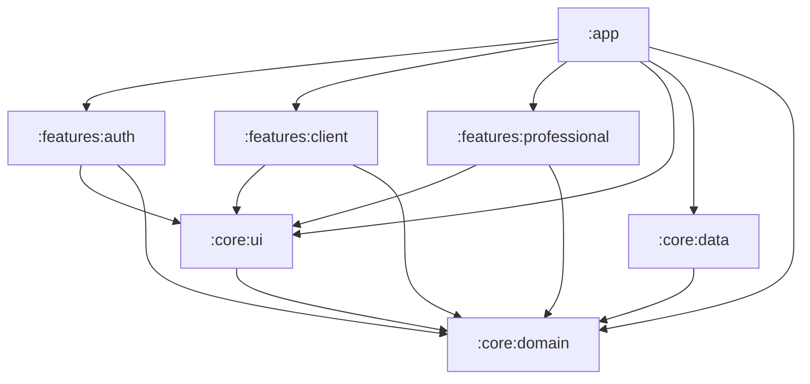

# FixIt — Proyecto

> Trabajo Práctico 2 — UNAJ, "Aplicaciones Móviles".
> Nombre de trabajo de la aplicación: **FixIt** (`applicationId`: `com.vespelabs.fixit`).

## 1. Visión

FixIt es un "Uber de reparaciones". Un cliente que tiene algo roto en su hogar publica una
solicitud de reparación (categoría, descripción, fotos y ubicación). Los profesionales cercanos
que trabajan esa categoría ven la solicitud en un feed en tiempo real y **el primero en aceptarla
obtiene el trabajo**. Una vez aceptada, ambas partes se contactan por teléfono o WhatsApp. Al
finalizar, el cliente marca el trabajo como completado y califica al profesional.

## 2. Actores

| Actor | Descripción |
|---|---|
| Cliente (`CLIENT`) | Usuario que publica solicitudes, las cancela mientras están abiertas, contacta al profesional asignado y califica el trabajo terminado. |
| Profesional (`PROFESSIONAL`) | Usuario que define categorías, ubicación base y radio de trabajo; ve el feed de solicitudes compatibles, acepta trabajos y contacta al cliente. |
| Sistema | Valida reglas de dominio, resuelve la concurrencia de aceptación y mantiene el agregado de reputación. |

El rol se elige al registrarse y **no puede cambiarse** posteriormente.

## 3. Glosario

| Término | Definición |
|---|---|
| Solicitud (`RepairRequest`) | Pedido de reparación publicado por un cliente. |
| Estado (`RequestStatus`) | `OPEN`, `ACCEPTED`, `COMPLETED`, `CANCELLED`. |
| Categoría (`ServiceCategory`) | Rubro fijo: `ELECTRICITY`, `PLUMBING`, `GAS`, `CARPENTRY`, `PAINTING`, `LOCKSMITH`, `MASONRY`, `OTHER`. |
| Ubicación base | Punto GPS (lat/lng) desde el cual el profesional mide su radio de trabajo. |
| Radio | Distancia máxima en km a la que el profesional acepta trabajos. |
| Feed | Lista en tiempo real de solicitudes `OPEN` compatibles con un profesional. |
| Matching | Regla: categoría incluida en las del profesional **y** distancia Haversine ≤ radio. |
| Reseña (`Review`) | Calificación 1..5 estrellas con comentario opcional, una por solicitud. |
| Reputación | Promedio de calificaciones (1 decimal) y cantidad de reseñas del profesional. |
| Fake | Implementación en memoria de un repositorio, usada en Fase 1 y en tests. |
| `DomainError` | Error de dominio tipado, devuelto como valor dentro de `AppResult`. |

## 4. Fases

| Fase | Alcance | Entrega |
|---|---|---|
| **Fase 1** | Flujo completo de UI para ambos roles. Repositorios **Fake** en memoria con datos mock. Ubicación y fotos simuladas (ubicación fija/mock, imágenes de recursos o URIs mock). Lógica de dominio completa y testeada (validaciones, máquina de estados, matching, Haversine, atomicidad del aceptar). | TP2 |
| **Fase 2** | Implementaciones Firebase (Auth, Firestore, Storage) intercambiadas mediante bindings de Hilt. **Sin cambios** en `:core:domain` ni en `:features:*`. Geohash con `geofire-android-common`, transacciones para aceptar y para reputación, listeners en tiempo real. | Posterior |
| **Fase 3** | Hardware (Clase 5): GPS real con permisos de ubicación en tiempo de ejecución, cámara real (`TakePicture`) y Android Photo Picker real. | Clase 5 |

Cada requisito de las especificaciones lleva la etiqueta `[Fase 1]`, `[Fase 2]` o `[Fase 3]`.
Un requisito de Fase 1 sigue vigente en las fases siguientes salvo indicación contraria.

## 5. Alcance

### Dentro del alcance

- Registro e inicio de sesión con email y contraseña; elección de rol fija.
- Perfil de profesional con categorías, ubicación base, radio y reputación.
- Publicación de solicitudes con 1 categoría, descripción, 1..3 fotos y ubicación.
- Listado y detalle de solicitudes propias; cancelación mientras estén `OPEN`.
- Feed en tiempo real para profesionales con matching por categoría y distancia.
- Aceptación atómica (el primero gana).
- Contacto por llamada (`ACTION_DIAL`) o WhatsApp (`wa.me`) una vez aceptada.
- Completar trabajo y calificar al profesional en el mismo flujo.

### Fuera del alcance

- Pagos.
- Chat dentro de la app.
- Notificaciones push.
- Panel de administración.
- Calificación mutua (el profesional no califica al cliente).
- Verificación de identidad o matrícula de profesionales.
- **Edición de una solicitud una vez publicada** (solo puede cancelarse si está `OPEN`).
- Cambio de rol de una cuenta.
- Límites de cantidad: no hay tope de solicitudes `OPEN` por cliente ni de trabajos `ACCEPTED` por profesional.
- Recuperación de contraseña y verificación de email (podrían agregarse en Fase 2, no se especifican).

## 6. Stack tecnológico

| Área | Tecnología | Versión |
|---|---|---|
| Lenguaje | Kotlin | 2.4.20 |
| Build | Android Gradle Plugin | 9.2.1 |
| SDK | compileSdk / targetSdk / minSdk | 37 / 37 / 26 |
| UI | Jetpack Compose (BOM) + Material 3 | BOM 2026.09.00 |
| Lifecycle | `lifecycle-runtime-compose`, `lifecycle-viewmodel-compose` | 2.11.0 |
| Navegación | Navigation 3 (`androidx.navigation3`) | 1.2.0 |
| Concurrencia | kotlinx-coroutines | 1.11.0 |
| Serialización | kotlinx-serialization (claves de navegación) | 1.11.0 |
| Imágenes | Coil 3 (`coil-compose`) | 3.6.3 |
| DI | Hilt + `hilt-navigation-compose` (o `hilt-lifecycle-viewmodel-compose`) | Última estable al momento de implementar |
| Backend (Fase 2) | Firebase BoM: Auth, Firestore, Storage | Última estable al momento de implementar |
| Geo (Fase 2) | `com.firebase:geofire-android-common` | Última estable al momento de implementar |
| Ubicación (Fase 3) | `play-services-location` (FusedLocationProviderClient) | Última estable al momento de implementar |
| Tests | JUnit4, kotlinx-coroutines-test, fakes escritos a mano (sin librerías de mocking) | — |

Las versiones se centralizan en `gradle/libs.versions.toml` (version catalog).

## 7. Arquitectura

Clean Architecture con regla de dependencia estricta: las capas internas no conocen a las
externas. Proyecto Gradle multi-módulo que replica la estructura del repositorio de referencia
de la cátedra (`mauromarod/unaj-am`) y de la "Clase 4".

### 7.1 Módulos



Vista ASCII equivalente:

```
                         :app
   (Application @HiltAndroidApp, MainActivity, navegación, módulos DI)
        |            |               |             |        |
        v            v               v             v        v
 :features:auth  :features:client  :features:professional  :core:data
        \            |               /                      |
         \           v              /                       |
          +-----> :core:ui <-------+                        |
                     |                                      |
                     v                                      v
                          :core:domain  (Kotlin/JVM puro)
```

| Módulo | Tipo | Responsabilidad |
|---|---|---|
| `:app` | Android application | `FixItApplication` (`@HiltAndroidApp`), `MainActivity` (single-activity), `NavDisplay`, grafos por rol, módulos Hilt (`RepositoryModule`, `DispatchersModule`, etc.). |
| `:core:domain` | Kotlin/JVM puro (`kotlin("jvm")`) | `model/`, `repository/` (interfaces), `usecase/` (`operator fun invoke`), `error/` (`DomainError`, `AppResult`), `geo/` (Haversine). Sin dependencias de Android. |
| `:core:data` | Android library | `fake/` (Fase 1), `firebase/` (Fase 2), `mapper/`, `dto/`, `seed/` (datos mock), adaptadores de ubicación/cámara (Fase 3). |
| `:core:ui` | Android library (Compose) | Tema Material 3, componentes compartidos (`LoadingContent`, `ErrorContent`, `RatingStars`, `CategoryChip`, `StatusBadge`, `PhotoThumbnails`), `DomainError.asMessage()`, `ServiceCategory.labelRes()`. |
| `:features:auth` | Android library | Login, registro (cliente/profesional). |
| `:features:client` | Android library | Mis solicitudes, crear solicitud, detalle de solicitud, completar y calificar, perfil del cliente. |
| `:features:professional` | Android library | Feed, detalle/aceptar, mis trabajos, perfil profesional (con reputación). |

> Decisión: no se crea `:features:profile` separado. Cada rol tiene su pantalla de perfil dentro de
> su feature; los componentes compartidos (p. ej. `ReputationSummary`) viven en `:core:ui`.

### 7.2 Dependencias permitidas

| Desde \ Hacia | `:core:domain` | `:core:ui` | `:core:data` | `:features:*` | `:app` |
|---|---|---|---|---|---|
| `:app` | Sí | Sí | Sí | Sí | — |
| `:features:*` | Sí | Sí | **No** | **No** (entre features) | No |
| `:core:ui` | Sí | — | No | No | No |
| `:core:data` | Sí | No | — | No | No |
| `:core:domain` | — | No | No | No | No |

Reglas:

- `:core:domain` NO DEBE depender de Android, Firebase, Hilt ni Compose. Solo `kotlinx-coroutines-core` (para `Flow`) y `javax.inject` (anotaciones `@Inject`, opcional).
- Las features NO DEBEN conocer implementaciones de repositorios; reciben casos de uso inyectados.
- Las features NO DEBEN navegar por sí mismas: exponen callbacks (`onRequestClick(id)`, `onBack()`); la navegación se resuelve en `:app`.
- El intercambio Fake ↔ Firebase se hace exclusivamente en módulos Hilt de `:app` (o `:core:data/di`), sin tocar dominio ni features.

### 7.3 Presentación (MVVM / UDF)

Por cada pantalla, un paquete con:

| Archivo | Rol |
|---|---|
| `XxxRoute.kt` | Composable con estado: obtiene `XxxViewModel` vía `hiltViewModel()`, recolecta `uiState` con `collectAsStateWithLifecycle()`, conecta callbacks y muestra snackbars con `LaunchedEffect`. |
| `XxxScreen.kt` | Composable sin estado: recibe `uiState` y lambdas `onXxx`. Incluye `@Preview` para cada variante relevante. |
| `XxxViewModel.kt` | `@HiltViewModel`. `private val _uiState = MutableStateFlow<XxxUiState>(...)`, `val uiState: StateFlow<XxxUiState> = _uiState.asStateFlow()`, actualizaciones con `_uiState.update { }`. |
| `XxxUiState.kt` | `sealed interface XxxUiState { Loading; Success(...); Error(error: DomainError) }`. |

Convenciones:

- Manejadores de eventos con prefijo `on` (`onDescriptionChange`, `onSubmit`, `onAcceptClick`).
- Mensajes de una sola vez se mantienen en el estado: `userMessage: DomainError?` + `onUserMessageShown()`.
- Los ViewModels no referencian `Context` ni recursos; la traducción de errores a texto es `DomainError.asMessage()` en `:core:ui`.

### 7.4 Errores como valores

```kotlin
sealed interface AppResult<out T> {
    data class Success<T>(val data: T) : AppResult<T>
    data class Error(val error: DomainError) : AppResult<Nothing>
}
```

Los repositorios y casos de uso NO DEBEN lanzar excepciones hacia la presentación; las
implementaciones capturan y mapean a `DomainError`. La validación vive en los casos de uso.

## 8. Convenciones

| Tema | Convención |
|---|---|
| Idioma del código | Inglés (identificadores, paquetes, clases, enums, comentarios). |
| Idioma de la UI | Español neutro, mediante `strings.xml`. Ningún texto visible hardcodeado. |
| Paquete base | `com.vespelabs.fixit` (`.core.domain`, `.core.data`, `.core.ui`, `.feature.auth`, `.feature.client`, `.feature.professional`). |
| Casos de uso | `VerbNounUseCase` con `operator fun invoke(...)`. Una responsabilidad por clase. |
| Repositorios | Interfaz `XxxRepository` en dominio; `FakeXxxRepository` y `FirebaseXxxRepository` en data. |
| IDs | `String` (UUID en Fase 1, ID de documento en Fase 2). |
| Tiempo | `createdAt: Long` (epoch millis) obtenido de un `Clock` inyectable (`interface Clock { fun now(): Long }`) para tests deterministas. |
| Dispatchers | Inyectados (`@IoDispatcher`), nunca `Dispatchers.IO` hardcodeado en data. |
| Tests | Nombre: `` `given X when Y then Z` ``. Cada escenario de spec ↔ al menos un test. Fakes escritos a mano en `src/test` o en un source set compartido `testFixtures`. |
| TDD | Estricto: test rojo → implementación mínima → refactor. |
| Commits | Conventional Commits. |

## 9. Índice de especificaciones

| Capacidad | Archivo |
|---|---|
| Autenticación | `specs/auth/spec.md` |
| Perfiles y reputación | `specs/profiles/spec.md` |
| Solicitudes de reparación | `specs/repair-requests/spec.md` |
| Feed del profesional | `specs/professional-feed/spec.md` |
| Finalización y reseña | `specs/job-completion/spec.md` |
| Contacto | `specs/contact/spec.md` |
| Ubicación | `specs/location/spec.md` |
| Fotos | `specs/media/spec.md` |
| Navegación | `specs/navigation/spec.md` |

Diseño técnico: `design.md`. Plan de implementación: `tasks.md`.
